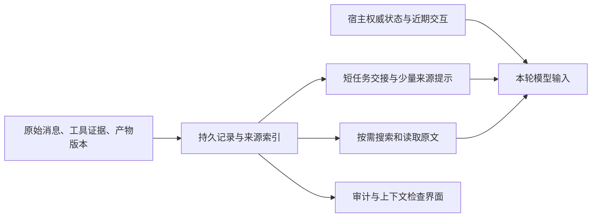

# Kodo 上下文管理架构复核：为什么反复修复仍未得到收益

日期：2026-10-24。范围：当前实现、已有真实实验记录、固定提交开源源码、官方文档及论文。不修改生产代码，不调用付费模型，不改变默认开关。本文是架构建议；§11 记录 2026-10-24 按该建议第 1 步实施的投影契约 v2 与零费用重放结果，其余建议仍未验收。

## 1. 判断

**不是“上下文压缩这条路错了”，也不只是“再修几个 bug 就好了”。目前同时存在实现契约缺陷、职责过度集中和评测目标不匹配。需要收缩设计，再验证收益。**

具体区分：

| 判断对象 | 当前结论 | 证据强度 |
| --- | --- | --- |
| 原文归档、来源校验、按需读回 | 应保留，是可恢复上下文的基础 | 代码机制、既有开卷实验支持；长期效益仍待验证 |
| 当前摘要生成到安装链路 | 有确定性契约缺陷，不能交给真实模型试错解决 | 本次从原始响应和数据库离线复现 |
| 全历史分块、反复合并为单份摘要 | 不适合成为最小内核的默认路径；会放大成本、失败和信息淘汰压力 | 代码结构及当前失败轨迹支持，收益大小未做因果验证 |
| 用闭卷随机历史事实问答验收整个产品 | 只能检验无检索时的细节保留，不足以验收可追溯任务续做 | 实验目标与产品能力边界不同 |
| 摘要方法在 Kodo 上是否有效 | 尚未被本批测到；不能从 0/2 安装推导语义能力强弱 | 本批两次都使用失败回退投影 |
| 更复杂的树、图或相关性组装是否必要 | 当前没有足够证据；先不增加 | 当前失败主要尚未走到检索选择质量这一层 |

对前几轮建议也应纠偏：不断调整输出上限、推理余量和重试，是解决了具体故障，但没有充分检查“为什么一份几千 token 的摘要需要一万多 token 才能安装”，也没有及时将在线任务续做与离线历史知识问答分开。继续只沿着阈值打补丁不值得。

## 2. 本次核查方式

检查 `compaction.ts`、`summary-input.ts`、`summary-schema.ts`、`summary-install.ts`、`context.ts`、`context-tokens.ts` 和 QA runner；以实验复核 §14 的原始目录为依据：

```text
.kodo/qa-retention-budget-repair-real-20261023-235818/
```

新增离线诊断：

```text
node .kodo/research/compaction-audit-20261024/audit-marker.mjs
```

脚本以只读方式打开原实验 SQLite，读取不可变响应与归档；抽取并使用当前源码的估算器、摘要解析器和 marker 序列化函数。它不打开可写 Store，不生成模型请求，不修改原实验结果。

诊断结果保存为 `.kodo/research/compaction-audit-20261024/marker-audit.json`。下文 token 均为 Kodo 当前估算器的数值，不是模型 tokenizer 的精确值。此次没有重新运行产品全量测试，也没有复现论文跑分。

## 3. 实现层：发现了什么

### 3.1 热上下文里装入了过多审计元数据

当前路径是：模型输出 `S1` 等短来源 ID → `parseSummary` 展开为 `history:<64 位摘要>:offset` → `markerText` 注入展开后的正文、完整 `sources` 和 coverage。

每个来源记录又包含完整 ID、`history.read` 参数、同一个归档摘要、状态字段和预览。完整记录对存储和审计有价值，但不必每轮全部发给模型。

本次逐字节读取真实记录并按当前函数重算：

| 组成，估算 token | r1 第 1 块 | r2 第 1 块 |
| --- | ---: | ---: |
| 模型原始 JSON | 4,229 | 4,903 |
| 规范序列化、仍保留短 ID 的正文 | 4,229 | 4,499 |
| 将短 ID 展开后的正文 | 5,728 | 6,186 |
| 24 条完整来源记录 | 4,680 | 4,680 |
| 最终实际 marker | **10,793** | **11,250** |
| 允许的注入预算 | 10,484 | 10,484 |
| 相同正文使用短 ID、简化来源展示的离线示意 | **6,259** | **6,529** |

分项单独估算有取整，不能要求逐项相加完全等于总数。r2 原始 JSON 含格式空白，所以规范序列化更小；r1 不存在这个收益。

与规范化短 ID 正文相比，现有 marker 约 **60%** 是引用展开、来源记录和包装。离线示意保留正文与来源预览，把完整来源映射留在存储侧，注入估算量减少约 **42%**。

**这只证明表示方式存在可消除的开销。** 示意尚未实现短 ID 的运行时读取接口、权限绑定、原子安装，也没有模型续做验证，不能报告为“修复后安装成功”或“任务质量不变”。

直接建议：完整 `SummaryEnvelope` 留在存储侧；模型看到短摘要、短引用、有限导航信息。短引用必须由“当前摘要版本 + 短 ID”共同解析，不能把 `S3` 当全局 ID，也不能绕过现有读取授权。

### 3.2 “非法结构”实际上是没有向模型完整公开的列表上限

r2 第 2 块能够解析为 JSON，八个顶层字段齐全。实际情况：

- `critical_source_refs` 有 **37** 项；
- `parseSummary` 的通用 `list()` 对所有数组施加 **30** 项上限；
- 当前 `summaryInstruction` 没有说明这个 30 项限制；
- 离线仅把解析器列表上限临时改为 100，原响应即通过其余结构、字段和来源解析。生产代码没有修改。

所以该样本不应笼统归因为“模型不会输出合法 JSON”。直接故障是宿主与生成约束不一致。即使修正列表契约，正文仍为 **7,744 token**，超过 5,242，仍需单独处理；一次诊断不能同时宣布两个问题解决。

也不应直接把 30 改成 100 就结束：额外来源越多，当前 marker 越大，刚修完结构又可能撞安装上限。

建议将“引用语法正确且可解析”与“本次展示多少条来源”分开。重要语义字段由模型生成；来源索引去重、映射、展示限额由宿主管理。保留 JSON 是合理选择，问题在多处不一致的限制与重复表达，不在 JSON 本身。

### 3.3 三种预算不是一个闭合契约

当前 `summaryBudgets`：

```text
正文预算 = min(8192, 8% × 工作输入预算, 输出预算)
生成目标 = 85% × 正文预算
模型输出预算 = 正文 + 推理余量，受模型输出限制
注入预算 = min(工作输入预算, 2 × 正文预算)
```

最后一项采用固定倍数，却没有约束引用个数、引用重复次数、预览和外壳的最终序列化长度。因此“正文合法”并不推出“可以安装”。安装检查又发生在付费摘要完成之后。

正确方向不是继续把倍数从 2 增至 2.2，而是让最终投影预算成为上游约束：

```text
可用输入 = min(模型输入上限, 模型上下文上限 - 输出预留 - 估算安全余量)
任务工作预算 <= 可用输入
摘要展示预算 = 任务工作预算 - 权威状态 - 最近完整交互 - 必要协议开销 - 本轮证据预留
摘要正文可用预算 = 摘要展示预算 - 有界索引与包装开销
```

先确定来源展示方案和有界开销，再给模型正文目标。候选摘要完成后仍要复核**最终真实序列化对象**，不可只检查模型原始字符串。估算安全余量与真实 provider usage 校准也要继续保留。

### 3.4 525、结构失败和安装失败必须分层处理

| 故障 | 所属层 | 能否由本次推断根因 | 合理动作 |
| --- | --- | --- | --- |
| HTTP 525 | 通道/传输 | 只能确认请求失败，不能据此定位上游内部原因 | 有界传输恢复，保留未知费用；不要靠增加语义复杂度解决 |
| 37 项超过 30 项 | 生成与解析契约 | 已离线定位 | 统一契约、去除重复元数据职责 |
| marker 超额 309/766 | 投影与预算契约 | 已精确复现 | 分离存储和展示，前置预算 |
| 正文超额 | 模型输出控制 | 已观察，原因不等于格式错误 | 缩小单次任务、减少要求；必要时一次有界修正 |
| 事实遗漏、错误判断 | 语义与续做能力 | 本批安装失败，未进入该测量阶段 | 安装可靠后再用任务验证 |

必须保留现有取消、权限、工具调用/结果配对、并发版本检查及原子提交。简化上下文表示不意味着放松这些边界。

## 4. 设计层：哪些负担应拆开

### 4.1 单份摘要承担了三种不同任务

1. **任务交接**：目标是什么、做到了哪里、下一步是什么。
2. **历史知识检索**：此前看到的某个数值、限制、文件事实在哪里。
3. **审计记录**：哪些消息被处理、来源是否可恢复、采用哪次模型与预算。

三者都需要，但不应全部序列化进同一份热上下文。短摘要适合第一类，原文索引和读取工具负责第二类，宿主存储与检查界面负责第三类。

结构化存储依然有价值，但应先结构化**宿主本来就知道的事实**：来源类型、文件路径、工具名、运行 ID、消息位置、时间、文件版本、产物路径。无需让模型在每轮结束时把所有观察重新提炼、分类、建树。

模型提炼只用于“为什么做这个决定”“有哪些未解问题”等宿主无法从执行记录直接获得的信息。项目知识目录可以按已验证的发现逐步增加，不能成为当前任务继续执行的前置条件。

### 4.2 当前全历史累积折叠放大了依赖

`renderFoldedGroups` 读回归档正文，`packChunks` 按时间打包，`runSummaryChunks` 依次将“上一份摘要 + 下一块”重写成同一份累计摘要。

本批计划四块，两次都到第二块停止。实现**已有部分结果回退**，并非必须四块全成功才能尝试安装；但是有效部分仍被最终投影预算拒绝。这一点不能误报为缺少部分安装设计。

这种路径的问题是：

- 一次维护可能连续调用多次模型，全部占据主任务等待和费用；
- 每次合并都要求继续保留旧内容、加入新内容，却维持固定正文预算；
- 早期细节会经历多次有损改写，后续块失败又无法贡献信息；
- “已读过一条消息”并不等于最终摘要还保留这条消息的事实；
- 从超大冷归档恢复与正常在线工作被放进同一条路径。

这是风险分析，不是对四块必然失败的数学证明。阶段失败可能相关，不能拿两个 trial 拟合可靠性或泛化成功率。

建议：正常会话按压力和完整交互边界逐步维护“已有任务交接 + 新增已完成交互”；不要在每次触发时为了全覆盖而恢复全部旧正文。若接入一个已经超窗的冷归档，保留检索入口，按当前问题取证；明确这是导入/恢复工作负载，不要求在线摘要器先完整理解全部历史。

增量摘要也可能漂移，所以原文、版本、近期证据和必要的复核入口必须保留。不要把“增量”宣传成无损方案。

### 4.3 每轮先运行一个“上下文规划模型”不是当前最小解

用户此前提出先按需求调整上下文再回答，这个方向在恢复旧信息时合理。但若每轮先做一次模型分类/检索/重排，会把短任务变成多次串行请求，并可能反复改变缓存前缀。

建议稳定保留任务状态和最近交互，仅在需要旧信息或预算有压力时扩展/缩减证据。正常短任务不新增摘要调用。宽泛报告任务不按最新一句话的词语相关度淘汰所有旧主题；但当前仍缺少“正确交付报告因隐藏证据而漏项”的因果样本，不立即新增复杂跨主题覆盖框架。

## 5. 评测层：此前实验测到了什么

### 5.1 闭卷不是无用，但它测的是不同能力

当前 deep fixture 将约 360k token 历史装入约 128k 窗口；phase-1 的目标是“阅读当前项目上下文证据并确认已掌握，本轮简短确认”，不包含下一阶段的问题；phase-2 才提出事实题，并禁用检索。

这种设计避免泄题，能够检查通用细节保留；但不能代表一个知道当前工作目标、允许查历史和读文件的编码代理。`off` 也不是真正“全部原文都在窗口内”的上界，它受硬容量投影影响。

因此：

- 30% 对 30% 且摘要安装 0/2，只说明失败回退之后的回答相同；
- 它能证伪“当前摘要路径稳定可用”，不能证伪“成功安装后的任务摘要有用”；
- 开卷 97.5% 说明读回可能恢复信息，也说明恢复成本不可忽略；
- “有目录 93.3%、无目录 0%”支持定向知识沉淀与读取可工作；无访问能力的对照并不能证明目录优于文件检索、历史搜索或更简单的索引；
- 几十万 token 中只有少量目标事实，并不意味着压缩在信息论上不可能。不能把目前失败解释为“这些题天然做不到”。

更准确的结论：闭卷压力测试保留为诊断项，真实任务续做和有预算的可追溯检索应成为产品验收主线。

### 5.2 覆盖至少分四层

```text
计划进入处理 → 实际送入摘要请求 → 形成已安装投影 → 保留了任务所需语义
```

当前 `coveredMessages` 可以记录进入成功摘要阶段的消息范围，**不能作为语义覆盖率**。某块请求成功、最终摘要仍可能遗漏事实。即使 86/86 都处理并安装，也不等于 19/19 事实被保留。

实验需同时报告完整交付、硬约束违背、关键事实准确性、引用支持情况和原文恢复代价。不能用一个 coverage 值替代这些结果。

### 5.3 不要通过只看成功安装样本美化收益

下一轮要同时报告：

- 所有被分配到该策略的运行结果，包含安装失败、回退、费用和延迟；
- 安装成功样本中的语义诊断，明确这是条件分析。

前者回答产品可靠不可靠，后者帮助定位摘要到底丢了什么。基础设施错误可以单独分类，但不能静默删除；如按预定规则补跑，应保留原失败记录和敏感性分析。

## 6. 当前成熟项目可借鉴什么

源码核查固定于下列提交，不能与此前 2026-10-22 的数字混用。这里比较机制，没有新做同模型端到端排名。

| 项目及版本 | 本次核实的做法 | 对 Kodo 的启示 |
| --- | --- | --- |
| Pi，`ede2c9b` | 保留近期内容；结构化 Markdown 交接；合并已有摘要；分割当前长轮次时可以分别总结历史和轮次前缀；从执行记录附加读写文件列表 | 状态交接和近期原文并存；可确定提取的文件信息交给宿主，不要求模型生成完整审计对象 |
| OpenCode，`4386838` | 当前源码近期保留默认 15k；缓冲按窗口比例和下界计算；简洁 checkpoint 强调可恢复信息不必详述；优先保留请求前缀利用缓存；有逐级削减和原生压缩路径 | 摘要要允许删除可重新获取的细节；成本包括缓存与恢复；不要照抄旧文档中的固定阈值 |
| Codex，`3985001` | 本地摘要、远端压缩、token-budget 新窗口等不同路径；本地代码重建用户信息和初始上下文，远端路径不是单一通用 JSON 摘要器 | 把窗口重建、运行时权威状态和压缩后端分开；不能声称所有 Codex 部署用同一种算法 |
| DSH，`22ddee3` | 持久日志记录范围和用量，另用摘要消息替换可见范围；保留工具配对；默认摘要调用重放请求前缀以复用缓存；支持先剪除工具结果再重新计量 | 明确分离日志与模型投影；维护操作要有真实进展，别无限总结同样输入 |
| Claude Code 官方文档 | 先清理旧工具输出，必要时总结；允许指定摘要重点；持久规则独立保存；反复压缩又立即填满时停止循环；子代理/skill 减少主上下文加载 | 摘要不是唯一内存机制；不依赖有损摘要永久保存关键规则 |

重要修正：此前“OpenCode 摘要工具输出固定截到 1250 字符”的描述不能作为当前实现结论。本次版本有多级 transcript 缩减，`TRANSCRIPT_CLIP=2000` 是需要裁剪时的预算，正常路径尽量保留完整前缀。Pi 序列化摘要输入的工具结果仍有 2000 字符限制，也不能据此推断整个会话存储丢弃了原文。

OpenAI 官方 `/responses/compact` 返回可包含 opaque/encrypted compaction item 的下一窗口，并要求该独立接口的返回窗口按原样继续使用。它不是可移植的可读知识卡，也不保证无损或能直接套在当前 DeepSeek 通道上。可以参考其接口分层，不能把闭源服务内部效果当成 Kodo 已实现能力。

## 7. 论文给出的实际启示

### 7.1 The Complexity Trap，arXiv:2508.21433v3

论文比较 SWE-agent / SWE-bench Verified 上的观察隐藏与 LLM 摘要，涵盖五种模型配置，并给出 OpenHands 的初步结果。论文报告简单观察隐藏相对原始 agent 可明显降低费用，其解决率与摘要接近，部分设置更高；摘要在部分配置中使执行轨迹变长。

**可借鉴**：把简单基线保留下来，测总执行轮数和最终任务成功，不以单次输入更短判胜。**不能外推**：Kodo 的 mask 必然比 summary 好，或在随机事实闭卷问答中也更好。本仓库既有 mask 小样本成绩就不支持直接默认启用。

### 7.2 ACON，arXiv:2510.00615v3

ACON 使用任务反馈优化压缩指南，并可以进一步蒸馏小模型压缩器。其关键方法之一是收集“未压缩成功、压缩后失败”的对照任务，分析前后上下文的差异，在训练任务上优化规则，再到不同任务评估。论文报告的峰值 token 改善来自其任务、优化和模型设置。

**可借鉴**：补回某条缺失证据是否真的恢复任务，是高信息量的验证。**当前不该做**：把安装失败的运行当成语义失败数据，训练/优化摘要提示；或者每个任务都在线多调用一个优化器。先让运行到达可比较的语义阶段。

### 7.3 AgentFold，arXiv:2510.24699v1

针对长程网页检索，训练 agent 主动按不同尺度折叠历史，保留细粒度关键信息或合并完成的子任务。论文的主要 agent 经监督微调。

**可借鉴**：按任务阶段和子任务完成边界维护上下文，而不只看历史长度。**不能外推**：给任意模型加一个 `fold` 工具，它就会可靠自主使用。Kodo 的自主委派实验已经说明“工具可见”不等于“决策策略形成”。

### 7.4 ReSum，arXiv:2509.13313v3

周期性总结支持持续搜索；论文区分无需训练的 ReSum 和使 agent 适应压缩状态的 ReSum-GRPO。

**可借鉴**：压缩后模型是否能够根据交接状态继续正确工作，需要单独验证。**不能外推**：所有收益都来自简单总结提示，或必须训练模型才能使用摘要。当前模型是否适应 Kodo 的交接格式，要由小型续做实验回答。

### 7.5 MemGPT，arXiv:2310.08560v2

将有限主上下文和外部存储分层，并提供工具把相关信息移入工作窗口，在长期对话和文档任务上评估。

**可借鉴**：上下文不需要包含所有知道的东西，但必须有可发现、可访问的恢复路径。仅有一个 hash 指针而模型不知道查什么，仍不足以完成任务。

### 7.6 RAPTOR，arXiv:2401.18059

通过递归嵌入、聚类和总结构造文档检索树，从不同抽象层次检索。此次核对摘要与方法概述，不声称复现其完整实验。

**可借鉴**：跨文档综合问题可能需要分层目录。**当前不该做**：用树或图解决 marker 过大、安装预算失配和列表上限问题。它们属于另一层，并会新增构建、更新和检索成本。先用浅层来源目录证明检索收益，再决定是否升级。

## 8. 建议的最小架构

### 8.1 一个原始记录系统，两个有界视图



复用现有存储、历史工具和知识目录，不新增图数据库、独立记忆 agent 或一套工作流引擎。

| 内容 | 默认放在哪里 | 谁维护 |
| --- | --- | --- |
| 当前明确目标、约束、执行状态、预算、待处理调用 | 权威运行状态与当前窗口；需要原文时保留精确用户消息 | 宿主保存，模型不能通过摘要更改权限或执行事实 |
| 当前进行中的交互及近期工具证据 | 工作窗口 | 宿主按完整交互分组保留 |
| 决定及理由、已尝试失败、未解问题、下一步 | 短任务交接 | 模型总结；引用由宿主校验 |
| 旧文件正文、测试日志、大量搜索结果 | 原始记录，短 ID 导航 | 宿主归档与检索 |
| 可复用、经验证的项目发现 | 现有浅层知识目录 | 阶段性沉淀；不阻塞当前交付 |
| 覆盖范围、完整来源对象、模型绑定、费用 | 存储与检查界面 | 宿主确定性计算 |

### 8.2 正常运行流程

1. **没有压力、不缺证据**：沿用稳定上下文，直接执行，不额外调用摘要模型或检索规划模型。
2. **工作预算有压力**：先处理旧的大观察，保留必要提示和读回入口；正在进行的工具组不拆开，不把未经确认的写操作结果当完成。
3. **观察缩减仍不足**：只对选定的已完成旧交互产生一次任务交接，结合旧 checkpoint 更新；不把全部历史原文恢复后重新折叠一遍。
4. **候选验证**：检查结构、来源有效性、最终注入预算、输入是否减少及权威状态版本；满足条件才原子安装。
5. **生成或安装失败**：保留已有有效交接；明确记录降级。若确定性缩减仍能提供合法窗口则继续，否则返回可恢复的明确阻塞，不能让失败回退看起来像成功摘要。
6. **问题需要旧证据**：在本轮证据预算内搜索/读回；需要时继续下一轮检索，计入总费用和时间，不假定一次检索一定足够。
7. **压缩后续做**：注入当前权威状态、交接与近期交互，让下一次正常推理复核计划。没有证据表明每次都应另起一个“重新规划模型调用”。

来源短 ID 读取可以扩展已有 `history.read` 参数或由宿主转换成现有参数；选一条最少改动的路径，不同时维护两套别名体系。解析须绑定摘要版本、所属运行及权限，失效来源明确返回，不偷偷换成相似来源。

### 8.3 保留、简化、暂停

| 处理 | 内容 |
| --- | --- |
| 保留 | 原始记录、权限校验、工具配对、原子安装、取消/恢复、真实用量记录、浅层知识目录 |
| 简化 | 模型需要生成的字段、重复来源列表、marker 包装、生成与安装预算契约 |
| 从默认路径移出 | 超大冷归档全覆盖多块累积摘要；需要时作为显式导入/离线处理能力单独评估 |
| 暂停 | 自动树/图记忆、每轮模型重排、为补齐闭卷 coverage 扩大分块与重试、在基础链路失败时继续大规模付费对照 |
| 继续实验开关 | 当前 summary、hybrid、assembly；没有数据支持提前默认开启 |

## 9. 下一轮验证应怎样改变

### A. 先完成零模型费用的契约验证

用已有真实响应重放，至少包含：

- 本批 24 来源、两份失败 marker 的精确复现与新展示方案；
- 30/31/37 项、重复来源、未知来源、跨摘要别名和跨运行权限；
- 正文可装但元数据超额、中文/标点密集内容、边界内外各一例；
- 完整工具组、部分覆盖、取消、重启、权威版本变化；
- 模型调用前的预算计划与最终注入对象计量一致；不能仅靠模型主动控制长度。

这些验证不需要调用真实模型。通过它们只能说明工程边界可靠，不能证明语义与成本收益。

### B. 再做极小的真实续做检查

准备两个明确续做任务：一次压缩后继续修复代码；两次自然触发压缩后保留一个早期约束并完成交付。控制模型、工具、真实源码状态，开放正常查证能力。

先要求有效安装、能够继续、没有丢硬约束；若再次出现确定性安装错误立即停止付费运行。两次通过也只说明值得进入下一阶段，不宣称可靠率或统计优势。

### C. 将算法效果与整条轨迹效果分开

**固定状态分叉诊断**：保存真实任务中某一压缩前状态，在相同仓库快照、工具权限和后续目标下，分别使用基线与候选交接继续。用于定位安装后究竟缺了什么。

**完整任务配对**：从任务起点比较现有基线与简化候选，计入全部探索、摘要、重试、检索、缓存重建和收尾。固定状态诊断不能代替这种产品实验。

先做三类任务各一对，共六次：短修复（不应触发）、长编码续做（实际触发）、多来源报告/中途目标变化（需要旧信息）。这是筛查，不是正式发布验收。发现质量或交付失败就复核，不盲目扩成四组大矩阵。

当需要回答“来源目录是否比直接检索更好”时，另做有相同原文访问权限的对照：直接历史/文件搜索 vs 浅层目录辅助搜索，保持来源语料一致，建库和维护计入成本。无目录且完全无证据的 0% 对照不够。

### D. 用恢复反证定位语义损失

对“基线成功、候选失败”的任务，先排除工具超时、保存路径、权限和收尾问题；再找出缺失证据，做单因素补回重放。

- 补回后恢复：支持该证据缺失参与了失败；随机模型下仍需重复确认。
- 补回后仍失败：不能继续把该错误直接归因于压缩，检查策略和执行链路。
- 两组都失败：该任务能暴露共同执行缺陷，不适合单独证明压缩劣化。

评分应尽量不向评审暴露分组，检查实际产物、约束和引用，不只检查是否包含关键词。

### E. 正式门槛不靠固定“小样本够数”

实验单位是独立任务，重复 seed 嵌套在任务下，不把同一轨迹的 20 道题当 20 个独立任务。按任务配对报告区间；预注册容忍退化、希望发现的收益和样本量依据。

“每组至少 20 个任务”可以作为起步下限，**不能保证**检验出完整交付率不低于基线 5 个百分点。如此窄的非劣效界可能需要明显更多样本，应按基线率、配对不一致率和功效计算；预算不足时报告探索性结论即可。

主要结果按顺序判断：完整交付和硬约束 → 事实与来源正确性 → 总费用/耗时/峰值窗口。只降低峰值窗口时，可以称为缓解容量限制，不能称为降本提速。

## 10. 实施顺序与本次结论的边界

1. 先分离持久 envelope 与模型投影，统一来源列表和最终预算契约，用本批响应验证。
2. 将普通在线维护与超窗冷归档处理分开；默认实验路径只处理有界新增交互。
3. 保留检索、明确失败状态、复用已有知识目录，不引入新记忆平台。
4. 通过最小续做检查后再做少量真实配对；仅在识别到语义损失时优化摘要规则。
5. **短引用读取接口（v2 已实现）**：`history.read` 新增 `{summary: <摘要引用>, source: "S2"}` 模式；解析绑定该摘要版本、所属运行与当前权限，未知/失效引用明确失败，委托原归档读取路径，不新增第二套别名体系。
6. 正式验收仍未通过，保持默认关闭。

**2026-10-24 状态更新**：第 1、2、5 项已按[投影契约 v2](context-compaction-contract.md)落地并通过零模型费用重放（详见 §11）；第 3 项的首次最小真实续做检查已付费执行一次并按停止规则中止（详见 §11.1），Task B 未运行、未重跑；第 4 项配对实验仍未执行，语义收益与恢复成本未被本批证明。

## 11. 实施与零费用验证记录（2026-10-24）

本节记录按本复核第 1 步完成的实现与零费用重放，不调用付费模型、不改变默认开关；之后按 §9B 执行的一次付费检查单独记于 §11.1。契约：[投影契约 v2](context-compaction-contract.md)。

**已实现**

- 持久 `SummaryEnvelope` 与模型可见 marker 分离：envelope 保存展开后的完整来源映射与全部被引来源（含 `short` 与 preview），marker 只含七个内容字段、短引用、有界来源目录、覆盖计数与一次读取提示（`src/runtime/summary-projection.ts`、`summary-install.ts`）。
- 生成契约 v2：模型只生成七键；旧 `critical_source_refs` 仅作为兼容与审计输入；结构上限 64 项/每条陈述 8 个引用，生成提示公开更紧的 20/4 限额；重复引用去重而非拒绝（`summary-schema.ts`）。
- 预算闭包前置：先估算安装后保留部分，再计算展示预算、固定外壳与来源目录预算，最后才给正文目标；正文目标过小则跳过且不发请求。最终序列化 marker 仍按展示预算复核，安装保持原子性（`compaction.ts`、`summary-install.ts`）。
- 短引用读取：`history.read({summary, source})` 按摘要版本解析，复用原有归档授权、scope、可见性、脱敏与缺失/损坏检查（`summary-read.ts`、`tools/index.ts`）。
- 回归：`tests/summary-projection.test.ts`（17）、`tests/summary-read.test.ts`（8）、更新后的 `tests/compaction.test.ts`（42）通过；新增零费用重放脚本 `scripts/comparison/compaction-contract-replay.mjs`，48/48 项检查通过（只读原始试验目录、退出码 0），结果 JSON 保存在 `.kodo/research/compaction-audit-20261024/replay-v2.json`（研究目录不随产品包发布）。
- 集成回归：`history.read` 同时承载两种模式后工具描述变长，暴露出 `scripts/demo-kernel-recovery.mjs` 的 20k 字符演示预算已被工具目录增长占满；将该演示预算调整为 22k 字符（压缩与恢复断言不变），`tests/kernel-demo.test.ts` 恢复通过。这不是模型行为变化，而是测试夹具与工具目录大小的耦合。

**真实原始响应重放（只读试验目录，未安装、未调用模型）**

| 指标，Kodo 估算 token | r1 第 1 块 | r2 第 1 块 |
| --- | ---: | ---: |
| 旧展开 marker / 旧注入上限 | 10,793 / 10,484 | 11,250 / 10,484 |
| v2 投影预算（display / planned 上界） | 46,674 / 7,650 | 46,674 / 7,650 |
| v2 实际投影 marker | **6,038** | **6,300** |
| 其中正文 / 来源目录 / 外壳 | 4,184 / 1,544 / 360 | 4,446 / 1,544 / 360 |
| 相对旧 marker 降幅 | **−44.1%** | **−44.0%** |

r2 第 2 块响应含 37 项 `critical_source_refs`：v2 解析通过，不再误报结构错误；正文 7,744 token 仍超过本次 5,242 token 正文预算，因此按契约应进入一次有界缩写，不能直接安装。这同时确认了两个问题的层次：列表契约缺陷可以确定性修复，正文长度与安装预算仍需独立处理。

**边界**：以上只证明序列化、解析与预算契约可复现，并且真实失败的表示开销可以被消除；它不证明安装后的语义质量、真实任务续做能力、总费用或缓存收益。`30% vs 30%`、安装 `0/2` 的旧结论仍不能被外推为“摘要方法有效/无效”。

### 11.1 最小真实续做检查：按停止规则中止（2026-10-24）

预注册协议与判据：[continuation fixtures](../scripts/comparison/continuation/README.md)；运行器：[compaction-continuation.mjs](../scripts/comparison/compaction-continuation.mjs)。模型 `codego1/deepseek-v4.1-flash`，`workInputTokens=16384`，relay 上限 64 次调用 / 400 万 reserve token；证据目录 `.kodo/continuation-paid-20261024-a/`（研究目录，不随产品包发布）。

**Task A（一次压缩后继续修复，预注册 installs≥1）**

- 运行完成；`node verify.mjs` 退出码 0（27/27）；`verify.mjs`、`docs/**`、`src/legacy.js` 哈希未变；`context.summary.installed=1`（marker 2,150 ≤ display 2,764，正文 1,309 ≤ 偏好目标 1,310）。
- 同一 run 后续 3 次摘要尝试：模型正文 1,716 / 1,816 / 1,820 token 高于偏好目标 1,310，但都低于展示预算推导的硬上界（1,820–2,720）。修复前的实现把偏好目标当成拒绝边界，触发一次缩写，缩写后仍超偏好目标，记录 `SUMMARY_BUDGET`。按预注册停止规则（出现确定性摘要失败码即停止），**Task B 未运行，未重跑，协议未修改**。
- 用量（provider 实测，未知=0）：19 次模型调用；常规调用输入 142,971 / 输出 2,786，摘要调用输入 41,984 / 输出 39,818，合计输入 **184,955** / 输出 **42,604**；session 与 relay 均为 227,559 token，relay 无拒绝、无传输失败、无模型失败。cacheRead 合计 132,736。没有可用的定价口径，不报告货币费用。

**诊断与零费用修正（v2.1）**

该失败属于生成契约边界错误，不是投影/安装预算失败：展示预算本可容纳 ~1,820–2,720 token 正文，系统却按 8% H 的偏好目标拒绝。已按[投影契约 v2 §6](context-compaction-contract.md)修正：偏好目标只用于提示；模型正文 **≤ display-derived hard body 就接受**，> hard 才允许一次有界缩写；最终 marker 仍按 `displayBudget` 复核。新增零费用回归 `tests/summary-body-ceiling.test.ts`；定向摘要测试 85/85、全量测试 83 文件 / 1,117 项通过（8 skipped）、真实响应重放 48/48、`npm run check` 退出 0。独立审计（[续做检查记录](context-compaction-continuation-check.md)）对付费证据给出 0 material / 0 warning 差异。

**状态**：§9B 的首次最小真实检查**未通过**（按停止规则中止），Task B 未执行；不能据此评价摘要语义、续做可靠性或成本。修正后若要继续，需要用户批准**新一轮预注册**付费检查（不是重跑本批），否则保持默认关闭、暂停付费扩样。

### 11.2 v2.1 新预注册检查：任务通过，机制仍失败（2026-10-24）

用户批准后以新协议 `continuation-v2.1-screen-20261024` 执行 E1；证据目录 `.kodo/continuation-paid-v21-20261024-a/`，独立审计 `.kodo/continuation-audit-20261024-022645/`。Task A 正常完成，独立验收 27/27、保护文件未变、最终交付完整；摘要 started 8 / installed 3 / failed 5，达到 installs≥1 的暴露要求，但出现确定性 `SUMMARY_BUDGET`，故判定 `quality=pass`、`mechanism=fail`、`exposure=sufficient`、`protocol=stopped`。Task B 按冻结停止规则未运行，各观测维度均为 `not_observed`。

本轮证明 v2.1 可以在真实任务中连续安装摘要并继续交付，但没有闭合生成预算：两次规范 JSON 被 `hardBodyTokens * 4` 字符阈值提前拒绝；另三次仅正文超额的响应经过一次缩写后仍超过 token 硬上限。三次成功安装分别为 43,737→14,567、19,769→13,698、27,828→14,650 token，局部消息 coverage 都是 100%；该 coverage 不是事实保留率，也没有闭卷问题验证语义准确性。

摘要维护使用 11/30 次模型调用和 127,823/352,087 token（36.3%），其中输出 50,974/54,996（92.7%）；没有未知 usage、relay 拒绝或模型/传输失败。独立审计与 runner 为 0 material / 0 warning 差异。当前应把字符限制降为仅防异常大原始响应的独立守卫，语义正文继续以宿主 token 估算校验；合法但超额的响应最多一次有界缩写，仍超额就明确失败。修复并完成零费用边界重放前，不再付费扩样，默认关闭不变。

## 12. 来源

本地：

- [实验复核 §14](context-compaction-experiment-review.md#14-摘要预算闭环修复后的真实模型复跑2026-10-24)
- [主设计](context-compaction.md)
- [摘要生成与分块](../src/runtime/compaction.ts)
- [输入与来源索引](../src/runtime/summary-input.ts)
- [结构校验](../src/runtime/summary-schema.ts)
- [模型投影与原子安装](../src/runtime/summary-install.ts)
- [闭卷/开卷 runner](../scripts/comparison/compaction-qa-retention.mjs)

开源代码，固定提交：

- [Pi compaction](https://github.com/earendil-works/pi/blob/ede2c9b468d8e061c557d16957513715e6d49cd6/packages/coding-agent/src/core/compaction/compaction.ts)、[工具结果序列化](https://github.com/earendil-works/pi/blob/ede2c9b468d8e061c557d16957513715e6d49cd6/packages/coding-agent/src/core/compaction/utils.ts)
- [OpenCode compaction](https://github.com/anomalyco/opencode/blob/43868389223f3553c6786c2f1cfa70a657f8a8bf/packages/core/src/session/compaction.ts)
- [Codex 本地压缩](https://github.com/openai/codex/blob/398500106707f0a3217c7cf83edc2bf226cc342f/codex-rs/core/src/compact.rs)、[远端路径](https://github.com/openai/codex/blob/398500106707f0a3217c7cf83edc2bf226cc342f/codex-rs/core/src/compact_remote_v2.rs)、[token-budget 路径](https://github.com/openai/codex/blob/398500106707f0a3217c7cf83edc2bf226cc342f/codex-rs/core/src/compact_token_budget.rs)
- [DSH 子系统文档](https://github.com/deepseek-ai/deepseek-harness/blob/22ddee3792402c3e70ec5f86a63c3e3e895a2f60/docs/subsystems/compaction.md)、[默认摘要器](https://github.com/deepseek-ai/deepseek-harness/blob/22ddee3792402c3e70ec5f86a63c3e3e895a2f60/packages/compaction/compaction-basic/src/summarizer.ts)

官方文档：

- [Claude Code 工作方式](https://code.claude.com/docs/en/how-claude-code-works)、[费用与缓存](https://code.claude.com/docs/en/costs)
- [OpenAI Compaction](https://developers.openai.com/api/docs/guides/compaction)

论文：

- [The Complexity Trap](https://arxiv.org/abs/2508.21433v3)
- [ACON](https://arxiv.org/abs/2510.00615v3)
- [AgentFold](https://arxiv.org/abs/2510.24699v1)
- [ReSum](https://arxiv.org/abs/2509.13313v3)
- [MemGPT](https://arxiv.org/abs/2310.08560v2)
- [RAPTOR](https://arxiv.org/abs/2401.18059)

新抓取源码和页面及清单位于 `.kodo/research/compaction-audit-20261024/`。部分论文正文复用 `.kodo/research/context-20261022/` 的指定版本缓存，并重新核对对应 arXiv 页面。所有论文效果均为论文报告，不能作为 Kodo 的实测结果。
