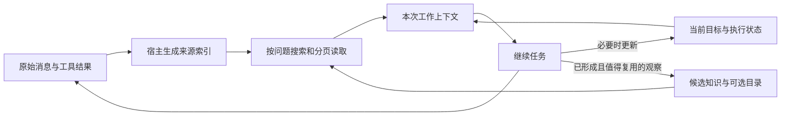

# Kodo 上下文压缩最终设计方案

> **v3 状态（2026-10-24）**：摘要子系统已改为前缀复用的自由文本交接摘要，并采用滞后触发，方案见 [`.helloagents/plans/compaction-v3/plan.md`](../.helloagents/plans/compaction-v3/plan.md)。
> - 摘要请求等于本轮主请求的消息加一条压缩指令，`tools` 相同，`toolChoice='none'`。窗口超限时删除最旧的一轮再重试，最多 3 次。
> - 只在摘要为空或 `SUMMARY_NO_GAIN` 时拒绝安装。七键 JSON、短 ID、来源目录、展示预算、修复轮和分块 map-fold 已删除。
> - 几何按剩余空间计算：F 为固定前缀（系统提示、工具定义、固定用户消息，不含旧摘要标记），W = H − F。保留尾部 0.3W，安装目标 F + 0.5W，防抖阈值 F + 0.7W。剩余空间不足 2,048 token 时记 `context.summary.skipped`（reason=`geometry`）。连续 2 次失败，或连续 2 次安装后仍高于防抖阈值，记 `context.summary.disabled`。
> - 触发：纯 `summary` 策略在估算输入超过 H 时直接摘要，不先 mask；`hybrid` 与摘要失败后的回退才走 mask 路径。
> - 新写入 v2 envelope `{version:2, archivedRef, coveredOffsets, coverageHash, text, usage, ...}`。v1 envelope 仍可通过 `history.read({summary, source})` 读取。`coveredOffsets` 只表示折叠范围，不代表事实保留率。
> - T8 已运行（`.kodo/v3-t8-compaction-paid-h24k`，H = 24,576，单模型，同一分页微项目的 A/B 两个变体）：summary 组总 token 为 off 的 0.67，主请求输入峰值为 off 的 0.49；但未缓存输入 +18.7%，输出为 3.2 倍，运行时长 +56%。原 summary.json 未通过 15% 维护占比门槛，`summary-rescored.json` 是按用户调整后的效果门槛事后重评分，需新批次确认。费用与时延收益尚未证明，见 [v3 复核](latest-v3-review.md)。
> - compaction 与 assembly 继续默认关闭。下一步按 [下一阶段方案](kodo-next-optimization-plan.md)：先用修复后的评测器（registration r2）和离线诊断定位开销，再做单点候选。离线诊断已完成（[v3 复核 §9](latest-v3-review.md)）：估算前缀校准因每步替换的 kernel-state 消息从未命中，估算约为实际 1.7 倍，导致约 0.6H 即触发摘要。候选修复已实施（估算前缀匹配忽略历史请求末尾的 kernel-state 消息），离线重放估算/实际降至 1.16–1.47 且无低估。r3 付费验证（[v3 复核 §10](latest-v3-review.md)）：摘要推迟到约 0.8–0.9H 触发，安装从 12 次降为 5 次，总 token 为 off 的 0.64，输出为 1.28 倍，时长为 1.04 倍，未缓存输入为 1.51 倍。按 token 口径判定通过；金额取决于缓存单价，尚未确定。任务是已曝光的微型夹具，不作为默认开启依据。
>
> 下文是 v2.1 及更早版本的设计和实验记录，保留为历史。其中关于 JSON 摘要、短 ID 和投影预算的描述已不适用于当前代码。

日期：2026-10-23（按需上下文修订）  
状态：C0–C3 的归档、裁剪、摘要、目录、检索与报表机制已有实现。2026-10-28 起，新会话默认启用 `summary@0.8E` 作为条件性容量保护，旧会话和显式 `off` 保持关闭；这不表示 C4 经济性收益已经通过。确定性动态组装仍默认关闭；最新真实压力样本 8/8 交付但三次投影均净增估算输入，修复净收益门槛前不扩大启用。历史实测与限制见 §5.3、§11、[实验复核](context-compaction-experiment-review.md)和[主动委派与动态组装定向实验](experiments/delegation-assembly-smoke-20261028.md)。

## 1. 结论

2026-10-24 后续工作入口：[v2.1 后续修正与实验方案](context-compaction-next-plan.md)。先统一预算与实验判定，再完成零费用触发分析，之后才准备新注册的真实续做与配对实验；该方案尚未执行，默认关闭不变。已发生的首次续做检查见[独立复核记录](context-compaction-continuation-check.md)。

上下文管理的目标是：**当前任务能继续正确执行，需要背景时能以有界成本找到正确证据。** 工作输入减少、摘要安装成功和知识条目增多都不是独立的成功标准。

最终采用：**自动归档与来源索引 + 简短执行状态 + 按当前问题装配的证据 + 按需沉淀的项目知识**。

内核自动记录消息、工具结果、调用归属、文件路径、捕获范围和版本；无需模型先抽取、分类再保存。模型负责本来就在做的任务判断，只在关键决定、失败原因和下一步发生变化时维护简短工作记录。摘要在需要移出旧历史时提供接手状态，不承担保存所有未来项目知识的责任。

已有浅层知识目录继续作为人工可浏览、可整理的知识入口；按任务、文件和来源浏览原始记录属于元数据视图，不额外建一棵语义知识树。内容可以先未分类，分类不阻塞保存和检索。

运行顺序为：

> 原始结果保存与定位 → 正常工作并更新必要状态 → 移出前检查并按需补足接手状态 → 隐藏无关或已完成的旧正文 → 依据最新目标重建上下文 → 缺背景时定向读取 → 继续执行。

每次移出历史前都要保护继续执行所需的状态；是否需要模型补摘要，由当前状态是否足以接手、以及容量压力共同决定。不能仅因为隐藏正文后 token 变少就认定已经可安全继续。小任务、无状态变化和已明确的下一步不新增必经模型调用。

**摘要有损，来源可追溯。** 恢复承诺只覆盖已记录、仍保留且当前有权读取的内容。新任务不能因为共享项目路径就读取其他会话的全部日志；跨任务复用走已有知识权限与版本契约。

原始记录、任务摘要、知识版本和目录仍使用现有 SQLite/blob，不新建记忆服务、图数据库或独立整理 Agent。新策略保持实验状态，阈值不因这次设计修订直接调整。

## 2. Kodo 当前实现

核对文件：

- [context.ts](../src/runtime/context.ts)：上下文装配、关键消息固定、归档与裁剪。
- [context-tokens.ts](../src/runtime/context-tokens.ts)：输入估算与实际 usage 校准。
- [compaction.ts](../src/runtime/compaction.ts)：二级任务摘要、来源索引、覆盖校验与原子安装（实验开关）。
- [context-inspection.ts](../src/runtime/context-inspection.ts)：只读上下文构成、用量与摘要外壳检查。
- [history.ts](../src/runtime/history.ts)：归档分页、所有权和历史授权。
- [coordinator.ts](../src/runtime/coordinator.ts)：请求前装配、归档提交、预算和模型调用。
- [model-limits.ts](../src/providers/model-limits.ts)：模型容量与输出预留。

### 2.1 触发方式

每次请求前调用 `buildContext`，包含工具 Schema、消息、协议开销与图片的输入估算；同时检查独立字符限制（如配置）、输入限制和输入加输出预留是否超过合并窗口。

当前 `contextOutputReserve` 为：

```text
R = min(maxOutputTokens,
        max(1, min(floor(W / 2), max(16384, floor(W × 0.15)))))
```

其中 W 是本运行有效上下文容量。这个值用于给上下文装配留出空间，不等于每次请求只能输出 R；实际请求输出上限还按剩余窗口与预算计算。不能把模型声明的最大输出容量当成每次必须完整预留的空间。

例如 W=1,000,000、maxOutputTokens=393,216 时，R=150,000；若无更小的输入或字符限制，估算输入接近 850,000 才触发此处裁剪。它主要防止窗口溢出，不会主动把 20k、80k 的工作历史控制在更小范围。

### 2.2 保留与裁剪

1. 装配最新任务进度、未完成待办和后续任务上下文。
2. 以完整 assistant 工具调用及其对应结果组成消息组，不允许拆断工具协议。
3. 所有 system 消息、初始方法和任务、真实用户输入/决定、未答复问题等固定保留；未知来源的 user 消息保守保留。
4. 超限时把压缩前当前投影保存到不可变 blob，并链接上一份归档。
5. 优先加入近期完整消息组；单个大工具结果装不下时，尝试 1600、640、256 字符的有标记预览。预览采用头尾摘录，保留原文引用。
6. 无法容纳的组被省略，归档标记仅附带少量近期被省略内容的摘录。较新的巨大组可能被跳过，较早的小组仍可保留。
7. 固定内容加工具 Schema 已经装不下时，明确抛出 `CONTEXT_LIMIT`，不偷偷删除用户约束。

这属于确定性裁剪与 observation masking 的近似实现，不是 LLM 语义总结。代码中的摘录不具备“提取重要决策”的能力。

### 2.3 归档恢复与计量

- `history.read` 只能读取持久事件索引中的合法归档，可分页并沿 `previousRef` 恢复更早历史；主代理可以读取受管子任务的合法历史，子代理不能因此读取主代理或其他同伴的全部历史。
- 图片原始字节保存在归档；恢复时返回元数据，重新检查像素应走授权的图像工具，不把 base64 当普通文本回灌。
- 输入 token 使用字符类别和协议开销估算；只有模型绑定、工具 Schema 和消息前缀完全匹配时，才用已记录 usage 校准已知前缀，再估算新增部分。这不是精确 tokenizer，也不是缓存命中计费折扣。
- `update_progress` 是有界结构化工作记录，但依赖代理实际更新；保存了快照不代表重要事实一定齐全。
- `withProgress`、`withTodo` 将最新可变状态放在较靠前的位置。更新时会改变提示前缀，可能降低后续历史的缓存复用；影响大小需计量，不能仅据代码量化。
- 确定性组装对归档指针先做授权恢复，再使用稳定原文评分；证据额度按实际注入的完整工具组计量。检查视图暴露已用额度和稳定来源 ID，来源丢失或越权时保留指针，不声称恢复成功。
- 启用上下文策略或设置累计 token 上限时，内核执行状态包含真实单工具时限和剩余预算；只剩约一至两轮时发出收尾要求。该信号只改变模型可见状态，不关闭工具、不绕过未知写入屏障。

### 2.4 已验证与未验证

2026-10-22 复跑（C1/C3 机制回归见 5.3，压缩收益仍未验收）：

```text
npx vitest run tests/context.test.ts tests/context-hardening.test.ts --maxWorkers 2
Test Files  2 passed (2)
Tests       34 passed (34)
```

覆盖原文归档、完整工具轮次、用户约束、未答复问题、授权拒绝、超大消息分页、图片处理、token 预算和估算校准等。它们验证机制与边界，不证明真实模型压缩后仍保有全部任务理解。

离线查询 `.kodo/frontend-native-20261021` 中长短两个 Kodo 运行：`context.compacted` 均为 0。此前短任务多次模型往返，不是本批发生压缩遗忘的证据。

### 2.5 主要缺口

| 缺口 | 后果 | 优先方向 |
| --- | --- | --- |
| 接近硬容量才裁剪 | 大窗口模型可能长期重复携带旧观察，累计输入增加 | 增加独立的工作上下文策略 |
| 头尾摘录不理解内容 | 中间的错误原因、接口约束、被否定方案可能消失 | 保留结构化状态，必要时模型摘要 |
| 进度需要主动维护 | 未更新时只有日志，没有可直接接手的状态 | 从真实运行记录构造关键状态 |
| 真实用户消息持续固定 | 长期多轮对话仍可能撑满固定区 | 对明确已取代的决定版本做可追溯整理；含糊约束不自动删除 |
| 按容量贪心保留消息组 | 活动工作阶段可能只留下不连续片段 | 明确近期完整尾部与可裁剪历史边界 |
| 缓存、恢复成本未形成整体指标 | 输入减少但费用、等待或重读可能增加 | 统计压缩调用、缓存重建、恢复读取和最终交付 |
| 确定性相关性没有跨主题覆盖保证 | 宽泛报告可能保留高分主题而漏掉其他交付主题 | 利用已有任务进度提供每主题最小证据，不增加每轮模型调用 |

## 3. 同类 Harness 调研

### 3.1 来源与版本边界

源码固定于本次获取的提交，不是把滚动分支描述成稳定版本。尤其 Pi/OpenCode 当前源码结构已与前端实验安装的 Pi 1.3.0/OpenCode 1.19.3 不同（该版本号来自本机前端实验安装记录，不是本次源码固定提交），不能把下面的默认值反推到那轮实测。

| 产品 | 本次来源 |
| --- | --- |
| Pi | 官方仓库现为 `earendil-works/pi`，旧 `badlogic/pi-mono` 跳转；提交 `58c0b02ce552adab76014e7ed712ab7981359aa8` |
| OpenCode | `anomalyco/opencode`，dev 提交 `248bfbe1117da1e7cc23bd41273188318afec3a5` |
| Codex | OpenAI 官方文档及 `openai/codex` 提交 `342ed69a174c206c1de52a59491b131e0753cfa5`；部署和供应商可选择不同压缩路径 |
| Claude Code | 官方用户文档；不将闭源内部实现、提示或固定阈值作为已知事实 |
| DSH | 已确认指 DeepSeek Harness，`deepseek-ai/deepseek-harness`，提交 `687f282e8625c6b8d11ff58211a90524be2e4317` |

### 3.2 Pi：结构化摘要 + 近期消息 + 持久边界

[文档与源码入口](https://github.com/earendil-works/pi/blob/58c0b02ce552adab76014e7ed712ab7981359aa8/packages/coding-agent/docs/compaction.md)。

- 自动触发采用 `contextTokens > contextWindow - reserveTokens`；本次默认 reserve=16,384、keepRecent=20,000 token。
- 在工具结果加入后、下一次模型回复前检查；新用户输入前也检查，并有溢出恢复及手动 `/compact`。
- 找到安全切点，汇总旧历史；生成结构化摘要；保存 `CompactionEntry` 和 `firstKeptEntryId`；重新装配摘要与近期消息。
- 再次压缩时输入上一份摘要与本次应归纳的新增历史，避免遗漏上次保留下来的片段。
- 保留文件读取和修改信息，原始会话条目仍持久保存；工具调用与结果不能随意拆开。
- 分支切换另有 branch summarization；摘要 usage 纳入消耗。当前文档说明一次性摘要请求关闭 prompt-cache writes，并非禁用所有缓存读取。

可借鉴：明确切点、结构化接手摘要、近期原文、摘要费用记账。不要照搬默认 token 值到所有模型。

### 3.3 OpenCode：摘要 + 近期窗口，重视摘要请求的缓存

[官方仓库文档](https://github.com/anomalyco/opencode/blob/248bfbe1117da1e7cc23bd41273188318afec3a5/services/www/src/docs/content/compaction.mdx)、[实现](https://github.com/anomalyco/opencode/blob/248bfbe1117da1e7cc23bd41273188318afec3a5/packages/core/src/session/compaction.ts)。

- 当前分支接近模型容量时压缩，默认保留约 15,000 token 的近期对话；buffer 默认按容量约 15%，至少 16k，具体可用容量还取决于模型输入/输出限制。
- 默认用会话模型总结当前对话，之后装配摘要与近期原文。发送完整当前对话参与总结，有利于复用正常请求的缓存前缀。
- 摘要格式包含 Objective、Requirements、Decisions、Work State、Next Move、Relevant Files 等。
- 手动请求在安全点执行，重复请求合并，支持幂等 ID；provider 拒绝超长请求时有受限恢复，不能无限循环压缩。
- 当前实现还支持配置 provider native compaction；文档明确其支持范围与部署相关，OpenAI Responses 返回的不透明压缩项不能当普通文本摘要使用。

可借鉴：完整前缀复用、摘要与近期原文并存、手动和自动共用安全提交路径。不能把旧版本的 `prune` 配置或历史默认值写成此次源码的行为。

### 3.4 Codex：多路径压缩、状态重建与供应商能力适配

[官方配置参考](https://learn.chatgpt.com/docs/config-file/config-reference)、[本地压缩实现](https://github.com/openai/codex/blob/342ed69a174c206c1de52a59491b131e0753cfa5/codex-rs/core/src/compact.rs)、[远端路径](https://github.com/openai/codex/blob/342ed69a174c206c1de52a59491b131e0753cfa5/codex-rs/core/src/compact_remote_v2.rs)。

- 配置提供 `model_auto_compact_token_limit`、计数范围、`compact_prompt` 等；未设置时使用模型默认，不存在一个适合全部版本/模型的统一触发百分比。
- 本地路径进行模型摘要，保留有界用户消息，并重建初始上下文和运行状态。本次代码中的用户消息保留上限为 20,000 token；不是完整近期历史通用上限。
- 压缩替换有持久元数据、窗口身份、usage 重算及钩子；远端 v2 路径包含后台压缩与结果安装机制，不能简化成“每次都在本地总结”。
- 同一源码还有特殊 token-budget 换窗口路径，不调用模型/server 摘要；这进一步说明必须按配置和供应商分支描述行为。

[OpenAI Compaction 官方文档](https://developers.openai.com/api/docs/guides/compaction)区分 Responses 请求中的 server-side compaction 和独立 `/responses/compact`。返回项可以是不透明加密状态，不可解释成一段可读摘要；其底层压缩算法未公开，不能称为无损或必然可跨供应商迁移。API 能力本身也不能证明所有 Codex 模式都走该 API。

可借鉴：压缩后重新建立宿主状态，按供应商显式选择能力，完整记录压缩与恢复生命周期。首版 Kodo 不照搬后台压缩复杂度。

### 3.5 Claude Code：先清理旧工具输出，再总结

[官方工作原理](https://code.claude.com/docs/en/how-claude-code-works)、[费用与上下文建议](https://code.claude.com/docs/en/costs)。

官方可确认的行为：接近容量时先清理旧工具输出，必要时总结对话；可用 `/compact` 指定保留重点，`/context` 查看占用；关键请求和代码片段会被保留，但早期细节仍可能丢失。连续压缩后立刻再次装满时有 thrashing 错误处理。Skills 按需加载，子代理使用独立上下文。

不据此推测内部阈值、摘要 prompt、隐藏调用次数或算法。Claude API 的 [context editing](https://platform.claude.com/docs/en/build-with-claude/context-editing)另外提供旧工具结果清理等机制；这是 API 能力，不等于 Claude Code 的内部实现说明。该文档明确指出清理旧工具输出可能使 prompt-cache 前缀失效，需考虑一次清理的收益。

可借鉴：先便宜清理后摘要，提供上下文可视化，避免压缩震荡。不要自动把所有 MCP/Skill 正文加载到主代理。

### 3.6 DSH：插件式裁剪、区域摘要和可重放历史投影

[子系统文档](https://github.com/deepseek-ai/deepseek-harness/blob/687f282e8625c6b8d11ff58211a90524be2e4317/docs/subsystems/compaction.md)、[默认实现](https://github.com/deepseek-ai/deepseek-harness/blob/687f282e8625c6b8d11ff58211a90524be2e4317/packages/compaction/compaction-basic/src/index.ts)、[配置](https://github.com/deepseek-ai/deepseek-harness/blob/687f282e8625c6b8d11ff58211a90524be2e4317/packages/compaction/compaction-basic/src/config.ts)。

- 压缩是可选能力，服务接口、实现与 `/compact` 命令分开；`compaction-basic` 可组合工具结果裁剪器。
- 触发区分普通压力与确认的 context overflow。压力达到阈值时先做无模型裁剪，再测量，仍超限才做区域摘要。
- 默认 thresholdRatio=0.8、retainRatio=0.16，但实际阈值还扣除本次输出预留和 headroom；retain 按可用消息预算计算，不能只记成“固定 80%/16%”。
- 摘要调用复用对话 system、tools 和消息前缀，减少缓存失效。摘要区间必须保持工具配对，重新测量后限制重试。
- 原始事件仍在日志中；模型可见的 surface 通过 replacement 改变。`compaction/start/summary/end` 记录范围、usage、调用及提交结果，未闭合记录可发现中断。
- 图像卸载有单独投影能力。仓库里的 proposed recallable-compaction 文档不能当已实现功能引用。

可借鉴：原始日志与模型投影分离、先裁剪后摘要、可靠提交、缓存前缀。Kodo 无需复制它的整套插件和事件框架。

## 4. 推荐论文与采用边界

### 4.1 优先读：The Complexity Trap（2025）

[论文 v3](https://arxiv.org/abs/2508.21433v3)，Tobias Lindenbauer 等，*Simple Observation Masking Is as Efficient as LLM Summarization for Agent Context Management*。

在 SWE-agent/SWE-bench Verified 的五种模型配置上比较原始历史、旧观察隐藏和 LLM 摘要，并有 OpenHands 小规模泛化探测。论文报告简单观察隐藏相对原始代理约减半成本，与摘要的解题率相近或略好；混合方法在其设置中进一步降低成本。

学习重点：冗长工具观察往往占大头；先保留行动线索、隐藏旧输出是强基线；摘要有额外生成和缓存成本。不能把该论文的成本降幅直接作为 Kodo 预期，也不能将其仅在编程场景的结论推广到所有任务。其轨迹中的模型推理保留做法也不能用来改变供应商私有推理协议或对外暴露私有内容。

### 4.2 优先读：ACON（2025，v3 2026）

[论文 v3](https://arxiv.org/abs/2510.00615v3)，*Optimizing Context Compression for Long-horizon LLM Agents*。

分别压缩观察和历史，通过完整轨迹与压缩轨迹的失败对照优化自然语言压缩指南，而不是只追求摘要更短；可进一步蒸馏小压缩模型。论文在 AppWorld、OfficeBench、Multi-objective QA 上报告峰值 token 减少及成功率改善。

学习重点：用“压缩后缺了什么导致任务失败”优化保留字段。Kodo 首版可做离线失败分析，不需要模型微调，也不默认增加自动优化器。

### 4.3 AgentFold（2025）

[论文](https://arxiv.org/abs/2510.24699v1)，*Long-Horizon Web Agents with Proactive Context Management*。

学习对单次交互做细粒度凝练，对已完成子调查做更大尺度合并，让上下文成为动态工作状态。论文采用监督微调训练模型产生 folding 操作。

学习重点：按已完成的任务段折叠，而不是只按固定消息数切割。不能认为给 DeepSeek Flash 加一句“主动折叠”就会获得论文中的能力；需要独立评测，且网页任务结果不等同于编程效果。

### 4.4 ReSum（2025，v3 2026）

[论文 v3](https://arxiv.org/abs/2509.13313v3)，*Unlocking Long-Horizon Search Intelligence via Context Summarization*。

将长搜索轨迹周期性转换为紧凑状态，使后续探索从摘要继续；另有 ReSum-GRPO 训练摘要条件下的继续推理能力。文中 training-free 主代理设置与专门训练的摘要工具要区分，不能把全部收益归给通用总结 prompt。

学习重点：探索子任务的状态摘要应保留已发现证据与未解问题；“保存了摘要”不代表执行模型已经善于利用它。

### 4.5 MemGPT（2023）

[论文 v2](https://arxiv.org/abs/2310.08560v2)，*Towards LLMs as Operating Systems*。

借鉴分层存储，通过模型与外部存储之间的数据移动支持长会话和大文档。适合理解“工作上下文、任务档案、项目知识”的分层，但不意味着必须引入完整自管理记忆系统。

### 4.6 Lost in the Middle（2023）

[论文 v3](https://arxiv.org/abs/2307.03172v3)，*How Language Models Use Long Contexts*。

在多文档问答和键值检索中发现相关信息位置影响表现，中间位置可能更差。用于提醒“大窗口不等于可靠利用全部信息”；不能依据较早模型的实验，直接断言当前某模型在某 token 长度必然退化。

### 4.7 LLMLingua（2023）

[论文 v2](https://arxiv.org/abs/2310.05736v2)，*Compressing Prompts for Accelerated Inference of Large Language Models*。

使用预算控制及 token 级压缩减少提示长度，其实验包括 GSM8K、BBH、ShareGPT 等。适合补充了解提示压缩，但不建议作为 Kodo 首版核心：代码、路径、补丁、工具参数和错误文本需要精确性，删词式压缩也不能直接处理完整 agent 协议。

建议阅读顺序：Complexity Trap → ACON → Pi/DSH 源码 → AgentFold/ReSum → MemGPT；LLMLingua 作为后续研究，不先引入额外模型依赖。

### 4.8 RAPTOR（2024）：树状检索的参考与边界

[论文](https://arxiv.org/abs/2401.18059)，*Recursive Abstractive Processing for Tree-Organized Retrieval*。

通过嵌入、聚类和逐层摘要，自底向上构造文档树，并从不同抽象层次检索信息。它证明树状组织值得研究，但其对象主要是文档问答，不能直接推出动态代码项目或执行中 Agent 的收益。

Kodo 借鉴“概览与细节分层”，首版不采用递归聚类、向量索引和自动父节点摘要。代码频繁变化时，上层摘要还需失效与重建，会增加写入成本、遗漏传播和调试难度；当前没有证据需要支付这些成本。

### 4.9 PageIndex：采用目录导航和原文读取的分离

[官方仓库](https://github.com/VectifyAI/PageIndex/tree/ce3b27f381dd4f545592a5e5dca2398faa1c7687)、[工具源码](https://github.com/VectifyAI/PageIndex/blob/ce3b27f381dd4f545592a5e5dca2398faa1c7687/pageindex/agent_tools.py)，固定提交 `ce3b27f381dd4f545592a5e5dca2398faa1c7687`。

PageIndex 以文档结构辅助定位，节点可以包含标题、节点 ID、摘要和页码范围；浏览结构与获取页面正文是不同操作。适合借鉴其“结构指路，原文作证”的接口，而不是每次给模型整本文档。

本次本地工具实现明确不支持文件夹和语义相关性排序，云端描述不能当成本地实现。Kodo 的项目目录和权限过滤需要自行实现，不能宣称直接接入 PageIndex 就具备这些能力。其产品宣传中的准确率、成本也不作为本方案的收益依据。

树的分类可能不符合当前问题，摘要也可能漏掉关键词，因此 Kodo 同时提供跨目录搜索和原始证据搜索，目录不是唯一入口。

## 5. 最终架构与实现边界

### 5.1 四种对象，各有一个职责

| 对象 | 保存什么 | 是否常驻请求 | 本次设计边界 |
| --- | --- | --- | --- |
| 原始记录 | 消息、工具请求/结果、已捕获附件和产物 | 否 | 不因上下文压缩删除；沿用既有保留与访问规则 |
| 任务摘要 | 当前目标、决策、完成项、失败尝试、未解项、来源引用 | 当前运行只装配最新一份 | 是接手状态，不是长期知识库 |
| 项目知识条目 | 问题、摘要、观察、假设、来源证据、版本 | 按需读取 | 复用现有知识版本；默认仍是候选结论 |
| 知识目录 | 条目的标题和父子归属 | 否，按页浏览 | 只有一棵浅树；无递归目录摘要 |

工作上下文由宿主规则、必要用户原文、运行时状态、最新任务摘要、近期完整轮次和本次需要的证据组成。它是这些对象的有界投影，不另建一个“工作记忆数据库”。

上表是持久化对象。§1 的来源索引来自原始记录元数据；执行状态复用待办、进度与任务摘要；近期交互和当前证据都是模型请求的投影，不新增存储体系。



图中的箭头描述数据流，不代表新增图存储。主代理和子代理采用同一机制，权限和上下文各自隔离。

### 5.2 已有与待实现

| 能力 | 当前状态 | 本方案工作 |
| --- | --- | --- |
| 不可变归档、工具配对、授权历史分页 | 已有 | 扩展来源定位与可发现性 |
| 超限时确定性裁剪 | 已有 | 增加工作软预算、成批旧观察隐藏 |
| 项目知识版本、证据片段、文件哈希、失效检查 | 已有 | 复用，不建设第二套知识库 |
| `knowledge.search` / `knowledge.read` | 已有 | 扩展证据搜索、目录与来源阅读提示 |
| 浅层目录和可视浏览 | 目录表、`knowledge.browse`、宿主整理 API 与 Web/CLI 项目知识视图已实现 | 目录元数据、browse/search/read 与整理 API 已完成；本方案补 HTTP/UI 回归（`tests/web-context.test.ts`） |
| LLM 任务摘要与原子安装 | 已有（实验开关）；2026-10-24 起采用分离的持久 envelope 与有界 marker v2 | 结构化摘要、覆盖校验、原子安装、短引用版本绑定读取已实现；投影契约 v2 实施见 §5.5 与[投影契约](context-compaction-contract.md)；默认关闭，语义收益未验证 |
| 原始归档内容搜索 | 已有（`history.search`；CLI/Web 上下文视图展示摘要来源与读取参数） | 已有回归；本方案补 HTTP/UI 回归 |
| 压缩后的真实模型交付收益 | 未验证 | 按第 11 节独立验收 |

[并行探索方案](parallel-exploration.md) 的 A–C 已有实现，默认启用，但真实模型收益仍未验收。本方案接入该实际契约。

### 5.3 实现进度（2026-10-22）

| 阶段 | 代码与验证 | 状态 |
| --- | --- | --- |
| C0 来源与计量 | `SummaryEnvelope` 记录覆盖偏移/哈希与来源（含 availability、coverage、freshness）；`history.search` 返回精确读取参数；`context.compacted`、`context.summary.*` 记录前后 token 与 usage；`Application.contextReport` / CLI `kodo context-report <run-id>` 聚合一个会话内全部运行的模型调用、压缩/摘要事件、未知用量、恢复读取与隐藏观察 | 完成；单运行视图与跨运行聚合均有只读入口 |
| C1 确定性压缩 | `buildContext` 支持工作软预算、成批隐藏旧工具正文、近期完整轮次与未解决错误保护；`targetTokens` 作为观测目标，不强制执行 | 完成；新会话默认 `summary@0.8E`，可显式关闭 |
| C2 目录与检索 | `knowledge_nodes` 两层目录、`knowledge.browse/search/read`、证据搜索、`history.search`；宿主 `createFolder/organize/removeFolder` | 机制完成；Web/CLI 目录视图（浏览/搜索/读取/新建/整理/删除空目录）已落地；整理 API 仅宿主与 HTTP 可用，未接模型工具；本方案补 HTTP/UI 回归 |
| C3 任务摘要 | `summarizeContext`：结构化字段、短来源 ID（S1..Sn）映射与来源/知识引用校验、上一份摘要链、禁用工具、生成/正文/注入三类预算、仅正文超额时的一次有界缩写、推理余量与会话预算预留、按块大小 60–300 秒超时、attemptKey 去重、覆盖/决定/contextRef 复核、原子安装、重建与运行时状态注入；记录 planned/covered/uncovered 覆盖范围与可诊断错误码 | 机制完成；计划复核仍由 marker 提示，不是独立调用；本方案补摘要崩溃/重启边界回归 |
| C4 真实任务验收 | 修复后的复核实验：固定投影闭卷 off 30%、mask/hybrid 10%、summary@65536 60%（2/2 安装，coverage 39%）；同投影开卷 off/mask 97.5%（输入为闭卷 4.8–9.2 倍）；增量 3 次压缩 off 57.5%、summary 52.5%、mask 25%、hybrid 20%；定向探索自动沉淀目录后仅用知识工具 QA 自动评分 14/15、人工复核 15/15（无目录负控制 0%）；3 个相关布局 task 配对 off 20.8%、summary 12.5%、mask/hybrid 4.2%（n=3，描述性）。真实代码任务对照（3 tasks × 4 arms × 1）为 off/mask/hybrid 各 1/3 完整交付、summary 2/3；mask 少 25.1% 输入但费用高 2.2%，summary 费用高 43.4%，hybrid 0 次摘要且质量最低。OpenCode/Picode(Pi) 机制对比见 [横向对比](context-compaction-third-party-comparison.md)，端到端同 seed 重放因上游通道不稳定未取得有效样本。仍缺自然任务知识选择、失效更新、同任务直接读文件/普通笔记基线、稳定端到端三方对比与统计显著验收 | 部分验证 |

默认策略为 `{ strategy: 'summary', triggerRatio: 0.8 }`；库可用 `ApplicationOptions.compaction: false`、CLI 可用 `--compaction off` 关闭，也可用 `--compaction mask|summary|hybrid [--compaction-work-tokens N | --compaction-trigger-ratio R]` 覆盖。比例模式按有效窗口 E=窗口−输出预留触发（目标 0.5E、尾部 0.2E）；供应商上下文溢出时仍可强制压缩重试一次。旧 `workInputTokens` 模式语义不变；策略随本地 CLI 会话持久化，缺少策略的旧会话恢复时保持关闭。

回归：`npx vitest run tests/compaction.test.ts tests/context.test.ts tests/knowledge.test.ts`。覆盖批量隐藏、未解决轮保护、摘要安装/非法引用/预算不足/决定变化/连续摘要、协调器真实路径与 `history.search`。本方案补充 `tests/web-context.test.ts`（`GET /api/runs/:id/context`、`/api/runs/:id/knowledge*` 与 Web/CLI 视图）、`tests/storage.test.ts` 的 `knowledge_nodes` 迁移与幂等断言，以及 `tests/compaction.test.ts` 的摘要崩溃/重启边界用例（`started` 未 `installed`、重启后不半安装、attemptKey 不重复生成）；以上均为本方案新增/补充，本文不记录具体通过数。这些是机制测试，不替代第 11 节真实任务验收。

### 5.4 当前方案的职责划分（2026-10-23 修订，新增部分待实施）

| 工作 | 负责方 | 何时发生 |
| --- | --- | --- |
| 保存已捕获原文、来源与版本 | 内核 | 正常消息/调用提交时，无模型调用 |
| 按项目授权、任务、工具、文件和时间定位记录 | 内核 | 自动建立可查询元数据，按需扫描正文 |
| 判断下一步、重要决定、失败原因和缺少的证据 | 正在执行任务的 Agent | 正常工作中，不独立启动整理 Agent |
| 保留最新计划/进度、去除重复运行状态 | 内核与现有进度工具 | 状态变化时，普通步骤无变化则不写 |
| 从将移出的历史补足接手状态 | 有界摘要请求 | 见 §8.8，不为每个观察单独总结 |
| 分类和整理跨任务知识 | 用户或现有探索结果流程 | 内容值得复用时；未分类也可搜索 |

这里的“重要”不能由内核仅靠时间自动准确推断。内核提供明确来源和保护规则，Agent 提供显式工作重点；二者都无法保证预知所有未来问题，所以原文检索始终保留。

### 5.5 投影契约 v2（2026-10-24 实施，默认关闭）

旧链路把持久审计对象直接序列化进模型上下文：完整来源记录、展开后的历史地址和覆盖字段一起注入。真实试验中，规范化正文约 4.2k token 的摘要最终 marker 达到 10,793/11,250 token，超过 10,484 注入预算；同时解析器把数组限制在 30 项但生成提示没有公开，37 项响应因此被判结构错误。根因不是“模型不会写 JSON”，而是存储格式、生成契约和展示预算没有分层。

v2 把三层分开（完整条款见[投影契约 v2](context-compaction-contract.md)）：

| 内容 | 持久 envelope | 模型可见 marker |
| --- | --- | --- |
| 语义交接 | 七个内容字段，引用保存为展开后的完整来源 ID | 同一内容，但引用只保留 `S1`…`Sn` 短 ID |
| 来源映射 | 全部被引来源的完整 `read.args`、版本、preview 与 `short` | 有界来源目录 `{ref, preview}`；目录不是完整清单 |
| 覆盖与审计 | planned/covered/uncovered 偏移、哈希、模型绑定、用量、预算计划与实际值 | 覆盖计数、首尾偏移、一次归档读入口；不内嵌偏移数组 |
| 预算 | 生成目标/正文/展示/最终 marker 分开记账 | 最终 marker 必须 ≤ 展示预算，且安装严格减少工作上下文 |

预算顺序改为“先展示、后生成”：`retained` 取安装后仍会保留的消息（不含将被替换的旧 marker），`displayBudget = min(built − retained − 64, min(H, safeInput) − retained − evidenceReserve − 256)`，再扣除固定外壳与来源目录预算得到正文目标；正文目标低于 128 token 时不发摘要请求。候选生成后仍要复核最终真实序列化对象、覆盖哈希、决定版本与取消状态，才允许原子安装。

2026-10-24 首次真实续做检查暴露了一个边界错误：8% H 的偏好正文目标被当成了拒绝边界，模型正文略高于偏好目标但仍在展示预算内时也触发一次无效缩写并报 `SUMMARY_BUDGET`。v2.1 已把两者分开：偏好目标只用于提示；展示预算推导的硬正文上界才是接受边界，正文 ≤ 硬上界不触发修正，> 硬上界才允许一次有界缩写。细节与证据见[架构复核 §11.1](context-compaction-architecture-review.md#111-最小真实续做检查按停止规则中止2026-10-24)，零费用回归在 `tests/summary-body-ceiling.test.ts`。

短引用读取复用现有入口：`history.read({summary: <marker ref>, source: "S2"})`。解析绑定该摘要版本、所属运行与当前权限，未知/失效引用明确失败，再委托原有归档授权、scope、可见性与脱敏检查；不新增图存储或第二套别名体系。

实现位置：`src/runtime/summary-projection.ts`、`summary-schema.ts`、`summary-install.ts`、`summary-read.ts`，预算接线在 `compaction.ts`，工具 schema 在 `tools/index.ts`。2026-10-24 的零模型费用重放（只读原始试验目录）显示：同一批真实响应经 v2 投影后，r1/r2 第 1 块 marker 为 6,038/6,300 token，相对旧 marker 下降 44.1%/44.0%，且低于旧注入上限 10,484；r2 第 2 块 37 项来源引用在 v2 下解析通过，但正文 7,744 token 仍超过 5,242 token 正文预算，只能走一次有界缩写。该重放只证明表示与契约可复现，不证明安装后的语义质量、真实续做或费用收益；默认关闭不变，真实续做验收仍见 §11.2a。

## 6. 结构化存储：浅目录、知识条目、来源引用

### 6.1 知识目录最多两层分类

示例只是展示方法，不是预建的强制分类：

```text
项目知识
├── 协议与接口
│   ├── 消息协议
│   │   └── 工具调用必须与结果配对 [知识条目]
│   └── 分页边界 [知识条目]
├── 构建与验证
│   └── Windows 构建注意事项 [知识条目]
└── 未分类
    └── 新探索发现 [知识条目]
```

根目录不计深度，最多两层分类再接叶条目。条目只属于一个目录，跨主题问题通过搜索命中；不创建多父节点、标签关系图或目录之间的依赖边。

目录按模块或问题领域组织，不照抄完整文件树。节点只有标题、归属等元数据，不自动生成父节点摘要。浏览时按当前权限分页返回目录名、可见条目标题、版本和状态，叶条目只展示有界预览。

创建知识时若没有明确目录，进入“未分类”；用户可移动、重命名。沿用探索任务已有的分类信息即可，不为每个条目额外调用模型分类，也不在后台持续重排目录。

### 6.2 复用现有知识版本，只新增目录表

现有 `knowledge_versions`、`knowledge_uses` 和 `KnowledgeBody` 保留。其问题、摘要、claims、hypotheses、open_questions、evidence、dependencies 已足够作为叶条目内容。

新增 `knowledge_nodes`，逻辑字段为：

| 字段 | 约束 |
| --- | --- |
| `project_id, id` | 项目内节点唯一，项目由宿主绑定 |
| `parent_id` | 同项目的目录节点；根节点为空 |
| `kind` | `folder` 或 `entry` |
| `title` | 有界标题，不接受可执行内容 |
| `knowledge_id` | 叶节点必填，目录为空；同项目同知识仅一个叶节点 |

表级约束与迁移（与 `src/storage/index.ts` 建表语句、`src/knowledge/index.ts` 校验一致）：

- 主键 `PRIMARY KEY(project_id, id)`，`project_id` 外键到 `knowledge_projects(id)`；节点 ID 只要求项目内唯一，不假设全局 ID。
- `UNIQUE(project_id, knowledge_id)`：同一项目内一条知识最多一个叶节点；`knowledge_id` 为空的目录节点不受该唯一约束影响。
- `CHECK(kind IN ('folder', 'entry'))`，并要求 `(kind='entry' AND knowledge_id IS NOT NULL) OR (kind='folder' AND knowledge_id IS NULL)`。
- `FOREIGN KEY(project_id, parent_id) REFERENCES knowledge_nodes(project_id, id)`：父节点必须同项目；根节点 `parent_id IS NULL`。
- 无环与深度由应用层在事务内校验：沿 `parent_id` 上溯检测重复父链；最多两层目录再接叶条目，根不计深度。
- 删除非空目录必须拒绝，先移动子节点；删除目录只删元数据，不删除知识正文或证据。
- 迁移幂等：`CREATE TABLE IF NOT EXISTS` 随当前 `PRAGMA user_version` 迁移执行，重复打开同一数据目录不重建表、不重写既有 `knowledge_versions`、不生成新版本。
- 分页稳定：`knowledge.browse` 以节点 `id` 的字典序为游标（`after` 为上一页最后 ID），表内没有创建/更新时间戳字段，分页不依赖时间与自增可见性。

移动节点只改变目录，不重写不可变知识正文；移动与整理复用同一事务校验，产生新版本不改变正在使用的旧版本。

目录叶节点指向逻辑知识 ID，列表显示最新可见版本。**当前任务已采用的版本仍由 `knowledge_uses` 固定**；产生新版本不能悄悄替换正在使用的旧版本。详情支持查看指定版本，明确区分“最新版本”和“本任务采用版本”。

现有无目录条目以虚拟“未分类”展示，首次整理时才落目录记录；迁移不生成新知识版本，不重新调用模型。引用扩展通过可选字段兼容现有正文；无法推导的历史覆盖范围标为 unknown，不伪造精确信息。

### 6.3 来源引用必须回答五个问题

1. **来自哪里**：所属会话、运行，以及消息、调用、归档或知识版本的稳定标识。
2. **是哪一份**：不可变正文/产物的版本或哈希；当前文件路径只是线索。
3. **保存了多少**：全文、分页片段、元数据或未知覆盖范围。
4. **如何读取**：允许调用的具体工具和参数，由宿主生成。
5. **现在能否读取**：授权、保留和完整性检查后的结果。

统一的是引用描述和内部解析逻辑，不必把所有现有来源搬到新表。类型包含历史消息、工具结果、产物、知识证据；按类型复用现有索引和访问检查。模型只能引用给它的 ID，不能靠编造 blob 地址获得权限。

位置用不可变正文中的消息索引、字段和分页偏移定位，偏移单位必须随类型固定；文件行号只能作人类导航，不能作为历史身份。整个源文件哈希与实际保存片段的哈希分别表示，不能用整文件哈希暗示保存了全文。

当前知识证据保存实际 `file.read` 返回页及当时的整文件哈希。若只读过 101–180 行，历史恢复承诺就只覆盖该片段。若以后需要完整文件快照，应单独记录其存储与保留成本，不默认对整个仓库做快照。

读取结果带以下区分：

- `availability`：来源可读、缺失或完整性校验失败；无权限时直接拒绝，不透露隐藏内容。
- `coverage`：返回片段及是否还有已记录内容；不能将未记录部分标为已完整恢复。
- `freshness`：相对当前工作区为 current、stale 或 unknown。

历史来源可读不意味着当前文件仍相同；文件哈希相同也不意味着模型结论正确。当前 `confirmation: candidate` 保持不变，不因摘要引用或多次采用自动升级。

### 6.4 权限、保留与删除

目录、搜索摘要和原文都要经过同一项目与来源授权检查；不能只保护正文而泄漏摘要。首版继续采用知识条目全部依赖都可读才可见的规则。目录仅显示有可见内容的分支，计数和分页游标不得暴露不可见条目。

活动摘要引用的归档、正文和知识版本加入现有垃圾回收引用集合。已被正式保存为知识的独立证据片段沿用现有保留行为；删除来源会话后，原调用可能不可读，但保留的片段仍按知识权限读取，界面必须区分两者。

压缩不会删除证据；用户明确删除数据、项目移除或保留策略清理则可以使引用失效，并反馈可识别的不可用状态。不能无限保留用户已要求删除的内容，也不能悄悄读取当前文件冒充历史版本。

### 6.5 自动来源索引与虚拟结构

已有调用、消息、归档和产物是唯一正文来源。新增检索能力优先从它们生成以下可重建元数据：所属运行/会话、记录类型、工具名、执行状态、工具明确报告的规范文件路径、不可变来源 ID、捕获范围、版本/哈希、记录顺序。没有提供路径或版本的工具保持未知，不能依赖模型补造。

来源 ID 与消息位置已有契约继续复用。同一来源跨多份归档出现时归并搜索命中，但不同执行、不同文件版本不合并。目录标题和来源摘要也按权限过滤，不能利用索引扩大原记录授权。

当前 `history.search` 已支持限定运行与有界字面扫描，尚未支持上述完整元数据筛选。先扩展现有查询的文件/工具筛选并利用已有数据库记录；扫描字节或索引重建确为瓶颈后再决定是否需要 SQLite 全文索引。模型输入膨胀不一定由扫描慢造成，不能仅凭输入 token 多就引入向量库。

界面以“任务 → 文件/工具 → 来源片段”的虚拟视图浏览授权原始记录，不将每个调用转换成 `KnowledgeBody`。项目知识继续使用已有浅目录；原始记录浏览与项目知识浏览是不同对象的视图，不需要复制正文、递归摘要或让模型维护两套分类。

普通任务的发现先留在现有进度 facts/evidence 和结果中，保留来源，不自动发布跨会话知识。当前正式知识仍只有宿主派发的探索运行能生成。若以后开放普通任务发布，必须复用成功读取、决定版本、文件范围和来源校验；作为单独功能验收，不能在本轮绕过现有生产者限制。也不为写一个记忆条目单独创建子 Agent。

## 7. 检索与恢复：摘要丢了细节，也能找到原文

### 7.1 最小工具面

| 入口 | 行为 | 变更 |
| --- | --- | --- |
| `knowledge.browse` | 列出某目录直接子节点，固定条数/字符上限和游标 | 已有；不一次返回整棵树 |
| `knowledge.search` | 跨目录按问题、标题、摘要、路径搜索；可显式搜索已保存证据片段 | 扩展现有工具；默认仍搜摘要 |
| `knowledge.read` | 读取指定知识版本，展示观察、疑问与证据；允许定向读取其中证据 | 扩展现有分页接口 |
| `history.search` | 在授权历史内查字面文本/路径，返回匹配摘录及精确读取参数 | 已有；新增元数据筛选见 §6.5，不做语义推断 |
| `history.read` / `inspect_run` | `ref` 模式读取历史分页或受管子任务证据；`summary+source` 模式按已安装摘要版本解析短来源 ID 并委托同一归档读取路径 | 复用现有入口，补齐来源描述与版本绑定读取 |

每个搜索命中都返回宿主生成的 `read: { tool, args }`，避免再次出现把子结果引用误当历史归档、触发 `HISTORY_DENIED` 的问题。引用不是新工具名，模型按实际注册工具读取。

`knowledge.search` 增加显式检索范围，例如 `in: summary | evidence`。证据范围只覆盖已持久保存且有权访问的片段，不搜索未记录文件内容。现有五条一页和有界输出继续有效。

`history.search` 默认仅本运行有权访问的历史；主代理可显式指定受管子运行，子代理不能借此越权访问同伴。初版在授权消息、归档和调用结果中分批字面扫描，按原记录标识或内容身份避免归档重叠重复命中。返回扫描游标、已扫描范围、`scanComplete` 与匹配读取参数，不把“本页未找到”解释为不存在。

现有工具面的数值上限（与 `src/knowledge/tools.ts`、`src/knowledge/index.ts`、`src/runtime/history.ts` 一致，本文只记录，不新增参数）：

- `knowledge.browse`：`limit` 1–20（默认 5），游标 `after` 最多 512 字符；按节点 ID 稳定分页，`next` 为下一页游标。
- `knowledge.search`：每页最多 5 条，`limit` 1–5（默认 5），`after` 为非负整数（知识版本自增序号游标）；`query` 最多 1000 字符、`paths` 最多 30 项；`in` 仅 `summary | evidence`。
- `knowledge.read`：`id` 与正整数 `revision` 必填；`offset` ≥ 0，`maxChars` 256–32000（默认 8000）；返回 `next` 直到 `complete`。
- `history.search`：每页最多 5 条，`limit` 1–5（默认 5），`maxScanChars` 256–128000（默认 64000），`query` 1–1000 字符；返回 `scannedChars`、`scannedRecords`、`scanComplete` 与 `next`，未扫完时 `scanComplete=false`。
- 所有搜索命中回传宿主生成的 `read: { tool, args }`：历史命中给 `history.read`（或受管调用的 `inspect_run`）参数，知识命中给 `knowledge.read` 的 `id/revision/evidenceId`；模型按实际注册工具读取，不自行拼接 blob 地址。

首版不要求全文搜索服务。扫描消耗达到可测瓶颈时，再用 SQLite FTS 建可重建索引；届时索引片段仍需同等权限与删除处理。图片字节不参与文本搜索，图像历史查看保持现有专用工具边界。

### 7.2 查询路径无需强制走完目录

```text
已有精确引用 → 直接读取该页
知道问题或文件名 → 跨目录搜索 → 读取匹配条目/原文
只知道领域 → 浏览一级目录 → 读取少量候选条目
摘要未命中或证据不足 → 搜索已保存原文 → 读取匹配页
仍找不到 → 明确是未搜完、未记录、已删除，还是需要重新观察现状
```

不要求每次先浏览目录再搜索。检索结果、原文读取均受本轮预算约束，不把命中的全部历史重新注入上下文。恢复页作为新工具结果短暂进入近期窗口，后续仍可被隐藏；必要事实和准确引用可进入下一份摘要。

例：摘要只写“分页边界已排查”，遗漏了曾出现的错误码。代理可以用文件路径/错误关键词搜索原始调用结果，读取具体分页。若关键词也未知，可沿摘要的源区间分页查看；这会增加读取成本，不能承诺零线索时总能低成本命中。

找回证据是读操作，不通过重新运行修改命令、创建子任务或外部写入来“恢复”历史。

### 7.3 按问题检索，限制恢复的累计成本（待实施）

一次检索应对应当前具体问题，如“空列表行为的依据是什么”，而非“恢复全部项目理解”。已知精确来源直接读取；知道文件/工具/运行时先筛选来源，再搜索文本；只有主题线索时才从知识条目开始。不能强制每次先逛目录，不能每轮自动全项目检索。

复用现有工具，不增加并列的 `memory.search`。模型提出问题并使用工具，内核处理筛选、分页、权限和重复范围。检索结果首先返回短候选及读取入口，最多沿用现有每页五条；只读取解决当前问题必要的片段。

当前单工具已有上限，但尚不足以限制多轮累计恢复开销。新增宿主控制的恢复额度，计入现有运行工具/token 预算，不另设独立账本。初始实验候选：单次恢复阶段新注入证据不超过 `min(8192, floor(H × 0.10))` 个估算 token，并预留下一次正常模型响应空间；这只是待验参数，不保证适用于所有任务。

额度约束的是向模型注入的搜索结果和读取正文总量，内部扫描字节另外计量。用户显式要求逐段核对全文时按任务范围推进，不用这个默认额度偷偷丢弃必要工作。

同一不可变来源/版本/范围在当前上下文已经可见时，返回现有定位而非重复正文；若正文已移出上下文，允许重新加载，不能把“曾经读过”误当作“现在仍能看到”。原始调用发生记录照常保留。

默认到达额度或连续两次查询没有新增可读证据时，反馈“检索未完成/没有进展”及当前范围，主代理在下一次正常调用中缩小问题、选择其他已授权来源或说明缺口；不得继续无界分页。未扫完不能宣称不存在，当前来源与历史来源冲突时明确区分版本。更换查询词不能重置同一运行的总工具/token 限制。

来源解析失败、未知格式或文件已变更时保持可见错误。模型仍可能提出不佳查询，因此最终验收既要看能否找回，也要看找到之前花费多少调用和输入。

## 8. 压缩策略：先隐藏旧观察，必要时才总结

### 8.1 控制输入与保护关键状态

继续使用工具分页、产物引用和有界返回。工具观察至少保留工具名、调用 ID、执行状态、路径/版本、返回范围、是否截断，以及准确读取入口。失败退出码和未知写入状态不能被头尾摘录掩盖。

宿主规则和稳定工具 Schema 保持在稳定前缀；可变进度、待办、采用知识版本由运行时生成一份有界视图，尽量靠近近期区域，避免多处重复和每轮改写旧前缀。移动消息不得改变其指令优先级或供应商协议含义。

始终可见的内容包括：当前目标与未被明确取代的用户约束原文、未回答的问题、待处理决定、未知写入、活动子任务/等待、必要失败状态。用户旧要求只有存在明确取代关系时才能退出固定区；仅凭摘要模型判断“应该不重要了”不删除。

未完成工具轮次不能截断；签名、加密状态、providerData 按供应商适配器契约处理。首版不为私有推理内容编写新的解析或压缩算法。

“近期完整轮次”指工具配对完整、正文有界：工具请求与结果必须配对完整，但工具正文仍按预算有界裁剪。单次结果超过可用容量时，先保存原结果，再返回带来源和执行状态的有界视图；不能为了保留最近一轮而让请求必然溢出，也不能假称模型已经读过被隐藏的部分。

### 8.2 预算与默认候选值

区分模型硬上限和为了效率设置的工作软上限：

```text
W = 模型合并窗口
I = 模型输入上限（若无独立值则使用 W）
R = 现有 contextOutputReserve 的规划输出预留
E = 估算误差余量，初始候选为 max(1024, floor(W × 0.02))
C = min(I, W - R - E)                 # 本地规划的安全输入容量
H = min(C, workInputTokens)           # 工作软上限
T = floor(H × 0.70)                   # 压缩目标，不是硬约束
```

最终请求仍按真实 provider 输入/输出契约检查。上述规划不静默降低用户显式指定的输出上限；实际输出请求与输入合计不能超过硬容量。估算误差不能靠固定 E 完全保证，需记录实际 usage 和供应商溢出反馈。

初始实验设置只有一个主要可调工作参数 `workInputTokens=65536`；近期原文预算取 `min(16384, floor(H × 0.25))`，任务摘要正文硬预算取 `min(8192, floor(H × 0.08))`。这些值是可复现实验起点，不是论文结论或对所有模型最优的声明。摘要预算分为三类：provider 输出额度包含正文和最多 16384 token 的推理余量；生成提示以正文硬预算的 85% 为目标并由宿主按 token 估算执行硬校验；最终可见 marker（正文、完整来源、覆盖和状态包装）另受正文硬预算两倍且不超过 H 的注入预算约束。`summaryTokens × 4` 字符只作为异常大响应的额外上限，不再表示 token 换算。极小窗口若连摘要请求的固定开销、一次可能的缩写和正常回复都无法预留，就跳过语义摘要，执行硬容量兜底。

生产启用方式明确：开发期由宿主实验开关选择现有策略或新策略，默认不改变现有行为；第 11 节验收后，新策略采用上述初始值或由实验选出的替代值。主代理不自行改预算，也不增加面向普通用户的一组复杂调参项。

固定区和必要近期内容若超过 T，可放宽软目标。若已无可压缩旧内容，即使超过 H 也继续遵守硬容量执行，不反复发摘要请求；固定区本身超过真实硬容量则明确报告 `CONTEXT_LIMIT`。长期用户原文过多仍可能触发这一边界，本方案不假装摘要能无风险解决所有情况。

### 8.3 一级：批量隐藏旧工具正文

在完整工具轮次结束后的请求前计量。现有策略低于 H 不做压缩调用；修订策略仍不主动压缩小任务，但移出已完成段前增加 §8.8 的执行状态保护。超过 H 时：

1. 选取近期尾部之前的完整已完成轮次，优先已完成工作段；阶段标签缺失时按时间与工具配对确定边界，不额外问模型如何分段。
2. 对可替换的旧工具正文使用稳定来源引用和类型化元数据。保留活动问题必要证据、未解决错误和有语义价值的行动摘要；不逐条新增模型打分。
3. 原始记录先落盘。将一次选中的旧段成批替换，避免每轮滑动改写前缀。
4. 能达到 T 则提交；仍超过 H 时尝试二级摘要。若无法达到 T 但已低于 H，记录受保护内容限制，不为追求比例再付费总结。

相同内容可以复用存储字节，但不同调用的发生、结果、文件版本和失败状态仍分别记录，不能把历史上的两次执行合成一次。

### 8.4 二级：有界任务摘要

当前实现仅在旧观察隐藏后仍超过 H，且有可折叠历史时启动摘要。修订后的目标策略还应在移出历史会丢失未完成工作的接手状态时进行一次有界状态整理，具体见 §8.8；后者尚未实现。两种原因合并为最多一次候选生成，不先做全量总结再另做状态总结。它是一次计费模型请求，无业务工具、无委派、无外部写入。

摘要至少包含以下字段（2026-10-24 起模型只需生成七个键；来源映射由宿主维护，模型只见短 ID，实际引用由宿主校验）：

```json
{
  "goal": "完成分页边界修复并验证交付",
  "decisions": [
    {"text": "保留既有调用接口", "source_refs": ["S4"]}
  ],
  "completed": [
    {"text": "已定位最后一页计算边界", "source_refs": ["S7"]}
  ],
  "failed_attempts": [
    {"text": "仅修改总页数未解决空列表情况", "source_refs": ["S9"]}
  ],
  "pending": ["处理空列表，再运行相关测试"],
  "hypotheses": [],
  "knowledge_refs": [{"id": "pagination-contract", "revision": 2}]
}
```

旧响应中的第八个字段 `critical_source_refs` 仍可解析并进入存储侧审计与来源候选，但不再要求生成，也不进入可见 marker。宿主把短 ID 解析为完整来源、去重、按展示预算裁剪来源目录，并保证目录未展示的短 ID 仍可由 `history.read({summary, source})` 读回。

模型摘要负责解释与接手线索；授权版本、未知写入、待回答问题、子代理/等待和实际工具状态由运行时重建。完成项不能凭摘要升级成已验收；测试结果只能说明该次调用，代码后续变化时其新鲜度需重新判断，无法建立对应关系时标为未确认。

摘要输入使用上一份摘要、拟折叠段的原始记录及必要当前状态，不能只给一级裁剪后的占位文本再要求“保留全部重要信息”。无需每次重读全部任务史；摘要要有覆盖区间，保留上一版来源链接，防止既漏掉新段又反复总结同一段。

首版使用当前会话模型，在装得下时优先沿用稳定对话前缀、追加摘要要求，争取复用缓存。即使为缓存保留工具 Schema，摘要路径也禁止执行工具；使用供应商支持的禁用调用选项，若仍返回工具调用则视为无效候选。实际选择的摘要输入范围必须记账；不可假定额外请求一定命中缓存。摘要模型的输入/输出容量同样有限，超大历史优先选择能装下的安全段，首版不做递归分块总结或静默截断。

每份摘要的不可变外壳 `SummaryEnvelope` 记录以下字段（与 `src/runtime/compaction.ts` 一致）：

| 字段 | 约束 | 含义 |
| --- | --- | --- |
| `version` | 固定为 `1` | 外壳版本 |
| `previousSummaryRef` | 可选内容引用 | 上一份已安装摘要的不可变引用；首份为空 |
| `archivedRef` | 内容引用 | 被覆盖上下文归档快照的引用 |
| `coveredOffsets` | 升序整数数组 | 被折叠消息在归档中的偏移 |
| `coverageHash` | SHA-256 十六进制 | 覆盖消息内容的哈希，安装前复核前缀未变 |
| `coverage` | 可选对象 | `plannedMessages`/`coveredMessages`/`uncoveredMessages`/`uncoveredOffsets`：拟折叠、实际总结、未总结（仅归档并在投影中隐藏）的范围；未总结部分必须在事件/marker/界面中显式可见，不能标为已语义压缩 |
| `decisionVersion` | 整数 | 生成时的会话决定版本 |
| `binding` | 运行模型绑定 | 生成摘要所用的模型/协议绑定 |
| `usage` | 模型 usage 或 `null` | 该次摘要调用的用量；缺失为 `null`，保留预留并按估算记账 |
| `content` | `TaskSummary` | 目标、决策、完成项、失败尝试、待办、假设、关键来源与知识引用 |
| `sources` | `SummarySource[]` | 全部被引来源的准确读取入口：`id`、`short`（`S<n>`）、宿主生成的 `read: { tool: 'history.read', args }`、`availability`、`coverage`、`freshness`、受限 `preview`；不受可见目录裁剪影响 |
| `beforeTokens` / `afterTokens` | 整数 | 安装前后工作上下文的估算 token |
| `budgets` | 可选对象 | 生成目标、正文、展示预算与最终 marker 的三类计量分开记录：`providerOutputTokens`、`generationTargetTokens`、`bodyTokens`、`bodyActualTokens`、`displayBudgetTokens`、`plannedMarkerTokens`、`injectionTokens`（兼容字段，等于展示预算）、`injectionActualTokens`、`directorySources`、`directoryTokens`、`repairs` |

可见 marker v2 由宿主投影生成，而不是把持久 envelope 序列化进上下文：`{ref, 七个内容字段, sources: [{ref: "S2", preview}], coverage: {ref, firstOffset, lastOffset, covered, planned, uncovered, chunks, read}, read: {tool: "history.read", note}, note}`。`sources` 是按展示预算裁剪的目录，不是完整来源清单；被引但未展示的短 ID 仍可解析。读取入口为 `history.read({summary: <marker ref>, source: "S2"})`，解析绑定该摘要版本、所属运行与当前权限，未知或失效引用明确失败。预算闭包见[投影契约 v2](context-compaction-contract.md) §6。

`content` 的校验边界（v2）：七个必填字段加可选的旧键 `critical_source_refs`；字符串非空且最多 2000 字符；每个数组结构上限 64 项、每条陈述的来源不超过 8 个，生成提示要求数组 ≤ 20 项、每条陈述 ≤ 4 个短引用；同一数组内重复引用先去重再检查上限，不因重复而拒绝整个响应；未知、裸数字或非短 ID 引用返回 `SUMMARY_SOURCE`，不做数字猜测。知识引用必须是本运行已采用且可用的版本。摘要正文不超过由展示预算反推的正文 token 预算，`bodyTokens × 4` 字符仅作为异常大响应的额外上限。来源引用只允许宿主分配的**请求内短 ID**（`S1`…`Sn`）；宿主在持久 envelope 中保存短 ID 到不可变 `history:<归档哈希>:<偏移>` 的完整映射与全部被引来源记录，可见 marker 只带受限 preview 目录。模型不得输出完整哈希、旧字段式的完整来源记录或自行拼接的读取参数。结构和引用合法但仅正文超额时，允许一次只携带已解析摘要和目标额度的缩写，不重发历史；缩写不得引入原摘要没有的来源或知识版本。继续超额或校验失败就保留旧投影，同一 `attemptKey` 不再付费重试。最终序列化 marker 在原子安装前按展示预算复核，超额返回 `SUMMARY_INJECTION_BUDGET`；候选还必须严格减少工作上下文（`SUMMARY_NO_GAIN`）。其他校验错误区分 `SUMMARY_PARSE`、`SUMMARY_STRUCTURE`、`SUMMARY_BUDGET`、`SUMMARY_SOURCE`、`SUMMARY_MESSAGE`、`SUMMARY_INSTALL`，失败事件保留具体原因。解析前剥离模型输出的 ```json 围栏只影响外壳，不放宽内容长度、结构、来源许可或工具禁用的校验。模型输出只填内容；外壳、覆盖范围、来源目录裁剪与生成/展示预算全部由宿主生成，安装事件与 `SummaryEnvelope.coverage` 记录 planned/covered/uncovered 范围，未总结部分明确标注为仅归档、按读取指针可恢复。

结构、引用和长度检查不能证明摘要语义无遗漏。摘要是带标签的非权威运行数据，来源中的网页/文件指令不会因总结被提升为系统指令。旧任务摘要不自动写入项目知识，防止失败假设被长期固化。

### 8.5 原子提交与有限失败恢复

首版同步执行，流程为：

```text
冻结已完成历史前缀及版本
→ 持久保存来源
→ 计算候选投影 / 生成候选摘要
→ 检查结构、引用权限、工具配对、预算和覆盖哈希
→ 比较覆盖前缀是否仍有效
→ 原子提交摘要事件和新的投影边界
→ 追加并消费期间到达的新输入
→ 从最新运行状态重建工作上下文
→ 在下一次正常模型调用中复核计划与证据需求
```

压缩期间的新用户消息、子代理结果继续入队，不纳入旧摘要，也不覆盖或丢弃。只要覆盖前缀未变且未取消，可以提交后接上新尾部；若决定或覆盖内容变化会使候选失效，则丢弃候选并按新状态装配。提交前后的崩溃恢复应能区分“仅生成候选”和“已安装”，不得重复执行业务工具。

同一历史版本最多发起一次摘要生成，失败不自动无限重试；只有结构和来源已通过但正文超额时允许一次有界缩写，这两次调用共用同一 `attemptKey`，用量分别记账并聚合进摘要外壳。候选错误、超时、缩写仍超额或未带来足够空间时保留旧投影，使用已验证的确定性裁剪继续。若只有软目标未达成，可暂时超过 H；若硬上限也无法满足，明确返回容量错误。新的有效历史或用户显式重试才能再次尝试，费用包括失败调用。

若供应商仍报告上下文溢出，按现有硬容量恢复路径做一次有记录的收紧与重装配，不循环生成摘要。同一来源版本没有新增可压缩内容时，不重复压缩。

### 8.6 压缩后重建上下文，并重新审视当前计划

压缩完成后的交付物应是“可以继续工作的上下文”，包含当前目标、真实进展、尚缺证据和下一步行动。仅将旧历史替换为一段摘要再原样续跑，会保留已经过时的工作重点，也可能把应当读取的证据留在档案中。

因此，每次成功安装压缩投影后，都执行一次上下文重建；涉及语义摘要时，主代理还要在下一次正常调用中复核执行计划。确定性工具正文隐藏若未改变目标、证据状态和工作阶段，允许直接沿用计划，不为此增加模型调用。

**第一步：内核重建当前状态。** 摘要安装后先处理已到达的用户输入、决定与子任务结果，再读取实际待办、调用状态和采用知识版本。将这些状态与摘要中的描述对照：摘要声称完成但没有证据的项保留为待核实；正在执行的子任务仍保持原 ID 和状态；未知写入先核实，不能因摘要缺失就重新执行。新用户要求通过正常指令处理更新目标，摘要不能覆盖它。

**第二步：重新分配上下文内容。** 以当前工作阶段为中心，沿用第 8.2 节预算重新装配：

| 内容 | 装配依据 | 不足或过大时 |
| --- | --- | --- |
| 宿主规则、工具协议与有效用户约束 | 真实配置和有效原文 | 按既有硬容量规则处理，不由摘要替换 |
| 最新任务摘要 | 本次已提交的摘要版本 | 保持不可变，过时之处由最新状态明确纠正 |
| 近期完整轮次（工具配对完整、正文有界） | 工具协议和近期预算 | 大正文有界展示，保留配对和读取入口 |
| 当前目标、进度、等待及计划 | 最新运行时状态和已保存计划 | 去除重复表述，不丢失未完成事项 |
| 下一步需要的证据 | 当前步骤已引用的证据、未解决错误和已采用知识版本 | 有限保留必要片段，其余保留引用供读取 |

稳定规则仍放在前缀；最新状态与本轮重点靠近近期区域，并清楚标识来源和时序。一个事实不在摘要、进度和证据预览里机械重复三遍。已完成阶段通常只保留结果和来源；当前阶段获得更具体的证据；未来阶段保留待办及入口，避免提前加载全部材料。

内核只能根据已有计划、显式引用与工具状态做初步选择，不能假装已经理解所有语义关联。语义上的取舍由主代理在下一步修正，目录、原文搜索和历史读取提供补充材料。此次重建不重新遍历整个仓库，也不全量加载知识目录、Skill 或 MCP 内容。

**第三步：主代理复核计划与证据需求。** 在压缩后的首次正常模型调用中，根据最新状态判断：目标及约束是否变化；哪些已完成、失败或等待中的步骤仍然成立；下一步缺少什么证据；应当继续、调整顺序、读取来源，还是等待现有子任务。

复核结果通过现有待办与进度工具表达，重点只保留当前步骤、必要调整、阻塞和来源引用，不要求输出长篇推理或重写整份计划。没有变化可以继续执行，无需为了记录“已复核”调用工具。发生实质调整时，先更新现有计划，再执行依赖该调整的动作；证据不足时先定向读取，不能将摘要中的猜测当成事实。

摘要器只负责保留接手状态，其中 `pending` 是压缩时的工作线索；当前主代理负责根据新情况决定下一步。压缩不是自动扩展任务范围、重建全部子代理或再次请求用户确认既有授权的理由。

**第四步：按最新状态继续。** 压缩版本、来源覆盖范围、现有待办/进度和消息消费位置足以恢复本流程，不另建规划数据库或“重规划 Agent”。如果计划尚未保存就中断，恢复后重新复核即可；已经保存的工具调用、子代理和写入结果仍由现有幂等及恢复机制约束。计划复核之后又有新消息到达，仍按正常运行循环处理，不能为了追求绝对静止的快照反复压缩和规划。

例如：压缩前计划是“等待子代理完成接口调查，然后修改分页”。压缩期间子代理已经返回，而用户新增了“保持兼容旧参数”的要求。重建时应带入新约束和调查结果，将下一步改为核对旧参数兼容性；无需再次创建调查子代理，也无需重新读取无关模块。

### 8.7 生产化边界

- **迁移与回滚。** `knowledge_nodes` 用 `CREATE TABLE IF NOT EXISTS` 幂等建表，随当前 `PRAGMA user_version` 迁移在同一事务执行；重复打开同一数据目录不重建表、不改写既有 `knowledge_versions`。旧知识没有节点时以虚拟“未分类”出现，首次整理才写入节点；迁移不生成新知识版本、不调用模型。回滚只停用新目录/摘要读写，不删除原始归档、知识正文或已保存证据，旧数据仍可读。
- **并发。** 单写者：同一数据目录由 `owner.lock` 独占，写路径走 SQLite 事务；摘要安装在同一事务内更新 `contextRef` 并写入 `context.summary.installed`。压缩期间到达的用户输入、子代理结果只在提交后追加到新尾部，不并入旧摘要、不丢失；同一 `attemptKey` 只生成一次，候选未安装前重启不重复提交。
- **隐私与删除。** 目录、摘要、搜索计数和原文使用同一项目/来源授权过滤：不可见条目不参与目录分支、计数和游标，摘要 `sources` 只含已授权且可读的来源。来源会话被删除或权限收回后，引用失效并标为不可用状态（历史读取端返回 `HISTORY_MISSING`/`HISTORY_CORRUPT`/`HISTORY_DENIED`，知识证据标 `sourceAvailable: false`），已保存片段仍按知识权限读取。摘要与目录标题是带标签的非权威运行数据，不因进入上下文而提升为系统指令。
- **计费。** 摘要调用是真实计费请求：首次生成前同时确认正常回复与一次潜在缩写仍有会话调用/token 空间；每次真实调用分别预留并计数，成功按 usage 结算，安装外壳聚合生成与缩写的已知 usage；usage 缺失保留预留并标 `usageEstimated`，不伪装成账单或零费用。取消/失败调用同样记录。缓存读写单独记账，不把缓存命中折扣当作输入 token 减少。
- **模型失败。** 超时（按块大小在 60–300 秒内有界）、非法 JSON/结构、返回工具调用、无压缩收益、正文或注入预算不足、摘要输出预算不足 128 token 或共享预算不足时，均保留旧投影，用已验证的确定性裁剪继续；除瞬时传输/截断的一次重试和合法超额正文的一次缩写外，同一来源版本失败后不自动重试，只有新历史或用户显式重试才再生成。供应商仍报上下文溢出时，按硬容量做一次有记录的收紧与重装配，不循环生成摘要。
- **崩溃与重启。** 候选生成与安装分离：只有包含摘要事件与新投影的事务提交后才生效；重启时未安装即未生效（`contextRef` 仍指向旧投影），已 `started` 但未 `installed` 的记录可识别为中断，不重复执行业务工具；失败调用已预留未结算的 usage 按估算保留。

### 8.8 以执行状态和证据需求决定保留内容（待实施）

旧策略“隐藏后仍超 H 才总结”解决容量压力，不能单独保障接手能力。修订后，模型每次请求拿到的工作上下文按职责组成：

```text
稳定宿主规则与获准工具
+ 有效用户要求原文
+ 最新接手摘要（如有）
+ 有界近期轮次
+ 当前执行状态与本步骤需要的证据
```

当前执行状态必须能表达目标、有效约束、已证实进展、当前步骤、阻塞/未解假设、未知写入/等待和必要来源。授权、调用/子任务状态来自内核；语义目标、失败经验和下一步来自正常任务进度与接手摘要。保留用户有效原文，不用模型总结替代决定版本或验收证据。

正常执行时，Agent 只在决定、失败结论、工作阶段或下一步发生实质变化时使用现有进度/待办工具；无需每次读取都记知识。当前实现的 facts/evidence 等字段先作为任务内工作记录，不追加一套通用记忆写入 API。

准备移出旧段时，内核检查：当前决定版本和计划是否对应；活动/未知副作用是否仍可见；显式标为当前必要的来源是否保留正文或有可用读取入口；最新进度后是否发生计划修订、失败或用户改变要求等尚未体现在交接状态中的事件。现有代码尚未覆盖这套完整检查。

这些检查只能识别明确缺口，不能证明所有语义信息齐全。状态足够且有明确下一步，直接隐藏旧资料；有显式缺口时先保留相关轮次，必要时用一次摘要从相关任务段补足状态；纯容量问题则沿用既有有界摘要。内容始终围绕当前未完成工作，不为了闭卷答出未来所有问题而把全仓库事实塞入摘要。

摘要请求优先包含最新有效决定、当前阶段相关历史、失败原因和已有进度，不能永远仅从最早消息开始塞满窗口。明确存在的当前依赖优先于已完成阶段的细节；未处理的剩余范围标为仅归档，后续按需检索。若必须保留的状态自身超出摘要请求容量，保留必要原文或明确报告限制，不把未处理内容标记为已总结。

不为提高 coverage 指标自动总结所有历史。仍需记录计划覆盖、实际输入、仅归档范围，以及近期可见证据；评测时另外标注任务关键事实覆盖。消息覆盖率不是事实覆盖率，全部消息都进入请求也不证明摘要正确。

安装成功后依 §8.6 重建最新上下文并复核计划：上一阶段已完成材料退出当前重点；下一步所需证据优先；缺口先读取。证据恢复后无需又总结一遍才执行，只有形成值得保留的决定/失败经验时更新现有工作记录。

超时和校验失败不静默丢弃必要状态；可满足硬容量时暂时放宽软目标，仍保留关键轮次与旧有效记录。硬容量也不能满足时走明确容量错误，不自动加重试链。重规划 marker 只是方法提示，是否真正调整计划必须通过行为实验验证。

### 8.9 动态组装与压缩的组合（最小实现已完成、真实任务待实验）

推荐将动态组装作为前向能力：根据当前问题选择必要背景，再执行或回复；压缩继续负责工作状态的有界表达与容量保护。允许仅启用确定性动态组装，同时关闭模型摘要，但不能关闭硬容量检查、来源归档和关键状态保护。

沿用 §7.3 的证据输入额度，在工作输入上限内按需分配，不固定填满。默认由内核依据当前步骤、明确来源、文件/工具元数据选择；信息不足由主代理正常检索。每次请求检查最新状态，不等于每次都调用一个模型重新整理历史。

“先额外调用模型选择资料，再给主模型回复”作为独立实验路径：先提供有界候选，返回短来源 ID，禁止业务操作，计入共享预算。不能把全部历史复制给选择模型，也不能将它的费用隐藏在主请求之外。只有实际质量与总成本收益支持，才考虑按事件启用。

确定性最小实现已提供独立实验开关：按当前目标和近期用户输入排序旧工具证据，保留最近两个工具轮次，将未选正文替换为准确归档读取入口，焦点变化后按现有权限恢复原文；不增加模型调用。当前只有装配投影自身满足工作预算时才采用，否则回退原上下文再走既有压缩，尚未实现“先装配、再对该投影摘要”的同轮组合。

详细预算、默认/可选路径、两因素组合的四个主组及额外选择调用组、真实任务、失败统计和交付顺序见 [动态上下文组装与压缩对照方案](context-assembly-experiment.md)。固定快照机制诊断已通过；一项 onboarding 四组探索性配对中，纯 assembly 虽减少 14.5% 输入，却从 off 的 70 分降至 10 分且耗时增加 40.3%，四组均未完整交付，因此按停止规则未继续剩余矩阵。该单任务样本不能估计总体效应，但足以维持默认关闭；不将 token 降幅或此前 QA、目录实验视作动态组装真实收益。

## 9. 多代理、项目知识与界面

### 9.1 多代理只交换必要信息和合法来源

主代理和子代理各自按预算压缩，共享会话费用与并发上限。子代理交付任务摘要、产物和证据引用，主代理按需 `inspect_run`，不接收子代理整段历史。

同伴通信仍走现有消息机制。允许收到一个引用，不意味着自动获得整个来源运行的访问权；无权限时由拥有证据的 Agent 发送可分享的有界摘录或重新安排合法探索，不新增“所有 Agent 可读全部历史”的捷径。

探索结果继续走现有 `KnowledgeBody` 的候选观察验证与提交事务，再进入目录。首版不允许普通任务摘要绕过仅探索运行可创建知识的约束。采用知识必须指定版本并检查当前来源；下一个任务按问题检索，不默认携带上一任务所有摘要。

探索自动入库是已有能力，但不会因为某个任务缺少知识目录就默认创建一批探索 Agent。只有任务本身确实需要调查、已有来源不足且分工有实际价值时才派发；模型调用、证据提取和校验修正费用都算入该任务。任务顺手形成的理解可以先保存在任务内记录中，未来是否提升为项目知识另行决定。

### 9.2 用户看到的是知识结构与来源

现有宿主工作区提供两个视图（CLI/Web 共用同一查询）：

- **项目知识**：左侧浅层目录与跨目录搜索，中间显示条目摘要/观察/未解项，右侧来源面板显示实际捕获片段、版本、覆盖范围、当前有效性及读取状态。支持移动、重命名、查看历史版本，不默认铺满图形关系。
- **当前上下文**：显示固定规则、工具、运行状态、摘要和近期消息的估算占用；可查看本次压缩前后大小、摘要正文和来源范围。明确区分“已从模型输入隐藏”与“已删除”。

运行时、CLI/TUI 和 Web 共用同一存储和查询逻辑：CLI 提供 `kodo context <run-id>` 与 `kodo knowledge <run-id>` 只读入口，Web 工作台提供“项目知识”和“当前上下文”面板，对应 HTTP `GET /api/runs/:id/knowledge*` 与 `GET /api/runs/:id/context`。本方案补充这两组视图的 HTTP/UI 回归；界面不是压缩正确性的前置条件。没有知识时直接显示空态，不为了好看预建分类或调用模型生成知识。

Agent 卡片导出仍打包能力配置及允许分发的依赖。**项目知识、任务日志和原始证据默认不随卡片导出**；分享具体知识是独立的数据选择，不能因为“Agent 越用越好”自动上传项目内容到社区。

## 10. 实施顺序与排除范围

| 阶段 | 可独立交付的范围 | 结束条件 |
| --- | --- | --- |
| C0：来源与计量 | 统一来源描述/读取提示，记录覆盖范围，完善压缩及恢复费用统计 | 随机原文能精确恢复，权限和缺失来源明确；无需摘要模型 |
| C1：确定性压缩 | 工作软预算、旧观察成批隐藏、近期工具配对、有限兜底 | 短任务无新增模型请求，长历史减少输入且保持协议正确 |
| C2：结构化目录与检索 | 目录表、迁移、`knowledge.browse`、证据搜索、`history.search`、最小知识界面 | 可看到结构，可绕过摘要找到原文；旧知识版本不被重写 |
| C3：任务摘要与恢复执行 | 有界摘要、覆盖范围、原子安装、上下文重建、计划复核、失败恢复和预算账本 | 多次压缩、计划过时、并发新输入、崩溃和取消边界通过 |
| C4：真实任务验收 | 四组对照、成本/质量/缓存与恢复分析 | 达到第 11 节门槛才默认启用新策略 |

C1/C2 都依赖 C0，彼此没有算法依赖；不需要等目录界面完成才验证确定性压缩。C3 不要求建设额外检索服务或摘要 Agent。

2026-10-23 起，C0–C3 作为已有基线保留，优先实施以下增量，不能重新把已有目录和检索当成待建设项目：

1. 复用调用/文件元数据缩小历史搜索范围，增加跨调用累计恢复额度与当前可见范围去重；对应 §6.5、§7.3。
2. 在移出旧段前检查执行状态，按当前阶段选择摘要来源，安装后重建并验证下一步行为；对应 §8.8、§8.6。
3. 保留已有探索自动入库和目录，默认不新增专项建库流程。虚拟来源浏览是界面增强，不能阻塞检索和执行状态验证。
4. 做同任务的直接文件读取、平面工作记录、目录复用对照，包含未知后续问题与源码变更；先确认收益再扩大 C4 与默认启用范围。

以上不要求统一改写历史数据，不增加向量库或每轮自动分类器；已有 `mask/summary/hybrid` 继续作为实验基线保留，新行为不得悄悄改变旧评测分组含义。

主要改动落在现有 `runtime/context.ts`、`context-tokens.ts`、`history.ts`、`coordinator.ts`、`knowledge/index.ts`、`knowledge/tools.ts`、`storage/index.ts` 及宿主界面。原子提交与摘要验证确有独立职责时再提取小模块，不新增记忆框架。

首版明确不做：图数据库、多父节点知识图、递归目录摘要、全仓库自动快照、向量数据库、自动微调、每轮自动整理知识、后台压缩、跨供应商不透明状态迁移。未来只有出现不能由当前方案解决的实测瓶颈，才单独立项。

供应商原生压缩作为后续显式能力接入，不能凭“OpenAI-compatible”推断支持；其不透明项遵守原协议，不能代替用户可浏览的来源档案。

## 11. 验证与默认启用门槛

### 11.1 机制验收必须能证伪

| 场景 | 验收要求 |
| --- | --- |
| 精确溯源 | 在已捕获原文放入摘要没有的随机标记，压缩后通过引用/原文搜索准确取回；不重跑原操作 |
| 摘要漏词 | 将查询关键词从摘要和目录标题中移除，原文搜索仍能命中已记录内容 |
| 检索不完整 | 限制每页扫描量；未扫完只能返回带游标的未完成状态，不能宣称不存在 |
| 连续压缩 | 至少连续三次后核对否定约束、路径、数值、失败尝试和待办；有意漏约束的坏摘要必须被任务验收识别 |
| 工具协议 | 大结果、跨页、图片和供应商不透明项都不产生孤立工具结果或非法签名组合 |
| 有效性 | 先测试通过再修改源码，不能沿用旧通过状态；来源哈希相同也不自动确认推断正确 |
| 版本与目录 | 重命名/移动不改证据；新版本发布不改变已采用版本；拒绝目录环、超深和跨项目移动 |
| 权限 | 目录、摘要、搜索计数及原文都不越权；主代理与同伴的历史权限保持原契约 |
| 保留边界 | 来源删除、片段保留、引用失效、哈希损坏、未记录文件范围都能正确区分 |
| 并发与恢复 | 摘要时到达用户输入、取消、进程重启均不丢事件、不半安装、不重复副作用 |
| 上下文重建 | 压缩期间新增约束或子任务完成，下一次请求包含最新状态；已完成阶段正文退出重点区，当前必要证据及其读取入口仍可用 |
| 计划复核 | 旧计划失效时调整下一步；计划仍有效时继续，不重复创建子代理、执行已完成写入或增加独立规划调用 |
| 有界失败 | 摘要超时、结构错误、无压缩收益和极小窗口，均不会陷入付费重试循环 |

测试重点是承诺是否成立，不只检查 JSON 可解析或程序能运行。摘要错误仍可能绕过结构检查，因此必须用恢复后的实际任务行为验收。

### 11.2 四组实验与任务集合

比较 A：现有硬容量裁剪；B：独立旧观察隐藏；C：模型任务摘要；D：混合策略。四组使用同一模型、同一工具集、同一源码起点、同一输出限制和同一验收条件配对；交错运行顺序并记录每次运行的缓存状态（冷/暖、前缀是否可复用），缓存状态不同时同时报告含缓存与不含缓存两种费用口径。

目录检索收益单独测：同一数据集和压缩策略下比较扁平搜索与浅目录加搜索，目录组另设与 A–D 同规模对照，避免把目录收益和摘要收益混在一起。

覆盖短任务、工具输出为主的长编程任务、长调查、多轮用户修改要求、多代理协作、跨任务知识复用与失效。既有固定历史后的恢复测试，也有从任务起点开始的端到端测试；使用较小工作预算触发多次压缩，同时保留真实生产预算结果，不能只用无意义填充日志。

**样本量与功效。** A/B/C/D 每组最低 20 个配对任务，总样本约 80 对；目录检索收益另设同规模对照。覆盖上述类型，随机轨迹任务每项至少两次。20 对是按发现中等问题设计的筛查规模，报告效应量与 95% 区间；区间过宽只能写“未发现差异”，不能当作等效，样本不足就保留实验状态。

**预注册与裁决。** 判据、任务切片与统计方法在运行前预注册；评审盲化或双人独立裁决，分歧由第三人复核。坏摘要注入（有意漏掉否定约束、路径、数值或失败原因）必须被任务验收识别，未识别的一次不计为通过。

### 11.2a 按需上下文的新增验收

- **无需提前建库**：普通短任务不出现额外探索、分类或摘要请求；原始调用仍可定位。
- **移出历史后可接手**：明确目标/约束/下一步和未知写入不得只剩检索入口；压缩期间新要求、子结果到达时，实际下一步能随之调整。
- **必要证据可恢复**：用未在查询中泄露的随机值验证精确恢复；分别计来源搜索、历史读取、当前文件读取和重复执行。
- **恢复有界且不误报缺失**：重复范围已在上下文时不重复注入；移出后允许重新读；额度耗尽或扫描未完成不能声明没有证据。
- **新问题复用**：先完成正常开发任务，再给未提前列入探索清单的问题；比较直接文件读取、普通笔记和知识目录，给出建库/维护/读取的完整账本。
- **失效更新**：改动来源后识别旧知识，保留历史版本，核对现状再继续；重新采用旧条目不能伪装为已更新。
- **判题与成本隔离**：不得在格式示例泄露答案；语义正确的表达进行独立复核；按 run/call 归属统计产品运行，负控制费用单列。

新修订仍使用原 C4 质量与成本门槛；不能用闭卷事实保留率替代完整交付，也不能用开卷准确率掩盖昂贵检索。

2026-10-24 状态：投影契约 v2 的零费用真实响应重放已完成（见 §5.5 与[架构复核 §11](context-compaction-architecture-review.md#11-实施与零费用验证记录2026-10-24)），它只证明序列化与预算契约可复现。首次最小真实续做检查在旧边界下因确定性 `SUMMARY_BUDGET` 停止（见[架构复核 §11.1](context-compaction-architecture-review.md#111-最小真实续做检查按停止规则中止2026-10-24)）。随后获准执行的 v2.1 新预注册 E1 中，Task A 完成、独立验收 27/27，摘要安装 3 次，但 8 次尝试另有 5 次 `SUMMARY_BUDGET`；Task B 按停止规则未运行。独立分类为 Task A `quality=pass / mechanism=fail / exposure=sufficient / protocol=stopped`，Task B 全部 `not_observed`（见[架构复核 §11.2](context-compaction-architecture-review.md#112-v21-新预注册检查任务通过机制仍失败2026-10-24)）。本轮仍未验收闭卷准确率、必要证据恢复或成本收益，不再追加付费样本。

### 11.3 指标与上线判据

主要终点（primary endpoint）是完整交付率；约束违背、关键事实准确率、原文恢复成功率作为独立指标单独报告，不用加权平均掩盖单项退化。另记录重复读取/重复工作、模型请求数、压缩与恢复次数、主代理和全体代理峰值输入、总输入/输出、真实缓存量、全部费用、端到端延迟及磁盘增长。

总费用计入摘要失败、缓存重建、检索回读的模型输入与全部子代理调用；输入 token 减少和高缓存率都不能单独判胜。缺失 usage 保留未知部分，估算不能伪装成账单。

默认启用需满足：

1. 权限、工具配对、取消和原子提交等确定性边界全部通过。
2. 短任务机制上不新增摘要请求或强制检索；配对实测无超过预设容差的额外开销，初始容差为成本与时延各 5%，报告噪声与区间。
3. 长任务质量相对现有策略满足预注册的非劣效标准；建议完整交付率差值的 95% 区间下界不低于 -5 个百分点，关键用户约束违背单独审核，不能用平均分掩盖。
4. 在质量合格前提下，总费用或端到端时间至少一项有可信改善，同时披露另一项的代价；若只有峰值上下文下降，则只能声称缓解容量压力。
5. 多次压缩与失效来源场景没有未解释的严重回归。达到上述统计条件前，新策略保持默认关闭的实验开关；达不到条件或收益不稳定时不以“最终设计”之名提前宣称收益。

**初步真实结果（2026-10-22 至 2026-10-23，小样本，不能替代上述门槛）。** 修复短来源 ID、覆盖遥测与 phase-2 冻结后：固定投影闭卷 off 30.0%、mask@16384/hybrid@65536 10.0%、summary@65536 60.0%（2/2 安装；coverage planned 164/covered 64/uncovered 100≈39%）；同投影开卷 off/mask 均 97.5%，但输入为闭卷 4.8–9.2 倍（0.75–1.29M token/2 trials），恢复必须设检索预算；增量 4 批/3 次压缩 off 57.5%、summary 52.5%（6/6 安装）、mask 25%、hybrid 20%，事实细节约半、执行状态基本保留。补充：定向探索自动沉淀 5 条知识（15/15 KF 标记命中）后 QA 自动评分 14/15、人工复核 Q10 后 15/15；无目录 0% 是负控制（建库约 466k input token，目录 QA 45,204 input token，control 10,648 input token）。3 个相关布局 task 配对 off 20.8%、summary 12.5%（消息 coverage 25.0%–32.4%）、mask/hybrid 4.2%。真实代码任务对照中 off/mask/hybrid 各 1/3 完整交付、summary 2/3；mask 相对 off 少 25.1% 输入但费用高 2.2%，summary 少 12.0% 输入但费用高 43.4%，hybrid 未进入摘要阶段且质量最低；所有恢复读取为 0。OpenCode/Picode(Pi) 机制对比见 [横向对比](context-compaction-third-party-comparison.md)；同 seed 端到端重放因共享上游通道不稳定未取得有效样本，不纳入结论。C4 仍未达成，默认关闭不变。

**预算闭环修复后的补充复跑（2026-10-24）。** deep 闭卷 paired off/summary 各 2 次均为 12/40（30%），但 summary 安装为 0/2，成绩来自 fallback，不能解释为摘要效果持平。两次均计划覆盖 86/86 条消息，实际只处理到第 2/4 块；一条缩写请求遭遇 HTTP 525，另一条块响应结构非法，两个已成功生成的第 1 块又因完整 marker 比 10,484-token 注入预算高 309/766 token 而无法部分安装。summary 使用 12 次请求、526,375 输入 token、估算 ¥0.26386，off 为 6 次、272,124、¥0.07507；估算不完整。后续架构复核进一步定位到存储对象直接进入模型投影的冗余，以及未公开的 30 项来源列表限制；当前建议先分离持久 envelope 与有界模型投影、统一最终预算，再做离线重放和最小真实任务续做，不扩大付费样本。全历史多块累计摘要应移出推荐的普通在线默认路径。原始结果见[实验复核 §14](context-compaction-experiment-review.md#14-摘要预算闭环修复后的真实模型复跑2026-10-24)，最新取舍和验证方案见[架构复核](context-compaction-architecture-review.md)。

**投影契约 v2 实施与零费用重放（2026-10-24 晚）。** 按架构复核第 1 步完成实现：持久 envelope 与有界 marker 分离、七键生成契约与 `critical_source_refs` 兼容解析、生成/正文/展示预算闭包、`history.read({summary, source})` 版本绑定读取。只读重放同一批真实响应：r1/r2 第 1 块投影 marker 为 6,038/6,300 token（正文 4,184/4,446、来源目录 1,544、外壳 360），较旧 marker 10,793/11,250 下降 44.1%/44.0%，也低于旧注入上限 10,484；r2 第 2 块 37 项引用不再误报结构错误，但正文 7,744 > 正文预算 5,242，仍只能走一次有界缩写。回归 67 项（投影 17、读取 8、压缩 42）通过；重放脚本 `scripts/comparison/compaction-contract-replay.mjs`。这只证明工程契约与序列化开销可复现，不证明语义收益、真实任务续做、费用或缓存收益。后续 v2.1 真实检查虽有 3 次安装和正确交付，仍因字符预算代理及缩写超额失败而停止；默认关闭保持。

第 2.4 节的 34 项现有机制基线，加上此前批量隐藏、摘要安装与检索/目录回归，仍不是新目录界面、模型摘要真实任务收益已经达标的证明。

## 12. 研究证据与设计取舍

本次抓取的固定提交源码、官方页面与论文材料保存在本机 `.kodo/research/context-20261022/`，不随产品包发布。五类 Harness 结论以第 3 节固定提交和官方链接为依据，论文与 PageIndex 的结论以第 4 节链接为依据；论文并非都复现了实验，也不将仅核对摘要的内容描述成全文验证。

| 来源 | 采用的具体做法 | 不据此承诺的内容 |
| --- | --- | --- |
| Pi / OpenCode | 任务摘要、近期原文、明确覆盖边界、压缩计费 | 照抄默认阈值即可适合 Kodo |
| Codex / DSH | 原始记录与模型投影分离、运行时状态重建、可靠安装 | 所有部署同一路径、压缩无损 |
| Claude Code / Complexity Trap | 先隐藏旧工具观察，再考虑摘要 | 输入减少必然带来同幅降本或提速 |
| ACON / AgentFold / ReSum | 按任务阶段保留接手状态，用失败定位遗漏 | 通用提示即可复制专门训练的收益 |
| MemGPT | 工作上下文与外部存储分层 | 必须引入完整记忆操作系统 |
| PageIndex / RAPTOR | 结构帮助定位、来源承载细节 | 必须递归建树、无向量就能可靠检索一切 |

## 13. 风险与开放项

| 风险 | 影响 | 缓解/验收 | 阶段 |
| --- | --- | --- | --- |
| C4 真实任务收益未验证 | 不能宣称压缩带来提速或降本 | 保持默认关闭；按第 11 节预注册实验，达到统计条件才谈启用 | C4 |
| C0 缺跨运行聚合报表 | 只能逐运行查看压缩与恢复成本，无法跨会话汇总 | 已实现会话级聚合（`Application.contextReport` / `kodo context-report`）；单运行视图保留 | 完成 |
| Web/CLI/HTTP 视图缺回归 | 路由、分页与视图元素回归不可见 | 本方案补 `tests/web-context.test.ts`；视图只做展示，不改变内核契约 | 本方案 |
| 摘要崩溃/重启边界 | 可能半安装、重复提交或错误记账 | 事务原子安装；本方案补“已预留/已开始但未安装”的崩溃-重启用例 | C3/本方案 |
| 来源只有归档偏移、无文件行号 | 人类导航与历史身份混用 | 行号只作展示线索；引用固定为归档 ref + 偏移，偏移单位随类型固定 | C0 |
| 迁移与回滚 | 旧库升级或回滚丢目录/摘要 | 幂等建表；旧条目虚拟“未分类”；回滚不删正文与归档 | C2 |
| 并发压缩 | 新输入丢失或对同一历史重复摘要 | 提交后追加尾部；`attemptKey` 去重；前缀/决定变化丢弃候选 | C3 |
| 隐私与删除 | 目录、摘要或搜索计数泄漏不可见来源 | 同项目/来源授权过滤；来源删除后引用失效标不可用；摘要不提升为系统指令 | C0/C2 |
| 计费口径 | 失败调用、缓存重建与恢复读回被忽略 | 预留+结算，usage 缺失保留估算，不伪装账单；总费用口径见 11.3 | C0/C3 |
| 摘要失败矩阵 | 超时/非法结构/工具调用/无收益/预算不足导致循环付费 | 失败保留旧投影、不自动重试；硬容量只做一次有记录收紧 | C3 |

以上开放项不改变本文边界：64k 只是实验起点、不宣称提速降本、默认关闭、无知识图谱/递归摘要/向量库、只能恢复已记录且仍可读的内容；第 11.3 节默认启用门槛未达到前，上述风险项不因机制测试通过而消失。

Kodo 的产品表达可以是：**工作时只带必要上下文，项目知识按目录沉淀，每条结论都能回到已保存的证据。** 这是可实现和可验收的能力边界，实际效果由交付质量、恢复准确性和总成本决定。
