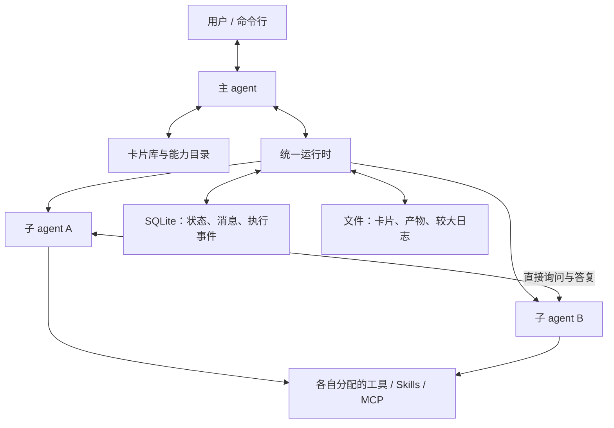
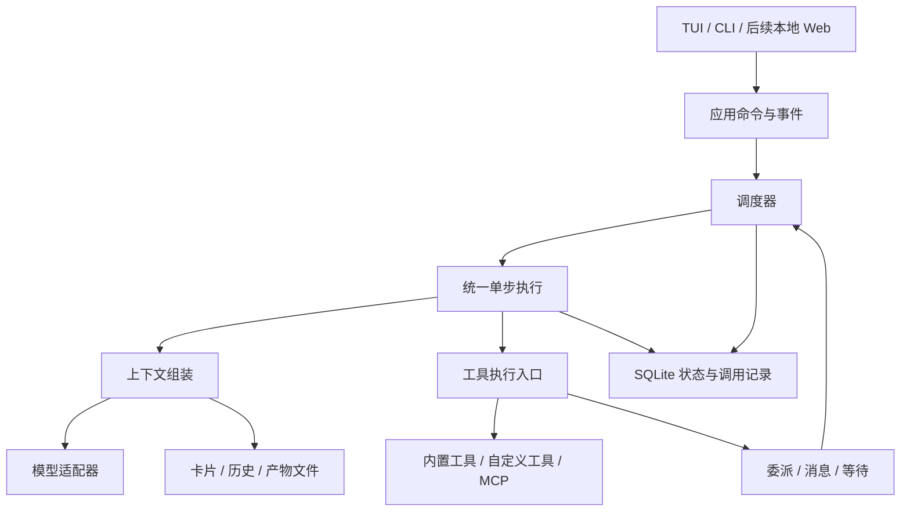

# Kodo 设计方案

版本：1.5  
日期：2026-10-19  
状态：用于实施的设计基线；本地执行、协作、上下文压缩与核实恢复内核已实现并提供可运行 demo。完整产品中的能力包、MCP 与本地 Web 仍属后续阶段。实际能力与验证方式见 [README](../README.md)，参数与效果仍需验证。

产品定位、社区生态、研发排期和发布步骤见 [Kodo 产品开发与上线方案](product-launch-plan.md)。本文件定义执行内核、Agent 能力包与本地核心版本，该方案规定社区、本地 Web 工作台和公开发布流程。

具体技术选型、工程契约、开发批次与验证命令建议见 [Kodo 实现方案](implementation-plan.md)。

内核模块边界见第 3.4 节，对象与生命周期见第 4.5 节，单步执行及输入语义见第 5.5 节；公开产品的证据与借鉴边界见 [内核参考调研](kernel-comparison.md)。

## 1. 目标与定位

Kodo 是 CodeGo AI 旗下独立产品，定位为以 Agent 为单位，共享和运行工作流的轻量 Harness。这里的工作流是完成某类任务的方法、能力配置和验收约定，可以由 agent 动态执行，不要求固定步骤或可视化流程图。可导入导出的 Agent 能力包承载这些方法，社区在产品复用价值得到验证后连接创作者和使用者。首版采用单机运行方式：主 agent 持续与用户交互、理解目标并统筹交付；子 agent 按需创建，在独立上下文中执行具体工作，可以直接向同伴询问信息，必要时向主 agent 升级问题。主 agent 仅在缺少用户意图、关键取舍或必要授权时询问用户。

用户可以通过对话设计 agent，将其保存为可导入、导出、分享和持续改进的 Agent 卡片。卡片的分发形式是能力包，可包含提示词、Skills、工具代码、MCP 配置、可分发的本地 MCP 服务及验证案例。卡片数量增加后，系统通过能力检索与分层浏览选择候选，避免将整个卡片库塞入主 agent 的上下文。

核心原则：**模型负责判断和分工；运行时负责状态、消息、权限、资源限制和执行记录。**

### 1.1 品牌定位

- 公司品牌：**CodeGo AI**。
- 产品名称：**Kodo**，读作 **ko-do**；与公司已有产品 CodeGo 分别命名。
- 品牌署名：**Kodo by CodeGo AI**。
- 品牌理念：**Know · Organize · Do**。
- 中文表达：**理解目标，组织协作，执行交付。**

Kodo 与现有 CodeGo 中转业务保持独立的产品定位、接入流程和发布路线。公司品牌归属保留，Kodo 的使用不依赖 CodeGo 账号、充值或模型服务；供应商按相同的能力与兼容性标准接入。

一句话定位：**以 Agent 为单位，共享和运行工作流的轻量 Harness。**

用户价值主张：**把做成过的工作，变成可复用、可分享、可改进的 agent。** 这是待通过真实任务验证的产品目标，不保证每次执行得到相同结果。

核心产品闭环：**完成任务 → 保存方法 → 换输入复用 → 根据纠正验证改进 → 按需分享 → 他人导入与使用。** 运行时承载执行，能力包承载可复用方法，社区承载发现、反馈和贡献。

导入导出、资源打包和插件市场已有成熟参考，不能单独作为独有优势。Kodo 重点验证完整能力包的实际可用性、导入后按任务参与协作的体验，以及版本改进能否被他人复核。先验证单人重复使用价值，再验证跨用户交付；分享能力首发具备，社区建设和推广不作为产品发布的前置条件。生态是持续产生、复用和改进有效 agent 后形成的结果。

Kodo 是品牌造词；Know · Organize · Do 是赋予它的品牌释义，表达产品的三个核心动作：

| 品牌理念 | 含义 | 产品中的体现 |
| --- | --- | --- |
| **Know** | 理解目标、约束和可用能力 | 主 agent 理解用户意图，发现适合的卡片；子 agent 按需获取信息并核实事实 |
| **Organize** | 组织可复用能力与协作 | 绑定能力包的工具、Skills 和 MCP，按任务创建执行者并分配上下文 |
| **Do** | 执行、验证和积累改进 | 使用实际工具交付结果，以案例检验改进，并将可复用版本分享给社区 |

这三个动作可以在任务中反复发生，不要求实现为固定的三阶段流水线。它们表达从理解到协作、再到实际交付的产品价值。

品牌体验应与设计保持一致：内核精简、授权范围内自主推进、协作过程可追溯、能力可扩展。持续改进通过卡片版本和实际验证体现，不将“越用越好”表述为未经验证的自动提升承诺。首版可以从编程场景验证，产品定位覆盖用户能够通过工具、Skills 和 MCP 扩展的其他任务。

命名约定：对外界面与文档使用 **Kodo**，命令行入口及机器标识使用小写 **`kodo`**；技术分类继续使用 Agent Harness，主 agent、子 agent 与 Agent 卡片保持现有称呼。

### 1.2 产品目标

1. 用户主要与一个主 agent 对话，无须手动协调所有执行者。
2. 主 agent 可以自主决定直接处理、复用已有 agent、选择卡片或临时组合一个 agent。
3. 子 agent 具备独立上下文、模型配置及工具、Skills、MCP 分配。
4. 子 agent 可直接沟通，减少主 agent 转发消息和处理局部细节的负担。
5. 用户能够通过对话修改 agent，并以版本化卡片积累可复用能力。
6. 卡片库可以持续增长，但每次检索和每个执行实例的上下文使用受预算约束。
7. 用户可以查看工作进展、补充要求、取消执行，并追溯结果的依据。
8. 创作者可以提交完整能力包，其他用户能够发现、导入、验证、反馈和派生改进，形成可观察的社区复用链路。

### 1.3 最小版本范围

本文件中的“首版”指首个本地核心版本，先完成无界面内核和精简 TUI。能力包机制先验证个人复用与文件或 Git 分享，通过他人导入检查可迁移性。受邀试用后复用同一内核制作本地 Web GUI；公开 Beta 验证产品可用与跨用户分享，不要求社区作者数量或活跃度。轻量社区按真实分享需求逐步建设，不承担云端执行。

| 首版必须交付 | 后续按证据扩展 |
| --- | --- |
| 单机运行、命令行／TUI 对话、流式回复 | 本地 Web 工作台；更后期的远程执行与多租户 |
| 同一执行内核支持主 agent 和子 agent | 多级递归委派、跨主机调度 |
| 自主创建子 agent、点对点通信、问题升级 | 开放式群聊、多 agent 投票 |
| 独立上下文、按需加载工具与 Skills | 全局长期记忆、知识图谱 |
| 完整能力包设计、版本保存、导入导出 | 自动格式迁移及跨 harness 适配 |
| 文件或 Git 分享、导入诊断、可追溯版本 | 轻量社区目录，随后按需求增加作者后台、推荐和团队空间 |
| 全文检索、浅层能力目录、预算控制 | 向量检索、查询时动态生成目录 |
| 本地执行记录、取消、失败反馈、保守恢复 | 分布式消息系统、任意外部操作自动补偿 |
| 候选版本、案例验证、采用与回退 | 无人监督的持续自我修改 |

第一版根据工具调用稳定性、可测试性和成本选择一种模型协议完成闭环，模型绑定按 agent 独立配置。其他供应商通过同一接口逐项接入验证；能力包表达模型要求和已测试组合，不内置某个供应商的账号或强制服务绑定。

## 2. 核心设计决策

| 决策 | 原因 |
| --- | --- |
| 主 agent 和子 agent 共用执行循环 | 避免维护两套运行机制，差异由配置表达 |
| 任务归属呈层级，信息通信允许横向连接 | 保持目标责任明确，同时避免主 agent 成为消息转发瓶颈 |
| 首版只有主 agent 拥有创建子 agent 的能力 | 避免递归膨胀；子 agent 可请求主 agent 增加协作者 |
| 卡片、运行实例、消息相互分离 | 可复用配置不混入某次任务的上下文和通信状态 |
| 能力包可携带 Skills、工具与 MCP 资源 | 接收者能还原专业能力，减少手动拼装；凭据与实际权限仍在本地绑定 |
| 产品先行，分享能力首发具备，社区逐步推广 | 先让单人获益，避免依赖社区规模才能使用产品 |
| 新建子 agent 默认只接收任务资料包 | 避免完整继承主对话导致重复消耗和信息干扰 |
| 同伴消息不能改变权限和全局任务约束 | 横向协作不等于横向授权 |
| 检索结合直接搜索与能力目录浏览 | 简单任务可直接定位，复杂任务可以推理探索 |
| 卡片内容采用文件，运行状态采用 SQLite | 文件便于编辑分享；事务用于协调消息落库和任务唤醒，减少丢消息与状态不一致 |
| 完成的运行保留记录，不持续调用模型 | 支持后续追问，同时避免空闲成本 |
| 卡片版本不可原地覆盖，运行绑定版本与内容摘要 | 更新、回退和结果追溯具有确定性 |
| 写入同一资源的任务默认串行 | 并发修改正确性比初期追求最大并发更重要 |
| 新版通过案例验证后才替换默认版本 | “改了提示词”不等于能力提升 |

## 3. 总体架构



图中的组件是一个应用内部的模块，不代表多个独立服务。首版不引入服务注册中心、消息中间件或工作流编排框架。

### 3.1 主 agent

职责：理解用户目标、保留关键约束、选择执行者、解决跨任务取舍、协调变更、核验结果并交付。

主 agent 默认只看到：

- 用户对话与当前目标摘要。
- 有关当前任务的重要决定和约束。
- 正在进行的子任务摘要。
- 检索到的少量能力摘要。
- 收到的升级问题、结果与产物引用。

主 agent 不需要加载所有子 agent 的工具参数、Skill 正文和 MCP 工具清单，但必须了解候选的适用范围、必要输入、结果形式和操作影响。保留读取关键产物与验证证据的能力，避免仅转述子 agent 的自我汇报。

### 3.2 子 agent

子 agent 执行边界明确的局部任务，拥有独立上下文和实际授予的能力。可以自主探索、调用工具、向同伴提问、修复可处理的错误，并按约定返回结果。

子 agent 不直接询问用户、不自主扩大权限，也不默认加载主 agent 的完整对话。发现任务范围不足或需要额外协作者时，通过消息向主 agent 请求调整。

### 3.3 运行时

运行时负责确定性工作：

- 调用模型、校验并执行工具、接收流式事件。
- 创建、调度、唤醒和取消运行实例。
- 保存消息和关联问答，管理等待关系。
- 绑定卡片版本、能力和本地环境。
- 执行资源限制、权限检查和上下文预算。
- 保存产物、验证记录和恢复所需状态。

不让运行时硬编码“先规划、再开发、再审查”的固定流程。主 agent 根据任务判断必要步骤，验收仍必须有可检查的依据。

### 3.4 内核模块与边界

首版采用 TypeScript／Node.js 单进程本地内核：主 agent 与子 agent 共用执行循环，每个实例独立组装上下文；SQLite 保存可恢复状态，文件保存能力包与大体积产物。模型决定方法和分工，内核实施确定性的边界。



| 边界 | 必须负责 | 不负责 |
| --- | --- | --- |
| 应用接口 | 接收用户输入、取消、查询与事件订阅 | 直接调用模型或修改任务表绕过运行时 |
| 调度器 | 唯一推进权、排队、并发额度、唤醒与控制信号 | 判断业务步骤、选择专业工作方法 |
| 单步执行 | 本轮模型请求、工具调用与结果收尾，返回继续／等待／终态 | 自建第二套调度或持有跨等待的资源锁 |
| 上下文组装 | 从结构化状态与历史中选择必要输入，按预算压缩 | 授予权限或将摘要当成唯一事实源 |
| 模型适配器 | 协议转换、流解析、调用关联及 usage | 绕过内核自动执行工具、隐藏重试消耗 |
| 工具执行入口 | 参数、授权、范围、锁、超时、调用记录与结果 | 根据提示词自述放宽实际权限 |
| 存储与通信 | 状态、消息、等待与事件的事务一致性 | 依靠内存通知保证唯一的恢复路径 |

这些是源码模块，不是独立服务或 npm 包。首版不引入微服务、完整事件溯源、递归管理 agent 或通用工作流引擎。MCP 与工具子进程可以独立运行，但不要求每个 agent 都对应操作系统进程。

能力包创建、导入导出、案例比较与社区位于内核之上。它们调用同一运行时验证效果，不额外维护一套“进化循环”。优先复用成熟协议 SDK；Pi 模型适配层是可评估候选，不在未验证前将其整套会话系统设为依赖。

## 4. 核心数据模型

### 4.1 Agent 卡片与能力包

Agent 卡片是用户理解和选择 agent 的入口，完整能力包是其分发载体；本文使用“卡片”指可复用的逻辑定义，使用“能力包”指包含相关资源的实际文件包。两者共享同一身份与版本，不维护两套相互独立的配置。

包内 `AGENT.md` 使用带 YAML 元信息的 Markdown 格式；提示词放在正文中，能力、依赖与检索字段放在元信息中。下面是首版格式示意，正式字段需要在实现时通过 Schema 校验。

```yaml
---
schema_version: 1
id: local/sql-analyst
version: 1.0.0
name: 数据库分析员
description: 分析结构化业务数据，输出可复核的查询与结论。
capabilities:
  tools: [artifact.read, artifact.write]

---
你负责使用可复核的数据回答业务问题。
先确认指标含义；缺少定义时询问负责该信息的协作者。
无法确认的假设必须明确标注。不得将相关性直接表述为因果关系。
```

上例是当前可导入的卡片格式，仅支持内置工具名称。未知字段与未知工具名都会在导入时拒绝；使用时机、输入、标签可写在正文。下面涉及 `permissions`、模型偏好、本地工具、Skills、MCP 与能力包的约束为后续设计，尚不是当前可导入的 YAML 字段。

字段约束：

- `schema_version` 表示格式版本；`version` 表示这张卡片的能力版本。
- 卡片 ID 在安装库内唯一；社区传播时包含发布者命名空间。
- 发布者命名空间只是标识，不自动代表身份已验证。
- `permissions` 表示申请的权限，不代表导入后已经授予。
- `preferred_binding` 是可替换的模型偏好。MCP `definition` 引用包内服务配置模板，`binding` 标识需要在本地补齐的连接和凭据。
- MCP 配置模板可以描述远程服务或包内本地服务的入口、传输方式和必需变量名，不包含密码、令牌或机器私有路径。
- `tools` 引用宿主工具，`local_tools` 声明包内工具模块。Skills、工具、本地 MCP 服务代码、示例和引用资料可随包提供；路径相对包根目录解析，不允许跳出包目录。
- 外部依赖需要固定版本或内容摘要，声明运行环境及可分发许可；包内代码不能冒充内置受信任工具。
- 卡片正文和社区描述是外部内容，不能覆盖宿主规则或运行时权限。

### 4.2 AgentRun：一次执行

运行实例至少记录：

| 字段 | 含义 |
| --- | --- |
| `run_id`、`session_id` | 实例标识及所属用户会话 |
| `parent_run_id` | 委派者；首版子 agent 的委派者为主 agent |
| `continuation_of` | 可选，表示对哪次已结束运行的后续追问 |
| `card_ref`、`card_digest` | 固定的卡片版本和内容摘要 |
| `objective`、`constraints` | 任务目标与边界 |
| `acceptance`、`input_refs` | 验收条件与资料引用 |
| `scope` | 被授权的工作范围和资源范围 |
| `decision_revision` | 本次任务采用的主任务决定版本 |
| `model_binding`、`capability_bindings` | 实际采用的模型、工具和服务绑定 |
| `status`、`waiting_for` | 生命周期与等待对象 |
| `budget`、`usage` | 限额与已经发生的消耗 |
| `context_ref`、`result_refs` | 对话记录及产物引用 |

工具结果和较大日志不作为巨大字段塞进任务摘要，而是保存引用。环境绑定的敏感部分仅在本地凭据配置中保存。

### 4.3 AgentMessage：协作消息

```json
{
  "message_id": "msg-203",
  "session_id": "session-12",
  "from_run": "frontend-1",
  "to_run": "backend-1",
  "kind": "question",
  "content": "订单详情接口是否保证返回 currency 字段？",
  "reply_to": null,
  "artifact_refs": ["artifact-api-contract-4"],
  "decision_revision": 2
}
```

首版只使用 `question`、`answer`、`notice` 三种消息。发送方、会话归属、时间和编号由运行时填入，模型不能冒充另一个 agent。

运行状态和消息投递状态分开记录。问题是否已回答也独立于投递状态：消息进入收件箱不代表接收方已经理解或完成处理。

### 4.4 产物与任务结果

产物包括代码补丁、报告、接口约定、查询、测试结果等。每个产物有标识、来源运行、内容摘要、版本或内容哈希，以及存储位置。

子 agent 完成时返回固定的结果封套：

```text
状态：完成 / 失败 / 需要输入
结论：简短说明
产物：可读取的引用
验证：检查内容、原始结果引用及适用边界
遗留：未完成内容、假设和不确定性
```

“子 agent 报告完成”和“主任务验收通过”是不同事件。最终交付由主 agent 对照用户目标与验收条件决定。

### 4.5 对象身份与生命周期

| 对象 | 存活范围与用途 |
| --- | --- |
| AgentDefinition／卡片版本 | 可复用的职责与能力定义；独立于具体用户任务，可导出 |
| Session／用户会话 | 保存用户目标、决定、授权与总预算，关联主／子运行 |
| AgentRun／运行 | 一次明确目标的执行；固定定义与绑定，终态不重新打开 |
| Step／执行步骤 | 一次模型响应及其工具结果处理；只需步骤编号和记录，不单独建立服务 |
| Call／调用 | 一次模型或工具请求；记录开始、结果、错误或未知状态，供预算与恢复使用 |
| Event／事件 | 已提交的状态变化或临时显示增量；只有持久事件可用于重连补读 |

卡片数量、正在运行的实例数和在途模型请求数分别计量。安装一千张卡片不会启动一千个执行者；保存上下文也不意味着持续推理。首版等待实例释放模型槽，尚不实现复杂的内存驻留淘汰系统。

## 5. 执行、调度与生命周期

### 5.1 统一执行循环

```text
组装本次上下文和可见工具
  → 调用模型
  → 校验工具请求及权限
  → 执行工具并保存结果
  → 将必要结果加入上下文
  → 继续、等待、完成或失败
```

主 agent 与子 agent 共用此循环。差异来自系统职责、模型绑定、工具暴露范围与任务输入。

同一个运行实例同时只允许一个模型循环推进，避免新消息到达后启动两个循环并重复执行工具。不同实例通过调度器并发执行。

### 5.2 状态

| 状态 | 含义与后续动作 |
| --- | --- |
| `queued` | 等待调度；获得执行槽后进入运行 |
| `running` | 正在推理或执行工具 |
| `waiting` | 明确等待某条答复、任务结果或用户输入；释放模型执行槽 |
| `completed` | 本次执行结束，结果和记录可读取 |
| `failed` | 已无法在当前任务和预算内继续，包含原因与可恢复信息 |
| `cancelled` | 不再安排新的动作；记录未能终止或已发生的外部操作 |
| `interrupted` | 进程崩溃或异常中断，等待恢复检查 |

答复到达后，等待实例进入 `queued`，再由调度器恢复执行。唤醒不绕过并发和预算约束。

完成、失败和取消的运行保持记录不变。后续需要原 agent 回答问题时，创建带 `continuation_of` 的新运行，复用固定卡片版本、相关上下文和产物；不重放之前的工具调用。用户感知上是继续与原执行者沟通，历史验收和消耗仍然可追溯。

### 5.3 主 agent 的响应性

启动子任务后立即返回运行标识，不阻塞到子任务完成。主 agent 可以继续其他工作或进入等待；用户的新消息能够唤醒它。

新要求涉及正在执行的任务时，主 agent 更新任务决定版本，并将变更发送给受影响实例。单个实例在模型或工具边界接收普通补充；取消、权限撤销等控制事件由运行时优先处理。

旧决定版本产生的结果标记为需要复核，不能直接作为新要求已满足的证据。

### 5.4 资源控制

首版提供运行时默认值和会话级覆盖，不在每张卡片中堆叠大量调度参数。必须能够控制：

- 子 agent 并发数与创建总量。
- 模型调用、token 消耗和执行时长。
- 单次工具响应与模型上下文大小。
- 检索探索次数及累计返回量。
- 工具超时和无进展问答次数。

子 agent 的消耗同时记入所在会话的总预算，不能通过新建实例重置总限额。每次调用前预留输出预算；工具请求也执行相应的次数和时限检查。

预算不足时停止新的动作并向主 agent 返回当前成果和限制。模型报告的费用不作为精确账单；供应商未返回 usage 时标记为估计值。

### 5.5 输入分类与单步执行契约

输入分为当前任务补充、后续任务和控制信号。当前任务补充在安全边界纳入已有 Run；后续任务在前一 Run 结束后创建关联运行，不把原终态重新打开。取消和撤权直接进入控制路径。普通同伴消息不能伪装成用户控制信号。

每一步依次执行：检查控制信号 → 读取已提交输入和实际授权 → 组装上下文 → 预留预算并保存请求 → 调用模型 → 保存完整响应与调用清单 → 按顺序执行工具并保存结果 → 检查新输入后决定继续、等待或结束。数据库事务不跨模型或外部工具调用。

首版只在模型响应完整且结束状态有效后执行工具；输出被截断或响应断流时，即使某段参数看似可解析，也不执行这份未完成响应中的工具请求。已执行调用的结果与对应调用 ID 一起保存；重启从已提交位置恢复，不从头重放整个步骤。

等待操作是运行时控制工具。注册等待后先持久化与工具调用关联的 `wait_registered` 结果，再让调度器挂起实例；这只表示登记成功，不表示条件已满足。唤醒时按正常输入加入答复、超时或状态事件，因此不会带着缺失工具结果的历史调用模型。

等待、询问用户及结束操作必须是本轮最后一个控制调用。同一模型响应如在挂起操作之后还包含工具调用，执行前拒绝该批工具请求并返回可修正错误，不先执行其中的写操作。

等待时收到需要处理的新问题，可以以“收到新问题”为原因提前结束本次等待并重新排队；原问题仍保持未解决状态，处理新问题后可重新登记等待。通知按实际相关性处理，不为无关状态变化反复调用模型。

新输入入库与 Run 结束通过同一写入协调器排序：若输入先提交，结束前必须消费或明确处置；若终态先提交，用户输入由应用层关联到后续运行，同伴消息得到已结束状态并按第 5.2 节处理。内存唤醒丢失时，调度器仍能根据持久队列找到工作。

首版的正确性检查包括：同 Run 不双跑、结束边界不丢输入、两种答复／等待时序都能继续、等待不占模型槽、取消后不启动新工具、未知写结果不盲目重跑。具体接口与故障检查见实现方案第 3.5～3.7 节。

## 6. 子 agent 通信与问题升级

### 6.1 直接协作

子 agent 通过当前会话的成员查询获取职责摘要、运行标识和状态，然后直接发送消息。默认只查询自己会话内的协作者，不枚举其他用户或项目的实例。

消息默认点对点投递，不自动复制给主 agent。跨部门形成的重要约定写入正式产物，再向受影响成员发送简短通知。

只有需要改变全局目标、任务边界、授权或优先级时，才升级给主 agent。普通信息问答由相关执行者自行完成。

### 6.2 等待与投递

发送问题并不立即阻塞发送者。发送者可以继续独立工作；确实无法推进时，调用等待接口并指定所等的问题或运行标识。

消息落库后才向发送者确认。收件箱由运行时在下一次模型轮次组装时读取，并用消息 ID 防止重复加入上下文。消息插入与等待实例的唤醒状态在事务中协调，避免“答复先到、随后进入永久等待”的竞态。

首版不承诺外部副作用恰好执行一次。进程中断时即使消息可去重，已发出的外部操作仍可能处于未知状态，恢复策略见第 12 节。

### 6.3 问题处理顺序

1. 检查已分配资料、约定和可访问产物。
2. 向掌握信息或负责该模块的同伴询问。
3. 遇到跨任务冲突、未获授权的范围变化或无法解决的分歧，询问主 agent。
4. 主 agent 先查既有决定；技术事实不确定时继续调查或实验。
5. 只有缺少用户偏好、目标取舍或授权时，主 agent 向用户提出合并后的问题。

同一个未解决问题不重复询问用户。回答保存为会话决定，并通知相关实例。

### 6.4 防止循环等待和无效讨论

- 运行时记录明确的等待关系，发现循环等待后通知相关实例和主 agent。
- 已结束或失败的接收方返回明确状态；不会静默等待其自动答复。
- 未答复问题到期后返回超时事件，由发送者重试、换信息源或升级；超时不是默认同意。
- 单个问题的往返次数和任务总预算受限。模型可判断语义上的无进展，运行时负责确定性的上限。
- 同伴消息只提供信息和提出请求，不能改变接收者的实际授权、覆盖用户约束或代替主 agent 分配新的全局任务。

## 7. 上下文管理

### 7.1 委派资料包

主 agent 创建子 agent 时提供：

```text
目标：需要完成什么
约束：哪些要求不能违反
资料：必要用户原话、相关文件和产物引用
范围：负责哪些模块或资源
协作者：已知相关实例，可按需查询更多成员
验收：怎样判断完成
决定版本：当前使用的任务约定版本
```

运行时另行注入必须遵守的宿主规则、实际授权、能力清单和当前环境。它们不依赖主 agent 是否在摘要中记得转述。

### 7.2 分层保留

| 内容 | 默认处理 |
| --- | --- |
| 用户目标、授权边界、关键决定 | 作为重要信息保留，变更后标注新版本 |
| 活跃任务、未回答问题 | 保留简短状态与引用 |
| 工具日志、探索过程、长文件 | 外部保存，按需读取 |
| Skills | 启动时加载短描述，匹配任务后读取正文 |
| MCP 工具 | 仅暴露此实例获准使用的工具；数量过多时按需发现与加载 |
| 过期检索候选、重复工具输出 | 压缩或从后续模型输入中移除，原记录仍可查 |
| 子 agent 的最终输出 | 传递结论、证据与产物引用 |

完整记录和本次模型输入是不同对象，不能因为需要审计就把历史全部回灌模型。

### 7.3 压缩与信息完整性

接近上下文预算时生成任务摘要，保留未解决问题、证据引用和重要用户原话。摘要可能有损，不能替代权限状态或被当成完整事实源。

重要决定存储为独立记录；子 agent 信息不足时可以请求补充或读取原记录。主 agent 也可以抽查子 agent 的原始验证输出。

成功指标是主上下文负担下降且完成质量保持，不承诺多 agent 的总 token 一定低于单 agent。

## 8. Agent 发现与 PageIndex 思路的应用

### 8.1 检索对象

卡片库只索引路由需要的信息：名称、描述、适用与不适用场景、输入输出、标签、依赖、示例和版本信息。完整提示词和 Skill 正文不默认进入候选摘要。

能力目录节点包含标识、名称、短摘要、子节点引用及卡片引用。节点没有权限授予能力，只用于导航。

### 8.2 路由顺序

```text
用户是否指定 agent？
  → 校验可用性后采用；不可用时明确说明
否则，当前会话是否已有适合继续的实例？
  → 直接沟通，或创建基于历史记录的后续运行
否则，检索卡片或浏览能力目录
  → 比较少量候选
  → 检查详细能力、依赖、权限和模型绑定
  → 启动选定版本
没有合适卡片
  → 使用通用卡片或临时组合已有能力
缺少必要工具或数据
  → 明确返回缺口，不伪装成可执行
```

名称和目标明确时直接搜索；任务模糊或跨领域时允许先浏览目录。运行时不把以上步骤硬编码为每次必须完整执行的流程。

### 8.3 直接检索与目录导航

首版使用 SQLite FTS5 的全文索引和结构化字段过滤。中文检索必须验证分词覆盖：采用可用的 trigram 分词支持中文片段匹配，较短名称和标签使用精确匹配；不直接依赖英文单词分词得到正确中文召回。启动时检查运行库能力，不支持时明确报错或显式采用已验证的替代实现。

目录采用浅层分类、标签和多入口引用。同一张卡片可以出现在不同能力入口下，结果按卡片 ID 和版本去重。导入作者给出的分类只是建议，本地目录不必照单全收。

借鉴 PageIndex 的部分：

- 目录与完整内容分离。
- 模型根据当前任务决定展开哪个分支。
- 通过稳定标识读取候选详情。
- 允许回退、跨分支探索和跳过无信息价值的层级。

首版不引入 PDF 解析、文档分页或 PageIndex 云端依赖，也不重建其企业级虚拟文件系统。

### 8.4 上下文与检索预算

目录不整体装入系统提示词。一次浏览只返回指定节点的有限子节点和摘要，支持分页；一次搜索返回少量候选及是否仍有更多结果。

原型可从“每次最多 5 个候选、最多 3 次展开、最多查看 2 张详细卡片”开始实验。这些数值仅是可调起点，不作为已验证的最优参数。还要同时限制累计 token，避免一张冗长卡片突破预算。

预算用尽仍不确定时，返回当前候选、已探索范围和限制，由主 agent 决定使用通用 agent、重新定义查询或分配额外预算。不能声称已遍历全库，也不能仅根据预算耗尽断言没有合适卡片。

历史候选在决定后压缩为选中版本、选择依据及必要引用。卡片数量增长不会直接增加常驻上下文；探索范围扩大仍会增加调用与延迟，不承诺固定成本或对数级搜索。

### 8.5 可用性与排序

严格禁止的权限和缺失的必要能力先筛除；可由本地配置修复的依赖标记为“需要绑定”，不伪装成即刻可用。候选比较结合任务匹配、输入输出、实际环境与已有验证记录。

作者自述、下载量、使用次数和模型自评分都不单独作为能力证明。暂无可靠反馈时保持透明，不人为制造置信度数字。

## 9. 工具、Skills、MCP 与权限

### 9.1 能力装配

卡片申请能力 → 解析本地依赖 → 与会话及宿主授权求交集 → 生成实例的实际能力集合 → 暴露模型可见工具。

实际权限不能超过宿主和用户已授予范围。子 agent 的专业工具可以不同于主 agent；主 agent 不持有某个工具的调用接口，并不妨碍运行时按既有授权为子 agent 绑定该工具。

主 agent 设计新卡片时可以查询能力注册表的简短说明，知道哪些工具、Skills 和 MCP 绑定可用；无需加载全部工具参数。新增外部能力和依赖安装是显式操作，不由一句“创建专家”隐式触发。

### 9.2 最小扩展接口

- 模型适配器：标准化消息、流式事件、工具调用、usage 和错误。
- 工具注册：名称、说明、输入 Schema、执行函数及所需权限。
- Skill 加载：读取本地 `SKILL.md` 和相关资源，作为方法指导。
- MCP 适配：发现工具、绑定身份、过滤允许的方法并调用。

普通用户通过配置与 Skill 文件扩展；需要自定义执行逻辑时，再编写本地工具模块。首版不引入任意生命周期钩子系统。

MCP 连接只有在凭据身份和权限范围相同的情况下才允许复用，工具清单仍按实例过滤。

### 9.3 安全边界

工具隐藏和提示词约束不是操作系统沙箱。拥有任意 shell 或原生代码执行能力的插件，可以绕过应用层文件工具限制。

首版按本地可信工具模式运行：默认使用受限工具接口，任意 shell 属于显式授予的高权限能力。不宣称能够隔离恶意原生插件。面向不可信代码的强隔离由后续独立进程、容器或操作系统沙箱实现。

包内自定义工具和本地 MCP 服务同样属于可执行代码，不能因为它们声明“只读”或被社区收录，就视为已受到操作系统级约束。启用前展示其来源和所需权限，执行边界仍由实际环境保障。

不可信卡片不能在导入时自动运行脚本、安装依赖或启动 MCP 服务。凭据只在运行时绑定，避免写入提示词、导出包和普通日志。

## 10. 卡片创建、分享与持续进化

### 10.1 对话创建

用户描述用途 → 主 agent 选择已有基础配置或构造临时配置 → 检查依赖与权限 → 实际试运行 → 修改 → 保存卡片。

另一条优先实现的路径是用户在任务验收后说“把这次做法保存为 agent”。主 agent 提炼用途、可变输入、执行方法、所需能力和验收条件，保存候选版本，再用不同输入检查可复用性。保留既有的对话设计入口，不强制先成功执行才能创作。

提炼不等于复制聊天记录或重放命令：项目临时事实、凭据、私有数据和一次性路径不写入通用卡片；需要保留的项目约束通过本地任务资料提供。只在原任务通过的版本不能标记为已验证通用。

不要求每次创建都经过固定问卷。需求足够明确时直接生成；缺少影响行为的必要信息才询问用户。临时实例不默认变成永久卡片。

### 10.2 导入导出

导入导出以完整能力包为主要体验。只有提示词且没有附带依赖时可以分享单个 `AGENT.md`；有资源时采用 ZIP 包，例如：

```text
sql-analyst/
  AGENT.md
  manifest.json
  skills/sql-analysis/SKILL.md
  skills/sql-analysis/references/query-patterns.md
  tools/report.ts
  mcp/analytics-db/server.json
  mcp/analytics-db/src/server.ts
  mcp/analytics-db/package.json
  mcp/analytics-db/package-lock.json
  examples/sales-drop.yaml
  examples/data/sample-sales.csv
  LICENSE
```

上述目录展示可选资源，不要求每个包都包含本地 MCP 服务或自定义工具。`manifest.json` 在导出时生成，记录包格式版本、实际包含文件及其内容摘要，供导入完整性检查；agent 的身份、行为和能力仍以 `AGENT.md` 为来源。

| 资源 | 打包方式 | 导入后需要处理的事项 |
| --- | --- | --- |
| 提示词与协作约定 | `AGENT.md` 正文及能力字段 | 解析并遵守宿主的实际权限边界 |
| Skills | 包含 `SKILL.md` 及显式引用的可分发资料、脚本和模板 | 校验引用完整性；脚本执行仍受工具权限控制 |
| 自定义工具 | 可分发源码或适合目标平台的构建产物、依赖声明 | 校验宿主接口与平台要求，注册到此 agent 的能力范围 |
| 远程 MCP | 服务配置模板、工具允许列表、认证变量声明 | 绑定接收者的地址或凭据；不能打包远程服务本身 |
| 本地 MCP | 服务配置模板、可分发服务代码、依赖锁定文件及运行要求 | 检查运行环境，准备依赖后按授权启动 |
| 示例与验证案例 | 不含私有信息的输入、预期条件及必要样例数据 | 在本地模型和工具环境中重新验证 |
| 无法随包分发的依赖 | 精确版本、来源、完整性信息和配置要求 | 明确缺口，按授权获取或由接收者配置 |

导出器从声明的资源生成候选文件清单，检查引用是否缺失；不会自动把整个项目、用户目录或依赖缓存打入包。只包含明确允许分发的文件，保留许可证及来源要求。凭据、私人聊天、运行日志、用户业务数据、机器私有路径和本地绑定配置默认排除。不能只依赖敏感关键词扫描决定文件是否可以导出。

导入流程：**检查包 → 注册未启用版本 → 检查环境与绑定 → 准备已授权依赖 → 运行示例 → 启用。**

包检查包括格式、文件摘要、引用、路径、包体和解压后大小限制。发现缺失或被修改的必需文件时拒绝该版本，不静默跳过。禁止路径穿越和越界链接；包检查与注册不会执行导入代码、安装脚本或启动 MCP。

依赖准备与启用是明确的操作阶段，可以在用户已有授权内连续完成。安装来源、精确版本和将执行的动作可见；需要新权限或凭据时明确返回缺口。状态至少区分“已导入”“待配置／不兼容”“可运行”，下载成功不等于已经可用。诊断逐项显示缺失条件及下一步操作：如绑定数据库、选择已验证模型、准备特定版本依赖。已有且身份与权限匹配的本地绑定允许复用，避免重复配置。示例通过只证明该环境中的该案例通过，不保证所有任务成功。

本地 MCP 和工具优先提供可分发源码与锁定依赖，不默认复制整个 `node_modules` 或虚拟环境。若包含二进制，应声明操作系统和架构并校验摘要；不匹配时明确不可用。凭据在执行时由本地绑定注入，不能以明文写入包内配置。

相同 ID 和版本但内容摘要不同的包拒绝覆盖。依赖应随包提供或固定版本／提交；凭据必须另行绑定。更换模型或依赖可能改变表现，需要重新运行相关案例。

首版可迁移性指符合已声明条件的 Kodo 环境间复用，不承诺 ZIP 包能够在所有机器上无配置运行，也不承诺原样导入其他 harness。已有标准的 Skills 和 MCP 尽量沿用其格式；跨 harness 转换按实际字段和权限语义逐项验证。

### 10.3 分享与社区

首发支持文件与 Git 分享，不依赖社区服务。重复使用和跨用户分享得到验证后，再逐步建设轻量社区；其首版可由公开站点、Git 版本库及反馈入口组成，支持外部作者提交能力包、用户发现下载、安装验证、问题反馈和派生版本收录。

社区需要展示作者、来源、许可证、版本、依赖和适用场景，以及示例的验证模型、环境和结果。下载数、作者自述与验证证据分开显示。人工收录检查格式和分发条件，不伪装成对所有行为的安全认证。

创作者能从用户反馈中修改并再发布，接收者能够选择是否升级。初期用 Git 提交和问题跟踪实现协作，之后再按实际负担增加作者后台、推荐和团队空间，以实际发现和维护需求决定建设节奏，不为等待社区规模推迟产品发布。

安装来源与授权结果保留在本地安装记录中，不污染可分享卡片。已安装能力包在目录不可用时仍可按原绑定运行；外部模型与服务可用性另行检查。主 agent 默认选择本地可运行卡片；发现社区候选不等于获准自动安装或执行其代码。

用户修改别人的卡片时创建派生 ID，并保留来源版本引用。更新上游卡片不覆盖派生配置。卡片更新也不自动扩大本地授权。

### 10.4 进化闭环

```text
任务执行与用户反馈
  → 识别具体缺陷
  → 修改提示词、Skill、能力组合或协作方式
  → 保存候选版本
  → 运行针对性案例与已有关键案例
  → 采用新版，或保留旧版
```

区分“这次这样做”和“以后都这样做”：前者仅影响当前运行，后者生成可复核的候选规则与脱敏案例。保存时展示改变了什么、适用范围和验证结果，避免一次例外成为全局规则。

进化不涉及模型权重训练，也不默认把每次对话转为长期记忆。只提炼适用于未来任务且允许保存的经验，排除用户私有事实。

首版提供保存候选、试运行、对比结果、采用和回退的简单操作。由主 agent 组织验证，不另建“进化 agent 系统”。

用户明确要求改善某项能力时，可以在授权范围内完成修改和验证。对于系统自主提出的改进，默认先保存候选；用户预先启用自动采用策略后，才按该策略升级默认版本。新增权限和依赖仍受原授权边界约束。

没有验证依据时不标记“能力提升”。针对性问题应得到改善，关键旧案例不能出现不可接受的退步。生产性副作用操作不用作自动回归案例，优先使用固定数据、只读环境或隔离测试环境。

卡片更新后同步刷新索引摘要和分类引用。历史运行与反馈绑定到当时的版本、模型和环境，不直接算作新版的验证成绩。

## 11. 并发写入与产物整合

首版默认允许只读任务并行，同一资源范围内的写任务串行。资源范围由任务授权和工具执行层共同检查，不能只依赖提示词中的“不要改别人的文件”。

项目级写任务初期可共用一把项目写锁，以降低实现复杂度；验证需要后再细化到目录或独立 worktree。高权限 shell 不宣称受到细粒度文件范围隔离。

外部资源按操作影响分配权限和串行范围。两份不同目录不代表不会影响同一个数据库或远程环境。

重要接口约定、需求决定和交付产物采用明确版本或内容摘要。子 agent 返回产物时注明基于哪个版本，主 agent 在整合前检查是否过期。

主 agent 根据风险决定自己检查、请求补充证据或安排独立验证，不强制每项任务创建审查 agent。代码任务除局部验证外，还需在整合后的实际状态运行相关检查。

## 12. 持久化、失败与恢复

### 12.1 本地存储

- 卡片与示例：文件，适合编辑和 Git 版本管理。
- 实例、消息、等待关系、用户决定和事件索引：SQLite。
- 大型工具输出、对话内容与产物：文件，通过标识和内容摘要引用。
- 凭据：本地专用绑定配置或系统凭据存储，不进入导出内容。

首版使用单个应用进程和单写入协调器。数据库写入使用短事务；不在数据库事务中等待模型或外部工具。

### 12.2 失败策略

| 失败 | 处理 |
| --- | --- |
| 模型限流、暂时性网络问题 | 在预算内有限重试，暴露最终错误 |
| 工具参数不合法 | 将错误返回模型修正；修正次数受预算约束 |
| 依赖、权限或凭据缺失 | 返回明确缺口，不静默换成能力不足的配置 |
| 子 agent 无法完成 | 保存阶段成果和失败原因，主 agent 决定改分工或终止 |
| 同伴问题无人回复 | 超时并返回状态，避免永久占用执行槽 |
| 用户取消 | 停止新调用，尽力终止在途操作，记录未能终止的动作 |
| 进程中断 | 标记相关实例中断，检查在途调用后恢复 |

### 12.3 副作用与恢复

工具调用记录标识、开始和结束状态。对只读、幂等且可安全确认的调用，可以按策略重试。

对于已经发出但未记录结果的写操作，不能简单重跑。优先查询外部状态或利用服务支持的幂等键确认结果；无法确认时标记为结果未知并交给主 agent 处理，必要时询问用户。

恢复会话时读取当前持久状态、产物及用户最新要求，重建待处理任务，不把历史模型输出或工具调用当作可直接重放的脚本。

## 13. 面向模型的最小操作面

以下是逻辑操作，不要求全部一次性暴露给每个模型。首版可按角色固定暴露必要集合，后续再按规模增加工具发现机制。

| 操作 | 主 agent | 子 agent |
| --- | --- | --- |
| `search_agents`、`browse_capabilities`、`inspect_agent` | 选择卡片 | 默认无须选择卡片，可建议所需能力 |
| `spawn_agent` | 创建子任务 | 不开放 |
| `list_peers` | 查询会话成员 | 查询可通信成员 |
| `send_message` | 补充、答复、通知 | 询问、答复、通知 |
| `inspect_run` | 查看状态与必要记录 | 查看获准的协作状态 |
| `wait_for_events` | 等待子任务或用户输入 | 等待指定答复或任务结果 |
| `cancel_run` | 取消其管理的任务 | 不取消其他实例，可申请退出自身任务 |
| `ask_user` | 集中询问用户 | 不开放 |
| 读取产物 | 按授权检查成果 | 按任务授权读取 |
| 卡片保存、导入导出、采用版本 | 用户授权下管理 | 可提交建议，不直接改主库 |
| 专业工具与 MCP | 按主角色需要配置 | 按卡片和任务授权配置 |

`wait_for_events` 进入持久的等待状态，不通过循环模型调用模拟等待。运行时能够在用户输入、相关答复、失败、超时或取消时唤醒实例。

## 14. 参考技术结构

建议首版采用 TypeScript 与 Node.js，便于实现异步调度、流式对话、JSON Schema 和 MCP 集成。该选择服务于最小可运行实现，不要求绑定某一完整 agent 框架。

实现时优先评估成熟模型适配库能否满足消息、工具调用、usage 和取消语义；只复用需要的能力。Pi 的模型适配与执行循环值得参考，但不预设必须依赖其整个应用。

参考模块划分如下，不要求从第一天拆为独立包：

```text
src/
  cli/          对话入口、状态和问题展示
  runtime/      执行循环、调度、上下文和预算
  agents/       卡片解析、绑定、版本和导入导出
  discovery/    全文检索、能力目录和候选摘要
  messaging/    收件箱、问答关联和等待检查
  tools/        内置工具、能力注册和权限检查
  providers/    模型协议适配
  mcp/          服务绑定和调用适配
  storage/      SQLite、事件和产物存储
```

依赖方向保持单向：界面调用运行时；运行时使用存储、模型与能力适配；卡片和发现模块不反向调度模型循环。避免为了扩展提前建设通用插件平台或远程服务接口。

CLI／TUI 阶段直接调用应用层，提前统一命令与事件结构；进入本地 Web 阶段再添加回环地址 HTTP 适配和界面模块。两种界面共用任务、消息、权限和存储，不能各自实现一套 agent 循环。具体界面范围和本地服务边界见产品开发与上线方案。

## 15. 实现顺序

### 阶段 A：验证单 agent 内核

实现命令行对话、一个模型供应商、受控工具调用、流式事件、执行记录、取消和预算。

退出条件：能完成一个真实任务；工具参数错误、模型暂时失败、用户取消均有明确行为；没有假执行结果。

### 阶段 B：验证导演式协作

实现主 agent 自主创建子 agent、独立上下文、消息投递、等待唤醒和集中询问用户。先支持少量并发，写任务采用保守串行策略。

退出条件：完成一个需要两个子 agent 直接问答的任务；同伴失败、循环等待与用户中途变更均能收敛；主 agent 无须阅读全部通信。

### 阶段 C：验证卡片复用与发现

实现对话生成卡片、配置校验、不同模型绑定、工具／Skills／MCP 分配、完整能力包导入导出、全文检索和浅层能力目录；支持从已验收任务提炼候选卡片、换输入复用和文件或 Git 分享。

退出条件：包含 Skill 与 MCP 配置的能力包在另一套本地环境导入后，能够明确绑定依赖并完成示例；包内引用缺失和不兼容环境会被识别。卡片数量增加后不全量加载上下文；无匹配项和不可用依赖不会被误报为可执行。

### 阶段 D：验证持续改进

实现版本固定、候选修改、案例对比、采用与回退，并验证中断恢复和社区包边界。

退出条件：真实反馈能产生可验证的改进；旧运行仍能定位原版本；新版失败可以回退；导出包不包含运行私有数据。

阶段 A 至 D 共同构成首个本地核心版本；受邀试用后增加本地 Web 工作台，随后进入公开 Beta。公开发布须验证个人重复使用、他人导入及反馈改进；社区上线和外部作者招募不在产品发布关键路径上。专用作者后台、其他模型供应商、细粒度写入隔离和更复杂检索按实际需求追加。发布门槛、打包、上线与回退步骤见产品开发与上线方案。

## 16. 验收与评测

### 16.1 端到端场景

选择一个小型应用改动作为贯穿案例：

1. 用户提出明确改动，主 agent 创建实现与验证任务。
2. 实现者向相关协作者确认接口或数据，未经过主 agent 转发。
3. 遇到业务含义不明确时升级主 agent；主 agent 查询已有决定后合并询问用户。
4. 用户回答更新决定版本，受影响 agent 接收到变更。
5. 子 agent 返回产物与验证证据，主 agent 检查整合后的结果。
6. 将有效配置连同 Skills、MCP 模板及必要资源导出，通过文件或 Git 分享；由另一位使用者在干净测试环境绑定依赖并完成示例。
7. 根据使用者反馈生成候选版本，通过相关案例后采用、再发布，并验证可回退与派生来源可追溯。

### 16.2 必测边界

| 类别 | 必须观察到的行为 |
| --- | --- |
| 通信竞态 | 答复在等待登记前到达也能被处理，不发生永久等待 |
| 重复消息 | 相同消息 ID 不导致重复上下文注入；未知副作用不盲目重跑 |
| 循环等待 | A 等 B、B 等 A 能被检测并升级 |
| 已结束同伴 | 明确反馈状态，支持以历史记录创建后续运行 |
| 用户变更 | 旧版本产物被标记需复核，不能直接验收 |
| 取消与预算 | 不继续安排新动作；不可终止动作有记录 |
| 权限 | 未授权工具、资源和 MCP 方法被实际执行层拒绝 |
| 导入 | 越界路径、同版本不同内容、摘要不匹配及缺失 Skill／MCP 资源不能静默通过 |
| 能力包启用 | 注册不执行代码；缺少凭据、依赖或平台不匹配时不能标记可运行 |
| 社区阶段验收 | 社区上线时检查外部提交、安装、反馈和派生；不是本地产品发布门槛 |
| 方法复用 | 换输入后仍符合验收条件；缺失输入明确询问，不照搬上次任务事实 |
| 纠正范围 | 单次要求不永久保存；候选规则有适用范围，并检查旧案例退步 |
| 导出 | 私有数据、凭据、运行历史不因目录打包而被带出 |
| 检索 | 相近描述、跨领域、中文表达、短查询和无匹配项均有案例 |
| 版本 | 新卡片不改变正在执行的旧实例；索引随版本更新 |
| 恢复 | 模型中断和写操作结果未知时采取不同恢复策略 |
| 并发写入 | 同资源任务不互相覆盖，整合状态经过相关检查 |

### 16.3 路由效果对比

使用同一批标注任务比较三种方案：

- 小规模下全量提供卡片摘要，作为对照。
- 直接全文检索。
- 全文检索加能力目录导航。

任务包含正常匹配、同名干扰、跨领域、缺少依赖、无合适卡片，以及新卡片缺少历史反馈等情况。扩大卡片库时保持任务集合和干扰构造可复现。

记录合适候选进入前 K 项的比例、最终选择是否可接受、无匹配项处理、下游任务完成情况、模型输入 token、调用数、时延和总消耗。一个任务可以有多个可接受 agent，不强行指定唯一答案。

只有目录导航在同等预算下改善选择或任务结果，才增加更复杂的分类与动态树。PageIndex 的文档问答结果不能直接证明本项目的 agent 路由效果。

### 16.4 “越用越好”的判断

至少同时观察：

- 同类任务的可验收完成率和用户纠正次数。
- 选择错误、依赖不满足与执行失败的分布。
- 主上下文的增长速度及被检索信息的利用情况。
- 新旧卡片版本在固定案例上的表现与成本。
- 社区能力包被其他用户实际运行、复用和改进的情况，而非仅浏览或下载。

不把卡片数量增加、累计执行次数或 agent 自评分提高当作能力提升。

## 17. 已知取舍

1. 多 agent 能隔离上下文和并行工作，但可能增加总 token、时延和协调成本。简单任务允许主 agent 直接完成。
2. 固定主 agent 保持交互一致性，也可能成为决策瓶颈。先通过局部直接通信和减少无关汇报缓解，不提前引入多级管理结构。
3. 树状目录支持推理导航，也可能因为分类和摘要错误漏召回，因此保留直接搜索、跨分类引用和回退路径。
4. 卡片提升可迁移性，不保证不同模型、工具版本和环境下表现一致。环境差异必须可见，示例用于重新验证。
5. 应用层权限不能代替高权限工具的操作系统隔离。首版的可信执行假设必须明确。
6. “自主”表示在明确目标与授权内自行选择路径，不表示无限预算、自行授权或自动相信其他 agent 的结论。

## 18. 参考资料及采用边界

资料查阅日期：2026-10-19。以下资料用于设计借鉴，不作为本项目已实现或达到相同性能的证明。

| 来源 | 本方案采用的思路 | 边界 |
| --- | --- | --- |
| [Pi 官方仓库](https://github.com/badlogic/pi-mono) | 精简执行内核、模型适配、通过扩展组合能力 | 不直接复制整个应用；其权限与功能取舍不自动成为本项目承诺 |
| [Codex 子 agent 文档](https://learn.chatgpt.com/docs/agent-configuration/subagents) | 分离执行上下文，主 agent 汇总和核验结果 | 本项目自行定义工具绑定、通信与权限语义 |
| [Claude Code 子 agent 文档](https://code.claude.com/docs/en/sub-agents) | 文件化配置、职责描述与专用能力 | 不假设不同平台的卡片格式和能力可无损互换 |
| [Claude Code 插件](https://code.claude.com/docs/en/plugins) | Skills、agents、MCP 等资源作为单元加载和分发 | 资源打包与市场已有先例，Kodo 必须用实际复用与协作体验验证差异 |
| [Pi Packages](https://github.com/badlogic/pi-mono/blob/main/packages/coding-agent/docs/packages.md) | 可包含资源与运行依赖，通过 npm 或 Git 分发 | 不将可分享配置或依赖打包单独表述为独有能力 |
| [PageIndex 原理介绍](https://pageindex.ai/blog/pageindex-intro) | 目录与内容分离、推理导航、按引用读取 | 树本身不保证准确率或上下文上限 |
| [PageIndex File System](https://pageindex.ai/blog/pageindex-filesystem) | 多入口、语义目录、按任务选择导航维度 | 完整虚拟文件系统在官方资料中属于企业／云端能力，首版不依赖 |
| [PageIndex 工具源码](https://github.com/VectifyAI/PageIndex/blob/main/pageindex/agent_tools.py) | 浏览、读取结构、定向读取、响应分页 | 查阅时本地工具层不支持文件夹导航及相关性排序，不能作为现成的 Agent 社区索引 |

此前提到的 DeepSeek harness 尚无明确仓库或版本，因此本方案没有归纳其具体实现，也没有引入对应依赖。

本方案的实施重点是：做出可验证的“创作—打包—分享—导入—协作执行—反馈改进—再发布”闭环，再以实际复用、失败和性能数据驱动扩展。
