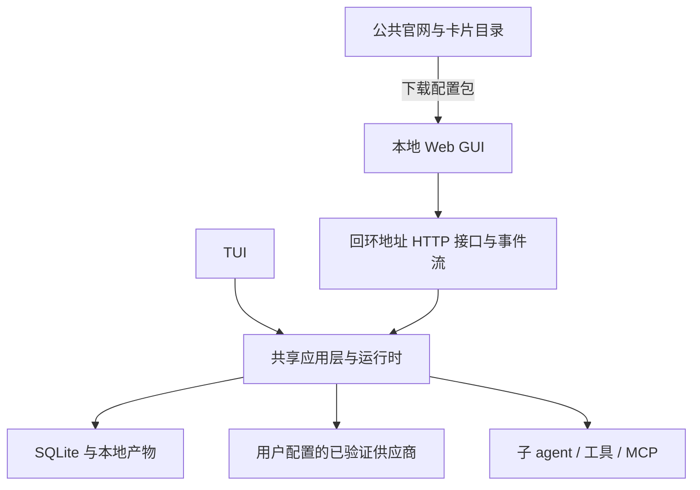

# Kodo 产品开发与上线方案

版本：1.2  
日期：2026-10-19  
品牌：Kodo by CodeGo AI · Know · Organize · Do  
范围：从产品设计、研发、试用到公开发布及发布后迭代。  
当前状态：已开始 P0/P1 单 agent CLI 内核原型，实现范围见 [README](../README.md)；完整产品尚未完成。本文件是实施路线与发布手册，不表示已经部署或上线。

技术架构与数据模型见 [Kodo 设计方案](design.md)。本文件规定独立产品定位、Agent 能力包与社区生态、开发顺序、差异化、发布门槛和上线步骤；技术实现以设计方案为基础。

具体技术选型、工程契约和开发批次建议见 [Kodo 实现方案](implementation-plan.md)。

## 1. 总体决策

**先做一个能让用户反复完成真实任务的产品，再推广分享，最后逐步建设社区。先完成内核与精简 TUI、能力包和复用验证，再制作本地 Web GUI。首发包含导入导出与文件或 Git 分享；公开 Beta 不以社区规模、外部作者数量或活跃度为门槛。原生桌面应用与云端执行后置。**

首发优先服务反复执行同类工作、需要维护或交接工作方法的开发者和小型技术团队。创作者可以先是保存自己成功做法的使用者，不要求用户一开始就成为社区作者。初期选择一个具体开发场景验证，再扩展其他领域。

产品定位：**以 Agent 为单位，共享和运行工作流的轻量 Harness。** 工作流包含任务方法、能力配置和验收约定，可动态执行，不限于固定步骤。

对外表达：**把做成过的工作，变成可复用、可分享、可改进的 agent。**

目标体验是“调好一次，下次少重复配置和纠正，交给别人也更容易使用”；这是需要实测的价值假设，不是稳定性保证。

“Know · Organize · Do”对应理解目标、组织协作、执行交付，不在界面中强制用户经历三个固定阶段。

### 1.1 独立产品边界

Kodo 保留 CodeGo AI 的公司品牌归属，与现有 CodeGo 中转业务分开规划。Kodo 的运行、社区、账号和未来商业模式不以 CodeGo 的账号、模型服务或计费流程为前提。

| 产品组成 | 职责 | 用户获得的价值 |
| --- | --- | --- |
| Kodo 运行时 | 本地执行、工具调用、上下文与多 agent 协作 | 让已有能力围绕目标完成工作 |
| Agent 能力包 | 携带定义、Skills、工具、MCP 配置／可分发服务与案例 | 保存、迁移、分享和改进专业能力 |
| Kodo 社区 | 连接创作者和使用者，提供发现、分发、反馈与派生记录 | 找到可用能力，贡献改进并积累信任 |

模型供应商按统一兼容性标准接入，没有为原中转业务预留的强制入口。卡片声明能力要求和已测试环境，接收者在本地选择模型、绑定凭据和授权。

本地使用不要求社区登录。社区首版可以用 Git 承载提交与作者身份；后续需要账户时作为 Kodo 社区身份管理，不与任何模型服务账户强制绑定。

初期优先验证个人重复使用价值，再验证分享，商业模式单独评估。候选方向是团队私有能力库、托管验证与分发、部署支持；付费卡片和作者分成要在实际复用、权利归属和支持责任清楚后再考虑。公开运行格式与分发规范有助于生态建设，代码许可证和收费方案仍由公司决定。

### 1.2 产品形态顺序

| 顺序 | 交付形态 | 用途与退出条件 |
| --- | --- | --- |
| 1 | 无界面内核与非交互命令 | 自动验证模型、工具、任务状态、恢复和取消 |
| 2 | 精简 TUI | 内部与受邀开发者执行真实任务，检验协作闭环 |
| 3 | 能力包与复用 | 保存真实任务的方法、换输入使用、导入诊断、版本改进及文件／Git 分享 |
| 4 | 官网、文档与演示 | 解释创作与复用价值，提供准确的状态与安装入口 |
| 5 | 本地 Web GUI | 降低任务操作、能力包装配、安装诊断与版本比较的负担 |
| 6 | 轻量社区 | 产品有真实复用需求后建设目录与贡献入口，不阻挡产品发布 |
| 7 | 原生桌面外壳与后续扩展 | 安装、系统集成和后台运行需求明确后再做桌面外壳；作者后台、团队服务和云端执行分别评估 |

这里的 Web GUI 是运行在用户电脑上的浏览器工作台，已经属于图形界面。它与公共官网、未来的云端 agent 服务是不同产品表面。

## 2. 为什么先做 TUI，以及做到什么程度

### 2.1 选择理由

先做 TUI 能让开发者在真实工作目录中验证工具执行、任务中断、权限和文件变更，交互范围较小。最初要回答的是“这套协作是否真正提高完成质量”，而不是“能否做出复杂的多 agent 动画”。

但 TUI 不应成为长期开发重点。能力包装配、导入诊断、版本对比和产物查看更适合图形界面，因此在协作、卡片和事件接口稳定后进入本地 Web 阶段。能力包的保存、导入导出和文件分享先于 GUI 完成，不能因制作复杂 TUI 耽误核心复用闭环。

不同时维护两套完整业务逻辑；也不先开发复杂终端布局、主题商店、可视化流程编辑器或完整终端 IDE。

### 2.2 首版 TUI 必需体验

| 区域或操作 | 首版范围 |
| --- | --- |
| 主对话 | 流式回复、多行输入、补充要求、集中回答问题 |
| 任务摘要 | 正在运行、等待信息、失败和完成；默认只展示简短状态 |
| 子任务详情 | 展开查看负责人、任务边界、相关问答与产物 |
| 执行控制 | 取消指定任务、停止会话、恢复可恢复任务 |
| 成本状态 | 展示 token 和可获得的费用估计，标记估计与实际来源 |
| 卡片操作 | 搜索、查看、安装、导出与切换版本，通过命令或对话完成 |
| 错误处理 | 明确区分模型失败、网关失败、工具失败和任务无法完成 |

默认显示主对话和简短任务栏；协作细节按需展开，不把所有 agent 的输出混成一条滚动日志。

需要验证中文输入、粘贴、多行文本、小窗口、非彩色终端与键盘取消。文本过宽时降级为单列布局，不因终端尺寸影响操作。

### 2.3 建议的命令契约

以下为完整命令约定；当前开发预览已实现 `run`、`doctor`，另有 `inspect`、`resume`。TUI、`web` 和 `agents` 尚未实现，实际运行方式见 [README](../README.md)：

```text
kodo                         启动 TUI
kodo run "任务" --json        非交互运行，输出结构化事件
kodo web                     启动本地 Web 工作台
kodo doctor                  检查环境、模型绑定、工具和存储
kodo agents                  查看或管理本地卡片
```

首版 CLI 的子命令应随实际能力逐步实现。不要在官网给出尚未实现的安装或运行承诺。

## 3. 本地 Web GUI 做什么

### 3.1 信息架构

工作台按以下五个主要区域组织，首页默认进入最近的任务：

1. **任务**：创建任务、与主 agent 对话、处理待回答问题、查看交付。
2. **协作详情**：谁负责什么、是否被阻塞、相关问答、成本和任务范围；作为任务内详情打开。
3. **Agent 库**：本地能力包、社区候选、适用场景、依赖可用性、创建／导入／导出；安装状态与可运行状态分开显示。
4. **版本与案例**：查看修改差异、运行验证案例、比较结果、采用或回退版本。
5. **设置**：模型绑定、工具／Skills／MCP、工作目录、权限与预算。

产物与验证证据出现在对应任务旁边，支持文件、差异和日志查看。卡片与实例明确区分：编辑卡片不修改运行中的实例，结束实例也不删除卡片。

### 3.2 首次使用流程

使用者路径：绑定模型 → 提出真实任务或选择官方示例 → 检查交付 → 保存适合重复使用的方法 → 换输入再用。导入他人能力包是另一入口：预览 → 补齐必要绑定 → 验证示例 → 执行自己的任务。首次使用不依赖社区。

创作者路径：在验收后的任务中说“把这次做法保存为 agent”，或通过对话设计 → 提炼可变输入、方法和验收条件 → 整理 Skills、工具与 MCP → 换输入验证 → 导出能力包 → 按需通过文件、Git 或后续社区分享。提供导出前的文件预览、缺失依赖检查和示例验证，减少手工整理配置。

没有合适社区候选时，用户仍可直接提出任务，由主 agent 使用已有能力执行。供应商配置按实际支持情况提供向导，不要求注册某个指定服务。

除非确有缺失信息，不要求用户先创建多个 agent、选择十种模型或设计复杂流程。主 agent 根据任务组织执行。

### 3.3 实现结构



在无界面和 TUI 阶段直接调用应用层；进入 Web 阶段再增加本地 HTTP 适配，不提前做远程服务架构。命令式操作与事件结构应从内核阶段统一，使两种界面读取相同的任务状态。

建议采用 React + Vite 构建本地 Web 页面，界面静态文件随 Kodo 版本发布，由本地进程提供。HTTP 操作配合 SSE 事件流满足首版需求；不需要为文本流和状态通知同时维护多套实时协议。

事件具有序号，断线后可从游标继续，必要时重新获取任务快照。重要变更先持久化再推送；短时 token 流可作为临时事件，最终回复与状态必须可恢复。重复提交通过请求标识去重，同一实例仍只允许一个执行循环。

### 3.4 本地服务的边界

- 默认只监听回环地址，不提供任意公网地址绑定功能。
- 本地会话需要访问凭据，并校验 Origin、Host 和修改请求，防止任意网页调用本地工具。
- 凭据在本地绑定，不放进公共站点、浏览器长期存储或普通日志。
- 浏览器按产物标识读取允许的文件，不提供任意路径读写接口。
- 公共目录中的卡片仅可下载和预览，安装不能直接启动任意脚本或 MCP 服务。
- 浏览器关闭时执行是否继续由应用进程生命周期决定，并在界面说明；进程退出不保证继续运行。
- 首版不接受网页远程控制任意用户电脑，远程访问是单独的后续能力。

## 4. 公共网页端做什么

公共网页首发承担产品说明、真实演示、安装、文档与反馈。随后按需求增加能力发现、作品展示和贡献入口。无需先建设社区账户、聊天或支付系统，也不把公共网页与本地执行工作台混为一体。

### 4.1 官网与文档

| 页面 | 必须回答的问题 |
| --- | --- |
| 首页 | 哪类重复任务值得用 Kodo，如何保存和复用工作方法，当前是否可用 |
| 快速开始 | 支持哪些系统，如何安装、绑定模型、导入能力包并完成首次任务 |
| 产品演示 | 作者打包、另一位用户导入、参与协作、反馈与版本改进的真实过程 |
| 文档 | 配置、卡片、权限、工具／Skills／MCP、费用、故障排查和恢复 |
| 下载与版本 | 稳定版与测试版入口、支持范围、变更及回退说明 |
| 数据与费用说明 | 哪些信息留本地、哪些会发到外部服务，以及运行所需的第三方费用和 Kodo 当期收费政策 |

“本地运行”不等于数据永不离开电脑。调用模型会向已配置供应商发送必要上下文，调用外部工具也可能发送数据，必须准确解释。

原型尚未可用时，官网标注“开发中／受邀测试”，不得放置伪安装入口。早期可采用静态页面，不必为了收集等待名单先建账户系统。

### 4.2 后续轻量 Agent 社区

首版社区采用“公开网站＋Git 版本库＋反馈入口”。目录由已审核的能力包清单生成；作者通过页面上的提交指引提交 Git PR 或能力包来源，维护者检查后收录。用户能发现、下载、复用和反馈，无需先建设独立上传后台。

每张卡片展示：作者、用途、不适用范围、输入输出、模型要求、包内 Skills／工具／MCP 资源清单、外部依赖、权限、许可证、版本、来源、内容摘要及验证案例。MCP 必须区分远程服务配置与随包提供的本地服务代码。

“示例通过”必须注明测试模型、环境和时间；它不表示适用于全部环境，也不等于安全认证。第一版不以星级或下载量作为能力保证。

安装流程：在社区发现 → 复制固定版本引用或下载能力包 → Kodo 预览内容与依赖 → 校验并注册 → 准备依赖和本地绑定 → 验证示例 → 启用。缺少凭据或环境不兼容时显示明确诊断；导入包不会自动获得执行包内代码的权限。初期不必实现浏览器唤醒本地应用。

产品首发必须具备反馈入口、派生来源和版本变更记录。社区阶段再验证外部作者提交和其他用户实际使用；不能把仅陈列官方示例的页面称为已验证生态，也不以外部作者数量阻挡产品 Beta 发布。

### 4.3 维护与生态演进

维护者承担收录检查、问题分流、版本与撤下管理；创作者负责能力边界、分发许可、案例与依赖更新；使用者可以反馈运行结果和提交派生改进。首版通过现有 Git 工具实现举报、讨论和贡献，入口必须清楚。

当维护负担和复用需求明确后，增加专用作者账户、网页上传、推荐、私有卡片和团队空间。分享能力从首发存在；社区目录、贡献流程和运营在复用需求得到验证后逐步展开。

上传服务至少需要不可变版本、包体限制、路径与资源校验、恶意内容处理和发布者身份管理。包内容摘要用于确定内容是否一致，不代替作者身份验证。

公共索引与本地安装解耦：目录故障不应阻止已安装卡片执行；被撤下版本需要清晰原因及本地风险提示，不静默替换正在使用的内容。

生态发展顺序：围绕少量真实任务共创种子能力包 → 帮助外部作者完成首次发布 → 验证他人能在本地运行 → 将反馈回流作者形成改进 → 扩大类别和组件贡献。可先准备 5～10 个有明确用途的包，并邀请至少 2 位外部作者参与，这些是初始招募目标，不是已经拥有的生态规模。

支持作者贡献 Skills、工具和 MCP 适配，沿用可复用的开放格式；首版按包内资源管理，不为每种资源另建一个市场。没有足够实际使用前，不建设积分、复杂榜单或交易体系。

## 5. 模型接入与能力包兼容性

### 5.1 先验证协议，再宣传兼容

模型接口能够返回文本，不代表可以稳定支持 agent 工具循环。内核阶段选择一个可测试的供应商与模型组合，验证以下能力，并以同样标准接入其他供应商：

| 项目 | 通过条件 |
| --- | --- |
| 文本与流式事件 | 可正确拼接内容，能判断正常结束、断流和错误 |
| 工具调用 | 名称、参数、调用标识与结果能正确往返 |
| 多轮工具循环 | 连续多次调用不会丢失消息类型、顺序和调用关联 |
| 多工具返回 | 受支持模型能正确处理多个工具请求；不支持时明确限制 |
| 取消 | 本地停止安排后续调用，说明供应商在途请求仍可能计费 |
| 限流与失败 | 区分限流、额度不足、模型不可用、认证错误及网络异常 |
| 模型差异 | 必需参数、上下文限制和工具能力按已验证组合声明 |
| usage 与费用 | 能说明实际 usage 来源；缺失时标记估计，不显示伪精确账单 |
| 并发 | 多 agent 请求在限制内可用，超限时排队或有限重试 |
| 凭据 | 同一会话各实例按绑定使用凭据，不写入卡片和日志 |

首个适配协议按工具调用稳定性和实现成本选择。不要把“OpenAI 兼容”“Anthropic 兼容”理解为支持所有模型特性。维护明确的已测试组合清单，其他组合标为未验证。首版不要求同时实现所有模型供应商。

### 5.2 能力包能带什么，以及何时可运行

能力包可以包含 agent 定义、完整 Skills 资源、自定义工具、MCP 配置模板、可分发的本地 MCP 服务代码、锁定依赖、示例和验收条件。细节以设计文档的包规范为准。

远程 MCP 只能携带连接模板与要求，服务仍由其提供方运行；本地服务按包内代码和依赖准备。密码、令牌、私人数据、作者机器路径和实际授权不随包传播。缺少依赖、不兼容平台和凭据未绑定分别显示，不能只给一个笼统的“安装成功”。

已安装 agent 的工具、Skills 和 MCP 按实例绑定；发现某个包不意味着向所有 agent 全局注入其内容或启动服务。运行时在使用时加载相关能力，使卡片库增长与常驻上下文分离。

首版承诺的迁移范围是声明条件匹配的 Kodo 环境。跨模型不保证效果一致，跨 harness 不承诺无损导入；需要转换时明确缺失字段与行为差异，逐项验证。

### 5.3 供应商与费用规则

支持按职责选择模型，默认使用已验证组合。不在失败时静默切换到更昂贵或未经验证的供应商。本地任务消耗注明实际与估计来源；第三方服务费用以对应账单为准。

不把用户模型凭据当作社区账号，不向社区上传执行上下文来完成普通卡片检索。后续接入供应商目录或费用 API 时逐项验证，不作为首版成立条件。

## 6. 与其他 harness 的差异化

### 6.1 对原定位的判断

主／子 agent、不同模型、Skills、MCP、自定义提示词、TUI 和 Web 界面都已有成熟参考。OpenCode 官方文档已说明自定义 agent 及模型／权限配置，并支持共享会话的 TUI 与 Web。因此不宣传“Kodo 首创多 agent”或“有网页就比其他 harness 更先进”。

进一步核对官方资料：Claude Code 插件已可包含 agents、Skills、MCP 等组件，并通过目录／ZIP 和市场分发；Pi Packages 可打包扩展、Skills、模板与运行依赖，并通过 npm 或 Git 分享。Claude Code 文档还提供插件评测入口。因此“导入导出＋携带 Skills／MCP＋社区＋评测”中每个单项都不能宣称独有。

用户提出的方向仍然成立：它明确了 Kodo 要围绕可复用 agent 建产品。需要修正的是竞争表述：**导入导出是基础能力，个人复用是先行价值，社区是后续分发与协作渠道，生态是长期形成的结果；差异化需要落实在创作、他人使用、协作与改进的完整体验中。**

不把 Skill 描述成只能放提示词：Skill 也能携带脚本、资源和复杂方法。Kodo 选择 Agent 作为产品单位，是为了统一交付任务目标、运行能力、协作约定和验收案例；已有插件同样可能承载这些组件，实际优势必须来自使用体验和结果。

### 6.2 三项主特色与支撑能力

| 优先体验 | 用户可感知的行为 | 必须提供的证据 |
| --- | --- | --- |
| 成功做法可保存 | 任务验收后一句话生成候选 agent，提炼可变输入和验收条件，下次无需重述全部方法 | 换输入后的质量、配置时间与纠正次数，不能只回放原案例 |
| 分享后容易运行 | 完整能力包携带 Skills、工具与 MCP 资源；导入明确缺什么、下一步怎么补齐 | 独立用户在干净环境完成绑定并交付真实结果的记录 |
| 纠正可积累和验证 | 将“以后这样做”转为候选规则和案例，比较新旧版本，选择采用或回退 | 新问题改善、旧案例退步情况、适用范围和版本证据 |

导演式协作、同伴通信、独立上下文和按需检索支撑这些体验。简单任务由主 agent 直接完成；确有独立分工价值才创建子 agent。混合来源 agent 使用明确的输入、输出和验收约定协作，不要求用户画流程图或手工转述同伴消息。

以上是产品假设，不能称为已证明或独有的优势。长期可以积累的资产是经过实际使用的专业方法、可复现案例、版本兼容记录和贡献关系；包数量、下载量或多 agent 数量本身不是壁垒。

### 6.3 首发叙事与演示

首发选择一个重复任务演示，建议先验证“网站改动后的发布前验收”：用户反复检查页面、关键交互和回归问题，验收证据易观察，也有向同事交接方法的需求。这是首发场景建议，不改变 Kodo 可扩展的产品范围；先通过访谈和原型检查频率、工具可用性与付费或使用意愿。

演示展示同一条链路：

1. 用户提出一次真实任务，完成并核验产物。
2. 用户要求保存这次方法，生成包含所需资源与验收案例的候选 agent。
3. 改变任务输入再次使用，展示哪些配置和说明得以复用，以及哪些仍需补充。
4. 将包通过文件或 Git 交给另一位用户，展示依赖诊断、必要绑定和实际结果。
5. 收到具体纠正后生成候选版本，用针对性案例与关键旧案例比较，展示采用和回退。

任务确实需要分工时展示同伴直接问答，不为演示而强行调用多个 agent。注明模型、环境、成本和剪辑情况；不能把录制回放伪装为实时执行。

### 6.4 不过早承诺的方向

不宣称完全无人管理、所有任务更便宜、永不失败、卡片越多必然越强，也不把自动更新提示词宣传为模型训练。

代码场景是首发验证入口；后续是否进入运营、数据和业务自动化，取决于对应工具与用户需求，不一次性构建所有行业 agent。

### 6.5 优化优先级与竞争验证

优先做上述三种体验，复用已有卡片、依赖检查、执行记录和版本机制，不为每种体验新增一套服务。延期完整社区后台、深层递归 agent、自动全局记忆、复杂动态目录、全供应商兼容及通用跨 harness 转换。

采用可比的真实任务，比较用户当前配置良好的 Codex／Claude Code 与 Kodo；允许对照产品使用现有 Skills、插件与 agent 配置，不能拿精心调好的 Kodo 对比空白配置。尽可能控制模型、工具、任务数据和预算；无法使用相同模型时明确混杂因素，不能将模型差异归因于 harness。

分别记录首次完成、换输入再次使用、另一位用户接手的质量、配置时间、人工纠正、总时长和模型费用。首要指标是质量满足同一验收条件时，重复使用和交接是否更省事。保留未用于调整规则的案例，多次运行检查波动，并覆盖依赖缺失、无合适 agent 和修改引起退步的失败情形。

若连续验证仍无法体现复用或交接收益，应缩小场景，或评估把能力包与验证体验作为现有 harness 的扩展层；不凭“未来有社区”要求用户迁移。初期允许用户继续用既有工具处理日常编码，只把经常重复或需要交接的任务交给 Kodo。

## 7. 研发到发布的完整流程

### 7.1 阶段与产物

| 阶段 | 主要工作 | 可审查产物 | 发布门槛 |
| --- | --- | --- | --- |
| P0 定位与协议验证 | 核实创作者与使用者痛点，选择模型协议，确定能力包和分发边界 | 访谈记录、小型任务集、协议验证结果 | 至少一个模型完成真实工具循环，首发用户和复用场景清楚 |
| P1 内核 | 执行循环、存储、工具、预算、取消、事件 | 无界面可运行程序与自动检查 | 正常任务、参数错误、断流和取消通过 |
| P2 协作与 TUI | 委派、直接通信、等待、升级、状态展示 | 可在真实项目运行的内部版本 | 无永久等待；用户变更和子任务失败可收敛 |
| P3 能力包与复用 | 方法保存、Skills／工具／MCP 打包、绑定、检索、版本、案例与文件分享 | 可复用本地版本与能力包 | 干净环境导入、资源完整性、不兼容诊断和回退通过 |
| P4 受邀 Alpha | 验证个人重复任务、跨用户交接与纠正后的改进 | 复用记录、导入诊断、案例与候选版本 | 换输入可复用，独立用户可导入；反馈改进与回退通过 |
| P5 本地 Web | 任务工作台、卡片库、案例比较、设置与本地接口 | 共享内核的 GUI 版本 | 断线恢复、权限与跨界面状态一致通过 |
| P6 公开 Beta | 打包、平台检查、官网、文档、示例和维护流程 | 安装包、官网与可分享示例 | 功能、个人复用和可迁移性门槛通过，回退路径已演练 |
| P7 稳定版 | 基于持续使用修复、兼容性与迁移稳定 | 稳定渠道版本及支持范围 | 质量与恢复门槛持续满足，无阻断问题 |

P0 至 P3 建立本地执行和能力分享闭环；P4 先验证个人重复使用，再验证他人接手。公开 Beta 提供官网、文档和本地 Web GUI，TUI 保留给开发者。社区目录按分享需求独立推进，不占据产品发布关键路径。

### 7.2 工作量与排期方法

以 1～2 名有经验的工程师、复用成熟模型／MCP 库、使用现成模型服务且社区采用 Git 支撑为前提，可暂按以下开发周范围估算：P0 约半周至一周，P1 约两周，P2 约两周，P3 约三周，P4 约一至两周，P5 约两周，P6 约一至两周。

原完整范围曾按约 12～15 周规划；现已将社区移出产品发布关键路径，需在 P0 和内核原型后按实际人员及包兼容工作量重新估算，不直接承诺节省多少周。阶段门槛未通过就调整排期。该估算不是承诺，也不以模型代写代码消除集成、真实试用和跨平台验证时间。种子作者招募、社区页面和文档可在研发期间并行准备。

稳定版不预设“Beta 后两周必上线”，以真实使用质量和迁移验证为准。原生桌面应用不纳入这段估算。

### 7.3 每阶段实施循环

明确可观察行为 → 完成最小实现 → 运行自动检查 → 用真实工具和模型走通 → 覆盖失败／边界 → 检查产物与日志 → 更新文档 → 再进入下一阶段。

不以截图漂亮、进程能启动或模型说“完成”作为阶段通过依据。也不在没有用户问题证据时增加新的抽象层和平台功能。

## 8. 公开发布前的质量门槛

以下是建议的初始发布标准，用于指导测试和试用，不是当前已经取得的成绩。数量可在形成真实基线后调整，调整需要说明原因。

### 8.1 功能与可靠性

- 设计文档中的关键失败场景都有自动或可复现检查，全部通过。
- 没有已知的数据损坏、权限绕过、凭据泄露、重复外部写入或无法取消新动作的问题。
- 用户取消、超时、限额、模型断流和进程重启后，都能看到明确状态和恢复边界。
- 同资源写入不互相覆盖；整合后的代码状态执行相关验证。
- 同一个对话在 TUI 与 Web 中呈现一致的最终状态；重复点击不会重复委派。
- 卡片升级不改变旧实例，错误升级可恢复默认卡片版本。
- 能力包内 Skills、工具和 MCP 资源可完整导出导入，缺失文件、摘要不符、不兼容平台和未绑定凭据不会被标记为可运行。
- 导入检查与注册不执行包内代码；依赖准备和启用按已有授权处理，超出范围明确暂停。

### 8.2 可用性

至少邀请 5 名未参与开发的用户在干净环境按文档安装，目标是其中至少 4 名无需开发者代操作即可完成首次示例。记录失败发生在凭据、安装、工具权限还是产品交互，不只统计最终成功。

受邀 Alpha 可以限定一个已验证平台；公开 Beta 页面只列出通过实际安装与工具测试的平台。Windows／PowerShell 为当前开发环境，应作为明确验收对象；macOS 和 Linux 需要各自验证，不能凭 Node.js 跨平台特性直接宣布支持。

首次示例应小而可验收，说明预期耗时和可能的模型费用。目标是让用户尽快看到有证据的结果，不通过隐藏成本追求表面上的快速完成。

### 8.3 效果评测

准备至少 20 个覆盖调查、修改、验证、跨任务沟通和无合适卡片的任务，保留未参与提示词调整的案例。对核心场景进行多次运行，记录完成结果和波动。

同时比较单 agent 与 Kodo 协作模式，以及直接检索与目录辅助检索。固定可比的模型、工具、任务数据和预算，报告完成质量、人工介入、主上下文增长、总 token、时延及失败类型。

多 agent 没有改善的简单任务应优先走单 agent。对外展示提升时说明任务范围、样本和限制，不拿单个成功案例推广为所有场景有效。

### 8.4 个人复用与可迁移性验收

公开 Beta 验证同一用户保存方法后换输入复用、另一位独立用户通过文件或 Git 导入并完成匹配任务，以及一次“反馈—候选修改—新旧案例验证—采用或回退”的记录。社区外部作者数量和活跃度属于后续运营目标，不作为产品发布门槛；这些小样本也不能用于声称普遍领先。

必须覆盖一个包含完整 Skill 资源和本地 MCP 服务的包，以及一个需要绑定远程 MCP 凭据的包。明确各自环境要求，验证另一台机器能按说明配置，包内不携带作者的凭据与私有数据。

衡量从导入到首次可验收结果的时间、需要手工修正的配置数量、未解决依赖及后续复用。与用户原先分享配置的方式、至少一种现有插件分发方式比较，控制任务与模型条件；如果 Kodo 没有降低使用负担，应先修正产品体验再扩大宣传。

## 9. 打包、渠道与环境

### 9.1 分发建议

内部和 Alpha 先使用 npm 包或固定版本归档，确保命令入口为 `kodo`。公开 npm 包名、公司 scope、域名及代码仓库归属需要在发布前核实；命令名不要求与 npm 包名相同。

使用锁定依赖和声明的 Node.js 支持范围；SQLite 依赖需要在目标平台验证打包和安装，不依赖用户本机恰好已有编译工具或数据库模块。

公开 Beta 可以继续使用 npm 分发，并提供安装、升级、卸载和数据保留说明。独立可执行文件、桌面签名与自动更新可在安装摩擦证明必要后加入。

### 9.2 发布渠道

| 渠道 | 用途 |
| --- | --- |
| 内部候选 | 固定提交和构建产物，只用于开发检查 |
| `alpha` | 受邀用户试用，明确实验性与支持范围 |
| `beta` | 公开试用，功能边界稳定但仍收集反馈 |
| `latest` | 通过稳定版门槛后使用；不默认指向实验性版本 |

发布版本不可覆盖。渠道标签可以指向经过验证的旧版本，但不得通过删除或重写历史版本隐藏问题。

### 9.3 环境划分

运行时保持本地执行。研发与试用使用专门的工作目录、测试数据和受限模型预算；公共官网与目录分别有预览和正式环境。

官网和社区首版可以采用静态部署与 Git 托管，选择与 Kodo 独立发布流程兼容的基础设施。索引静态生成，提交、反馈和版本协作由 Git 工具承载，避免先建设业务数据库、队列和对象存储集群。页面必须有可用的提交与反馈入口，静态实现不等于只有展示功能。

## 10. 上线操作手册

### 10.1 发布准备

1. 确定本次目标是 Alpha、公开 Beta 还是稳定版，明确支持的系统、模型协议和功能。
2. 核实仓库、npm scope、官网域名、发布账户及许可证；使用公司控制的账号与发布流程。
3. 冻结候选版本范围，记录源代码提交、卡片格式版本、数据库格式和依赖锁文件。
4. 准备变更说明、已知限制、升级方式及回退方式。
5. 为状态数据库升级生成备份策略，并演练旧数据升级；卡片包保持原始版本可读。
6. 确认发布权限、域名和服务配置已具备。缺少这些条件时仍可完成构建与预览，但不得标记“已上线”。

### 10.2 构建与验证候选

仓库现已提供以下构建与检查入口；当前构建对象为 CLI，本地 Web 在 P5 实现。下面是命令契约，不可仅凭命令存在就视为检查通过：

```sh
npm ci
npm run check
npm test
npm run build
npm pack --dry-run
npm pack
```

脚本职责：`check` 覆盖类型和静态检查，`test` 覆盖确定性逻辑与关键边界。当前 `build` 构建 CLI，后续随 TUI 与本地 Web 实现扩展构建内容。真实供应商检查使用单独的受控凭据与预算，不把密钥放进仓库或公开 CI 日志。

检查打包清单，确认没有开发凭据、用户记录、测试私有数据、无关大文件和缺失运行资源。保存产物摘要；在独立环境安装实际生成的包，而不是只从源码启动。

对候选包执行版本显示、环境诊断、示例任务、直接问答、导入导出、更新回退、取消及进程中断检查。没有实际通过的平台不列为支持。

### 10.3 部署官网预览与目录预览

1. 从候选文档构建静态站点，部署到预览环境。
2. 检查品牌、当前状态、支持范围、安装步骤和版本号是否与候选一致。
3. 校验下载链接、能力包版本、资源清单与内容摘要；未公开的安装入口不向正式站展示。
4. 验证中文和英文关键文案、移动端阅读、键盘导航和错误页面。
5. 明确费用、模型调用的数据流向、反馈入口和已知限制。
6. 如有统计，仅启用经过确认的数据范围；不默认采集任务内容、代码或凭据。
7. 若本次同时发布社区目录，额外验证作者提交、收录、反馈与撤下入口；产品官网独立发布不依赖该步骤。

### 10.4 发布候选并进行外部冒烟检查

将精确版本发布到本次测试渠道，随后从真正的包仓库下载并在干净环境运行，验证发布后的产物与候选一致。使用组织发布流程；有条件时使用受控 CI 身份和构建来源证明，不将长期发布令牌写入脚本。

建议命令形态如下，尖括号均为待替换占位符，不直接执行：

```sh
npm publish "<已验证的包文件.tgz>" --tag beta --access public
npm install --global "<已确认包名>@<精确版本>"
kodo --version
kodo doctor
```

Alpha 使用 `alpha` 标签。稳定版可先发布精确版本到候选标签，外部检查通过后再将 `latest` 指向同一版本；不为了发布变更再重新构建未经检查的产物。

若公开检查失败，停止扩大渠道和推广，记录问题并发布修复版本。不可用已失败候选替代经过验证的旧稳定版。

### 10.5 正式上线

1. 验证目标渠道指向正确版本，公开安装路径可用。
2. 将已检查的官网和文档部署版本提升到正式环境，确认域名、HTTPS 与主要页面正常。
3. 上线已验证的官方示例与下载入口，检查导入和执行；若同时上线社区目录，再检查发现与贡献路径。
4. 发布对应版本的变更说明和已知限制。
5. 发布方法保存、能力包分享与使用者反馈指南；社区上线时补充作者提交入口和收录责任。
6. 执行一遍从官网出发的全新用户流程，并保存证据。
7. 对外公告准备好后，通过已授权的官方渠道发布；发布时间不能早于可用性检查。

官网可提前独立上线，但要标明当时真实可用的阶段。产品 Beta 上线需要程序、文档、能力包示例和产品反馈入口可用，不等待社区贡献规模。

### 10.6 回退与故障处理

| 故障范围 | 回退方式 |
| --- | --- |
| 官网或文档 | 恢复上一个静态部署版本，保留真实状态说明 |
| 程序版本 | 将渠道指回已验证版本，发布故障说明；精确版本仍保留以便追溯 |
| 卡片目录 | 暂停推荐有问题版本，默认入口回到已验证版本，说明撤下原因 |
| 本地卡片 | 用户切回旧默认版本，运行中实例仍保持原绑定 |
| 本地数据格式 | 先检查兼容性；不让旧程序直接打开不兼容的新数据库，必要时恢复升级前备份 |
| 外部副作用 | 不通过软件回退假装撤销；查询实际状态，按授权修复并告知影响 |

退出或卸载默认保留用户产物和本地数据；清理需要明确选择。回退程序不意味着模型费用、远程写入或用户文件自动回滚。

## 11. 发布后运行

### 11.1 首日、首周与首月

- 首日：关注安装失败、网关错误、无法取消、状态卡死和导入失败，先处理阻断问题。
- 首周：整理首次任务失败原因，修复文档与配置摩擦，核对实际费用和预算体验。
- 第二至四周：观察卡片是否真的被复用、同伴通信是否减少人工协调、版本改进是否可验证，再决定新增功能。

这些是运营节奏建议，不会因为本文件存在而自动创建提醒、监控或向用户发送消息。

### 11.2 衡量指标

| 目标 | 指标和边界 |
| --- | --- |
| 首次价值 | 安装至首次可验收任务的时间、独立完成比例 |
| 持续价值 | 在不同真实任务中再次使用的用户比例 |
| 核心复用价值 | 保存的方法换输入使用时，质量、配置时间和纠正次数相对原工作方式的变化 |
| 跨用户价值 | 能力包被独立用户用于真实任务并产生可验收结果的情况 |
| 创作者成长 | 从首次制作到首次被他人成功使用的时间，反馈响应与再发布情况 |
| 导入体验 | 完成环境绑定所需步骤、未解决依赖和首次结果时间 |
| 协作质量 | 人工转述次数、升级问题数、未解决等待和任务完成结果 |
| 可控成本 | 主上下文占用、总消耗、超时和预算触发比例 |
| 进化有效性 | 新版在固定案例中的改善、退步和回退情况 |

下载量不等于活跃使用，模型请求量不等于任务价值。先观察用户是否主动再次使用已保存的方法，再观察他人是否能接手；社区阶段才重点观察作者贡献与反馈关系。初期可由自愿反馈和本地诊断包获取数据，默认不上传任务内容；诊断包导出前展示包含的字段。

### 11.3 后续功能的进入条件

- 安装和后台运行成为主要障碍时，再做原生桌面外壳及签名／更新流程。
- 团队持续交换私有卡片、权限和验证结果时，再做团队服务。
- 用户确有无人值守远程任务，且本地能力不足时，再设计云端隔离执行。
- 直接检索和浅层目录在实际任务中明显漏召回时，再增加向量检索或动态目录。
- 社区贡献与复用已建立、Git 提交流程成为主要障碍时，再建设专用作者后台、网页上传和推荐机制。

## 12. 发布职责与未决事项

小团队允许同一个人承担多个职责，但每次发布应明确：谁冻结版本、谁核验质量、谁控制发布凭据、谁维护官网、谁处理上线故障。不为流程增加与团队规模不符的多级审批。

当前需要在后续实施中核实、但不阻止内核研发的事项：

1. 首个模型适配协议、供应商测试环境及稳定的工具调用组合。
2. 可使用的 npm scope、仓库和域名，公司现有静态托管能力。
3. 公开代码与许可证选择，以及 Kodo 本体的收费策略。
4. 可用研发人员和目标平台，随后校准时间估算。
5. 初期外部创作者、种子能力包范围及社区收录与维护责任。

这些事项在其对应发布或集成阶段解决，不反复要求用户预先确认每项实现选择。涉及公开发布、账户或实际费用的动作以届时已有授权为准，并提供具体可审查产物。

## 13. 参考与竞争判断边界

资料核对日期：2026-10-19。竞品功能会变化，下列资料用于判断基础能力已经普遍存在，不构成完整竞品评测。

- [OpenCode Agents](https://opencode.ai/docs/agents/)：主 agent、子 agent、自定义配置、模型及权限。
- [OpenCode Web](https://opencode.ai/docs/web/)：本地浏览器界面，以及 TUI 与 Web 共享会话状态。
- [Pi 官方仓库](https://github.com/badlogic/pi-mono)：精简执行工具与可扩展能力。
- [Codex 子 agent 文档](https://learn.chatgpt.com/docs/agent-configuration/subagents)：任务委派、独立执行上下文及结果汇总。
- [Claude Code 子 agent 文档](https://code.claude.com/docs/en/sub-agents)：专用 agent 定义和能力配置。
- [Claude Code 插件](https://code.claude.com/docs/en/plugins)：将 agents、Skills、MCP 等作为单元加载与分发，文档提供插件评测入口。
- [Claude Code 插件市场](https://code.claude.com/docs/en/plugin-marketplaces)：目录／ZIP 分享、自建市场、版本分发与安装。
- [Pi Packages](https://github.com/badlogic/pi-mono/blob/main/packages/coding-agent/docs/packages.md)：资源与运行依赖打包，通过 npm、Git 或本地路径安装。
- [OpenCode Plugins](https://opencode.ai/docs/plugins/)：本地或 npm 插件、自定义工具和社区扩展。
- [PageIndex 原理](https://pageindex.ai/blog/pageindex-intro)：结构导航与按需读取，本项目将其思想用于能力发现。

Kodo 的首发目标是让用户把一次做成的工作保存为 agent，在后续任务中减少重复配置和纠正，并能将这套方法交给别人使用。先推广有独立价值的产品，再放大分享与社区，以真实任务结果验证差异化。
